## About this lecture

A colleague sends you a single-cell RNA-seq table: 30,000 genes measured in 100,000 cells. You type `read_csv()` and your laptop freezes, or R stops with "cannot allocate vector". **Before you load a dataset, how can you tell whether it will fit?**

Today you will:

- learn what the CPU, RAM, disk and GPU each do, and where R keeps its objects;
- estimate the RAM a table needs: **rows × columns × 8 bytes**;
- check estimates in R with `file.size()` and `object.size()`;
- size up DNA, images and single-cell data.

Weeks 1–4 used small tables. From now on data size matters: tomorrow (Day 22) we move to a bigger, remote computer.

::: notes
Keep the opening concrete: the single-cell example returns at the end of the lecture with the arithmetic. Students do not need to buy or build computers; they need a rough working model so that error messages and slow computers make sense, and so they can decide when a laptop is not enough. All sizes in this lecture were measured in R on the course data or computed from the stated numbers.
:::

## The parts of a computer

:::: {.columns}
::: {.column width="42%"}
- **Disk (SSD):** slow but permanent. Saved CSVs, scripts and reports live here.
- **RAM:** fast, temporary working space. Everything in R's Environment pane lives here.
- **CPU:** carries out the calculations, using data that are in RAM.
- A file is read from disk into RAM before R can work with it.
:::
::: {.column width="58%"}
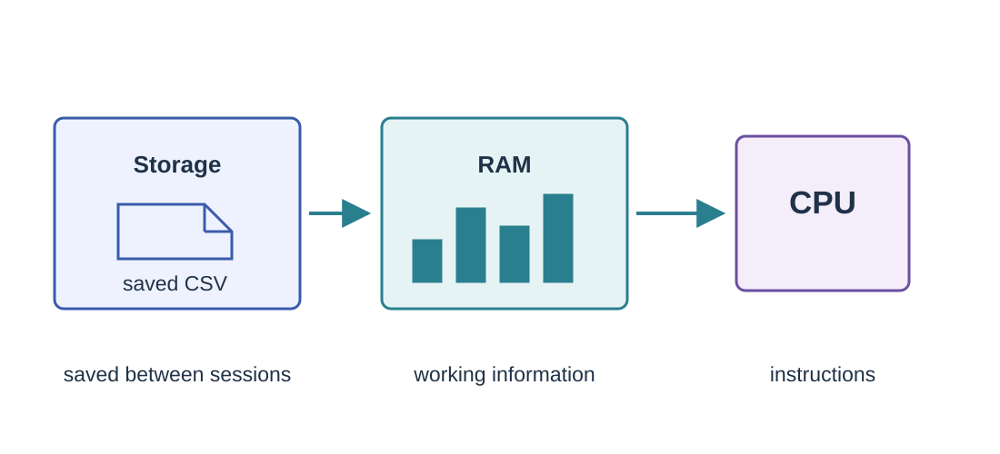{width="100%"}
:::
::::

::: notes
Typical student laptop today: 8–16 GB RAM, 256 GB–1 TB SSD. Disk is many times larger than RAM. Ask students to find their own numbers in the practical (Settings → About, or About This Mac). Avoid detail about caches, buses or clock speeds.
:::

## CPU cores, and what a GPU is

:::: {.columns}
::: {.column width="42%"}
- A CPU has a few **cores**; each can work on a separate task. `parallel::detectCores()` counts them.
- A **GPU** has thousands of simple cores doing the same small calculation at once.
- GPUs are used for images, video and deep learning (for example protein-structure prediction).
- This course runs on the CPU. You will hear about GPUs later; you do not need one here.
:::
::: {.column width="58%"}
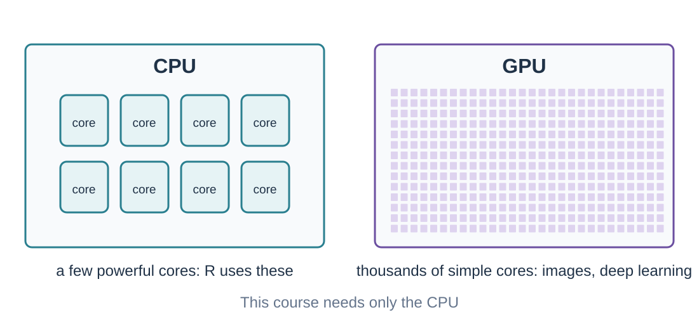{width="100%"}
:::
::::

::: notes
The drawing is schematic: real GPUs have thousands of cores. Ordinary R code uses one core at a time unless it is written to use more. A bigger computer with many cores helps when a job can be split into independent pieces, for example analysing many samples separately. That returns tomorrow.
:::

## Programs and processes

:::: {.columns}
::: {.column width="42%"}
- A **program** is an installed file on disk, such as RStudio.
- A **process** is a running copy of it, using CPU and RAM now.
- Task Manager (Windows) or Activity Monitor (Mac) lists processes and the RAM each uses.
- Look for `rsession` or `R`: that is where your data are.
:::
::: {.column width="58%"}
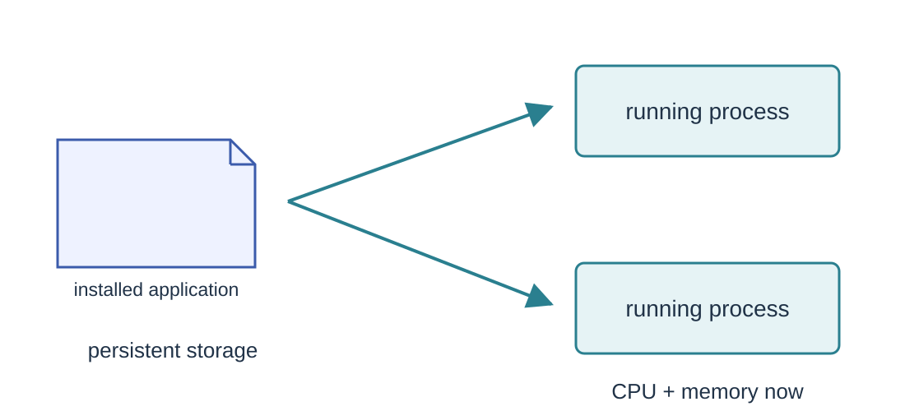{width="100%"}
:::
::::

::: notes
Demonstrate: open Task Manager or Activity Monitor, find the R process, run x <- rnorm(1000000) and show its memory grow by about 8 MB; then rm(x) and gc(). The operating system does not always show memory as released straight away; that is normal. Closing RStudio ends the process; the program remains installed.
:::

## Closing R empties its RAM

:::: {.columns}
::: {.column width="42%"}
- Objects in the Environment pane are in RAM. **Restart R and they are gone.**
- Saved files (data, scripts, `.Rmd`, outputs) stay on disk.
- That is why we restart R and render from saved files: a result only in RAM cannot be checked or repeated.
:::
::: {.column width="58%"}
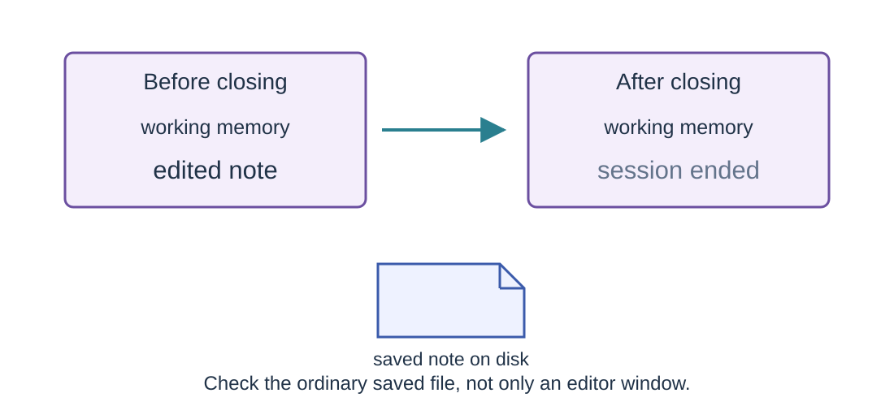{width="100%"}
:::
::::

::: notes
Connect to week 2: Session → Restart R, then run the script from the top. The figure uses an editor note; R objects behave the same way. The habit of rendering in a fresh session exists because of this RAM/disk split.
:::

## How many bytes?

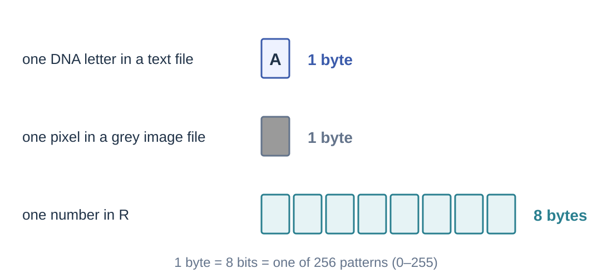{height=400px}

A **byte** = 8 bits = one of 256 patterns. 1 kB = 1,000 bytes; 1 MB = 1,000,000; 1 GB = 1,000,000,000.

::: notes
Three numbers carry the whole lecture: a letter of text is 1 byte, a pixel in an 8-bit grayscale image is 1 byte, and a number in R is 8 bytes. We use decimal units (1 MB = one million bytes), as disk makers do. Some programs use 1,024-based units; the difference does not matter for rough estimates.
:::

## Estimate a table before you load it

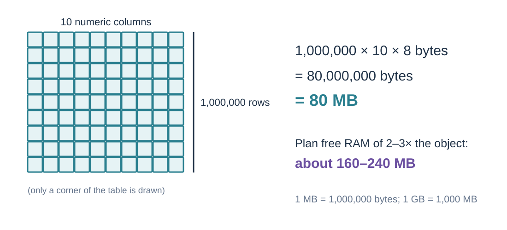{height=400px}

**RAM ≈ rows × numeric columns × 8 bytes.** Plan for 2–3× that: R makes copies while it works.

::: notes
Work through the arithmetic aloud: one million times ten is ten million numbers; times eight is eighty million bytes; that is 80 MB. Working space: filtering, mutate and plotting create new objects alongside the old one. The 2–3× factor is a rule of thumb, not an exact law.
:::

## Check the rule in R {.smaller}

```r
x <- rnorm(1000000)
format(object.size(x), units = "MB", standard = "SI")     # "8 MB"

set.seed(21)
n <- 100000
big <- data.frame(matrix(round(rnorm(n * 10, mean = 20, sd = 4), 1), ncol = 10))
format(object.size(big), units = "MB", standard = "SI")   # "8 MB"
write_csv(big, "output/big-measurements.csv")
file.size("output/big-measurements.csv") / 1e6            # 4.79
```

| Object | Prediction | R says |
|---|---|---|
| 1,000,000 numbers | 8 MB | 8,000,048 bytes |
| 100,000 rows × 10 columns, in R | 8 MB | 8.0 MB |
| same table as CSV | ≈ 5 MB (5 characters per value) | 4.79 MB |
| `data/seedlings.csv`: file / object | tiny | 592 bytes / 6,968 bytes |

- `object.size()` = bytes in RAM; `file.size()` = bytes on disk.
- For a 24-row table, R's bookkeeping is bigger than the data. The rule is for **large** tables.

::: notes
Students run exactly this code in the practical, so the numbers match theirs. The extra 48 bytes for x are a fixed header. The seedlings tibble is 6,968 bytes because column names, types and the read_csv column specification are stored alongside 96 values.
:::

## A CSV stores numbers as text

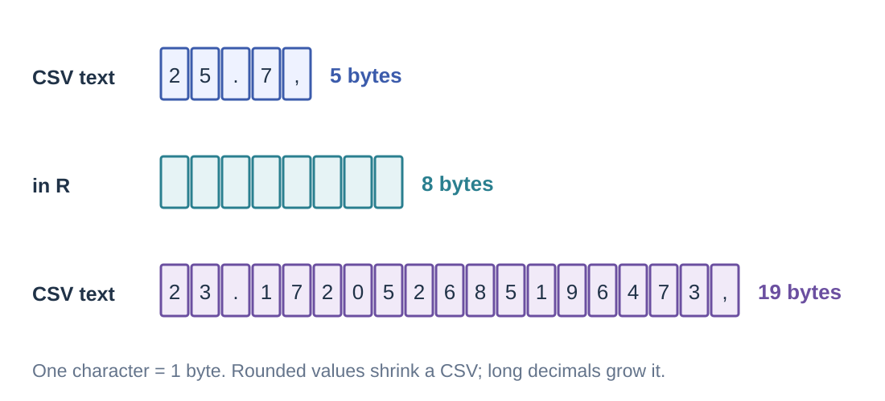{height=400px}

One character = one byte. Rounded values make a CSV **smaller** than its R object; long decimals make it **larger**.

::: notes
A CSV does not store numbers, it stores digits, a decimal point, commas and line endings. 25.7 followed by a comma is five characters. R stores every number in 8 bytes whatever its digits. Unrounded output, such as rnorm values written with all digits, can take 18–19 characters per value.
:::

## File size is not RAM size

:::: {.columns}
::: {.column width="40%"}
- Rounded numbers: CSV **4.8 MB**, in R **8.0 MB**.
- Add a unique ID per row (`S000001`, …): CSV only **5.6 MB**, in R **14.4 MB**. Each different text value costs about 64 bytes.
- One million unrounded numbers: CSV **18.6 MB**, in R **8.0 MB**.
- Repeated labels (`treated` / `control`) stay cheap: R stores each different text once.
:::
::: {.column width="60%"}
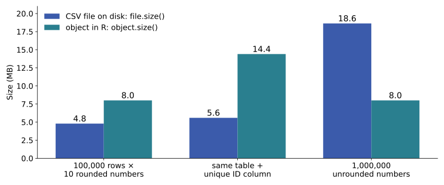{width="100%"}
:::
::::

::: notes
All values were measured in R with set.seed(21). The ID column alone is 6.4 MB in RAM but 0.8 MB on disk (8 characters per ID). Lesson: do not read the file size and assume the same RAM; estimate from rows, columns and column types instead.
:::

## DNA is text: one byte per letter

:::: {.columns}
::: {.column width="40%"}
```r
dna <- readLines("data/dna.txt")
nchar(dna)                  # 40
file.size("data/dna.txt")   # 41
bases <- strsplit(dna, split = "")[[1]]
table(bases)  # A 11, C 9, G 9, T 11
```

- 40 letters + a line ending = 41 bytes.
- Human genome: **3.1 billion letters ≈ 3.1 GB** as text.
- Split into separate letters in R, each costs 8 bytes: **≈ 25 GB**.
:::
::: {.column width="60%"}
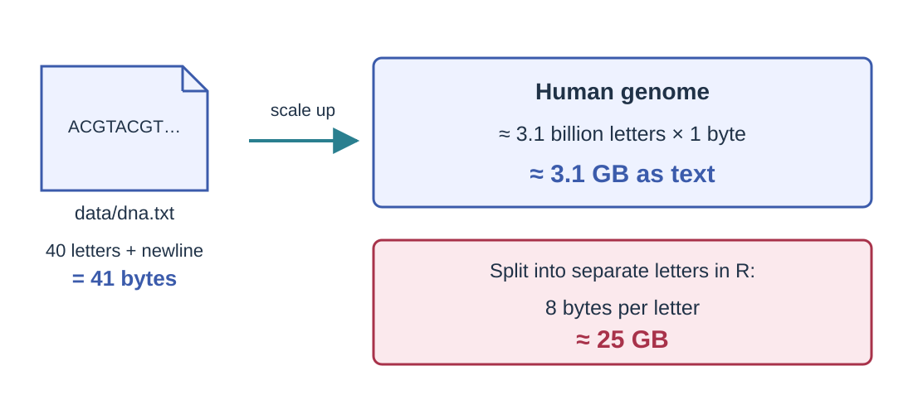{width="100%"}
:::
::::

::: notes
The sequence in data/dna.txt is invented. strsplit returns a list; [[1]] takes its first element. In R, object.size(dna) is 152 bytes and object.size(bases) is 592 bytes: separate letters cost 8 bytes each. Genome tools store sequences compactly and read them piece by piece rather than loading everything as one R vector.
:::

## An image is a grid of numbers

:::: {.columns}
::: {.column width="40%"}
- Each pixel is a brightness, 0 (black) to 255 (white): 1 byte in an 8-bit file.
- `data/pixels.csv`: 8 × 8 = 64 pixels; 24 are above 100.
- A camera image of **2048 × 2048** = 4,194,304 pixels:
  - file: **4.2 MB**;
  - in R: × 8 bytes = **33.6 MB**;
  - 100 time-lapse images in R: **3.4 GB**.
:::
::: {.column width="60%"}
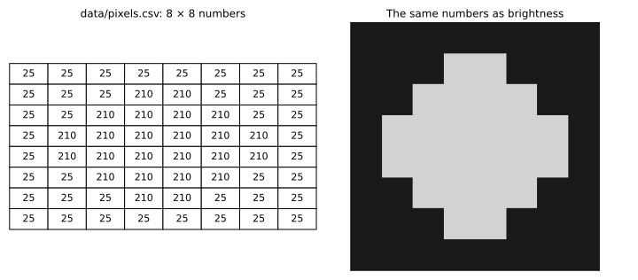{width="100%"}
:::
::::

::: notes
In R: pixels <- as.matrix(read_csv("data/pixels.csv")); sum(pixels > 100) gives 24. A colour image has three values per pixel (red, green, blue), so three times as many bytes. Many microscope cameras store 16-bit images (2 bytes per pixel); the R estimate stays 8 bytes per value.
:::

## How big is biology data?

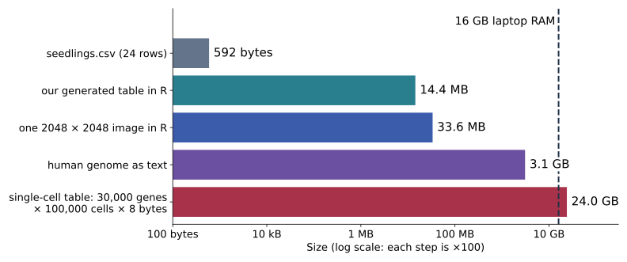{height=390px}

Single-cell RNA-seq: 30,000 genes × 100,000 cells × 8 bytes = **24 GB**, more than a 16 GB laptop, before any working space.

::: notes
Each step on the axis is a factor of 100. The course data sit at the far left; real experiments can be millions of times larger. Real single-cell tools store mostly-zero tables compactly, but the plain estimate shows the scale of the problem and why such analyses usually run on bigger computers.
:::

## When RAM runs out

:::: {.columns}
::: {.column width="40%"}
- **Swapping:** the computer moves parts of RAM to the much slower disk. Everything crawls, even the mouse.
- **R stops:** `Error: cannot allocate vector of size …`, or the session crashes and the Environment is lost.
- **Estimate first.** If 2–3× the estimate is near your RAM: use fewer rows or columns, a compact format, or a bigger computer.
:::
::: {.column width="60%"}
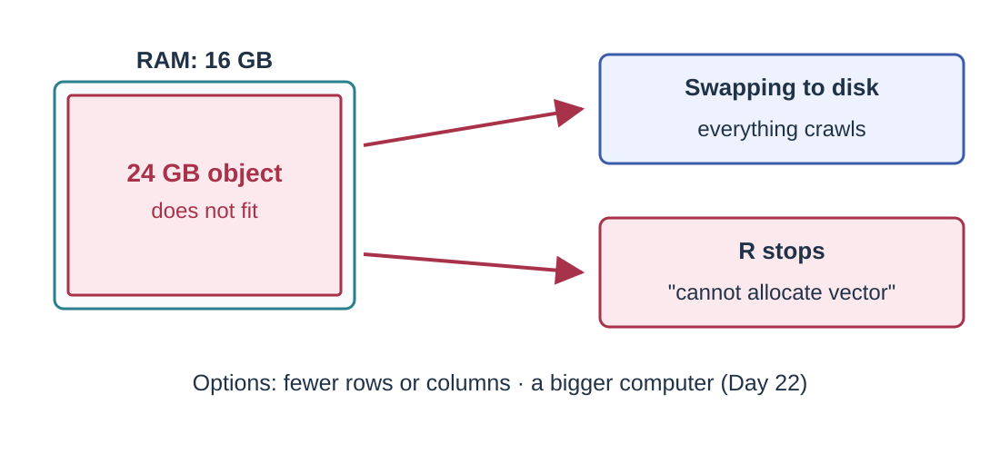{width="100%"}
:::
::::

::: notes
Do not demonstrate this on a laptop in class; it can freeze the machine. Remind students that the operating system, browser and RStudio already use several GB, so a 16 GB laptop may have much less free. The bigger computer is tomorrow's topic.
:::

## Summary {.smaller}

| Idea | Key fact |
|---|---|
| CPU | does the calculations; a few cores |
| RAM | fast, temporary; R objects live here; emptied when R closes |
| Disk | slow, permanent; files live here |
| GPU | thousands of simple cores; images, deep learning; not needed here |
| RAM for a table | rows × numeric columns × 8 bytes; plan 2–3× |
| File vs object | CSV text: 1 byte per character; can be smaller or larger than in R |
| Scale | genome ≈ 3.1 GB as text; 2048² image ≈ 33.6 MB in R; single-cell table ≈ 24 GB |

**Next (Day 22, remote computer):** log in to a bigger computer, move a project there, render, and bring the result back.

**Now:** [Open exercises](../../week5/21-computer.qmd) · [Quiz](../../week5/21-computer-quiz.qmd). Leave with `data-size.R`, `output/big-measurements.csv` and `reports/data-size.txt`.

::: notes
Check that students have recorded their own laptop's RAM: they will compare it with the remote computer tomorrow.
:::
