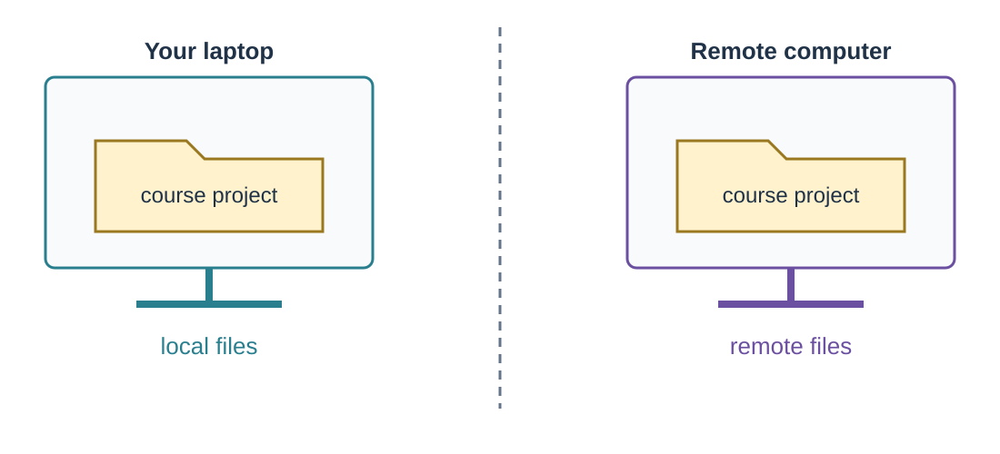
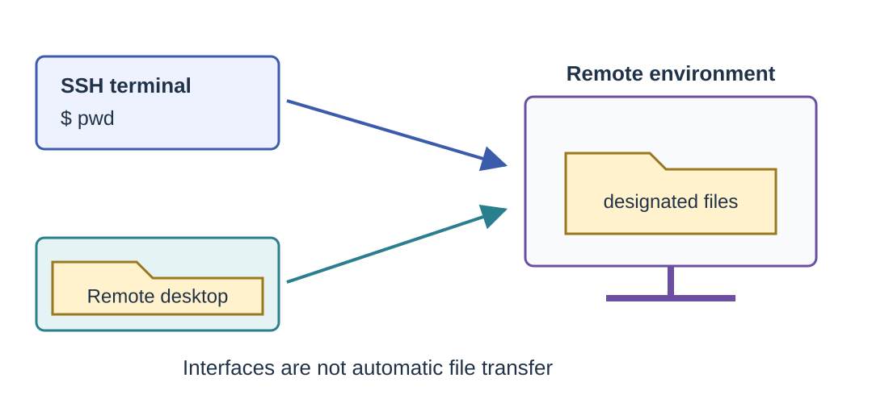
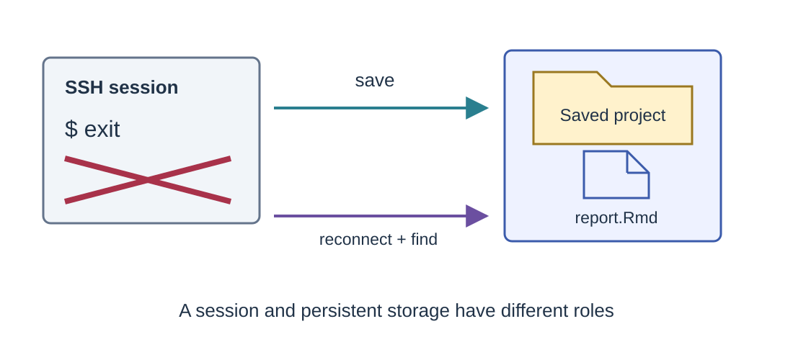
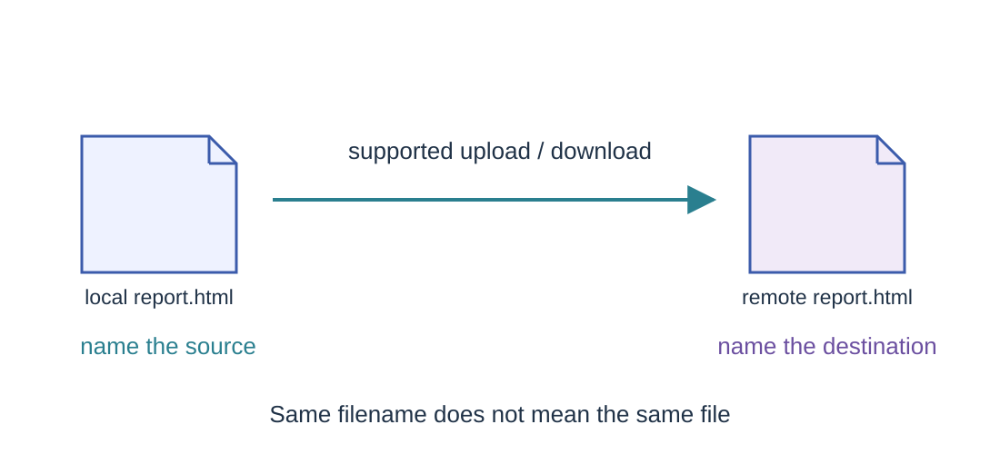
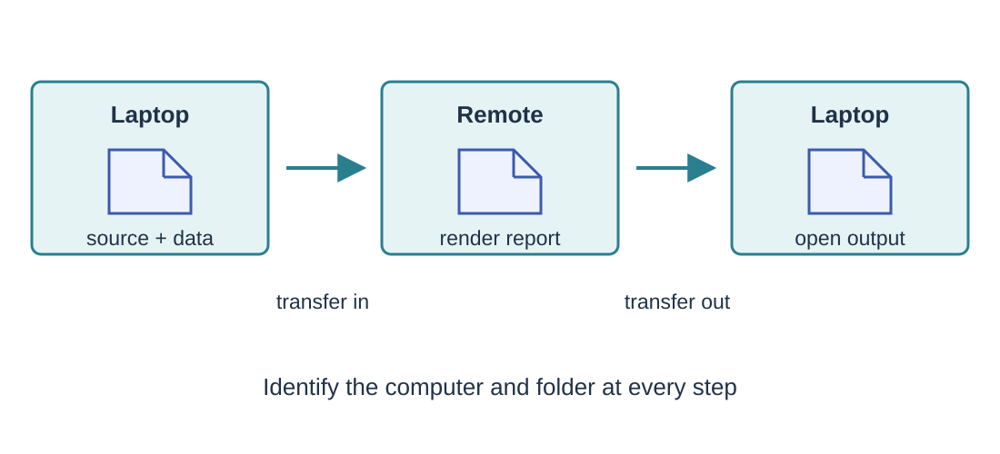
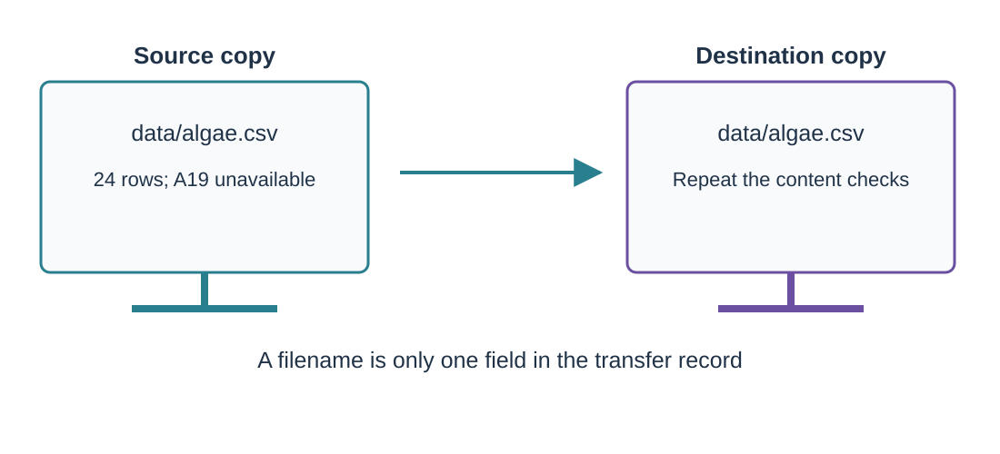
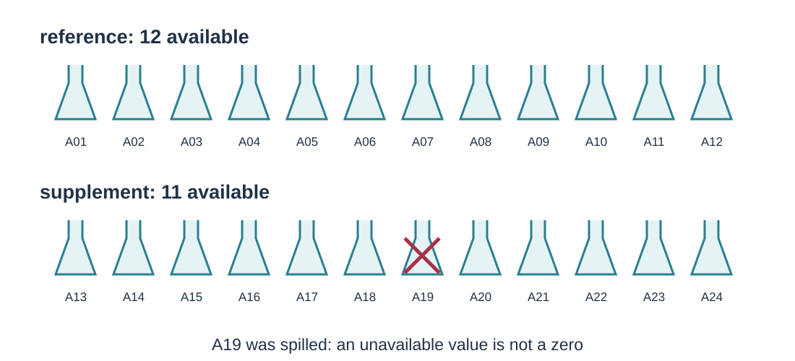
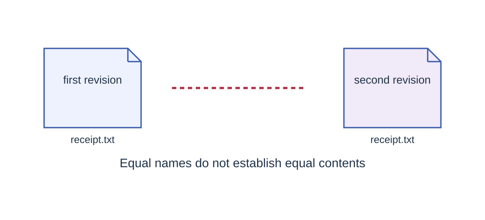
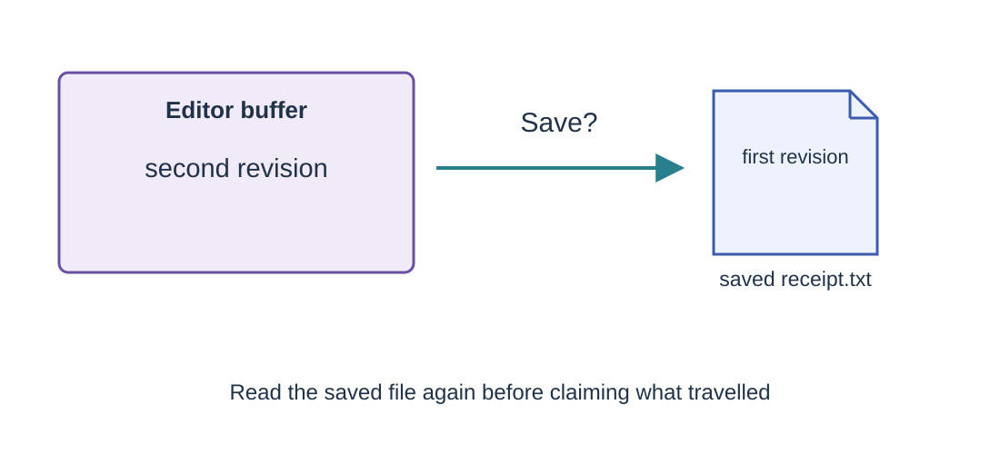
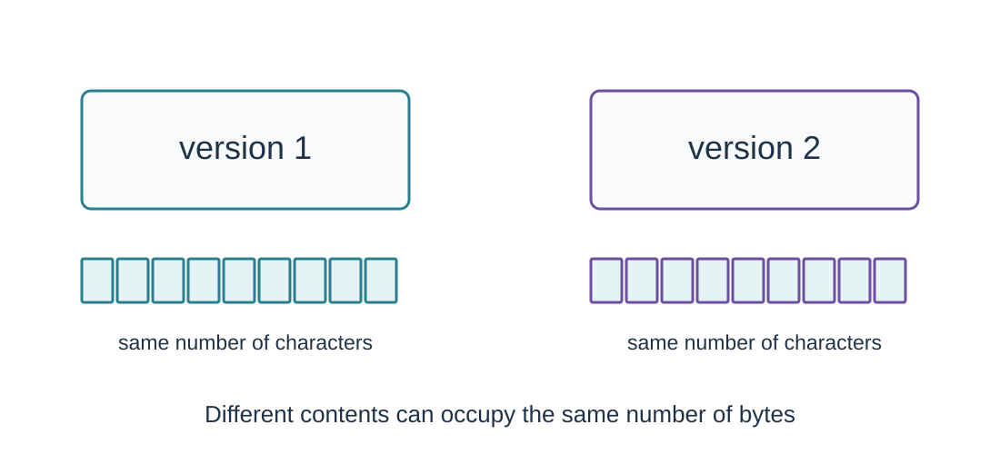

## Where is the report?

{height=370px}

A filename needs a **computer and location**, not just a familiar name.

::: notes
Ask where a browser download normally arrives. Then ask whether logging into a
remote desktop changes that location. It does not. Both projects may contain
report.Rmd while holding different contents. Start with this distinction before
demonstrating a login.
:::

## Two interfaces to a remote environment

{height=390px}

The service guide will tell us whether these views share a home directory.

::: notes
SSH provides the shell. Remote desktop provides the graphical workspace. The
actual service, authentication, permitted execution host, R application, and
transfer route are still to be supplied. Do not turn this schematic into a
promise that arbitrary desktop and SSH sessions share storage.
:::

## Identify the computer, then the folder

After connecting through the supplied route, run in the **remote shell**:

```bash
hostname
pwd
ls
```

- `hostname`: which machine answered?
- `pwd`: where am I on that computer?
- `ls`: what is in that folder?

::: notes
Demonstrate only on the approved environment. Explain that an HPC service may
assign different machine names. No invented hostname or account is needed for
this teaching slide. Record the service and path, never passwords or codes.
:::

## A path is interpreted in its environment

```text
Laptop R:    data/seedlings.csv
Remote R:    data/seedlings.csv
```

The text is identical. The accessible files may be different.

In the **R console** of the application you are using:

```r
getwd()
file.exists("data/seedlings.csv")
```

::: notes
Ask what FALSE means: R did not find that relative path in its current working
directory. It does not establish that the dataset is missing everywhere. Check
computer, project, and folder before inserting an absolute laptop path.
:::

## Closing the session does not erase saved files

{height=390px}

`exit` returns from SSH to the local shell. Reconnect and find the file again.

::: notes
Saved storage is different from an interactive session. Do not promise that
running programs continue after disconnecting; that depends on the service.
This exercise concerns locating saved files, not managing long HPC jobs.
:::

## Transfer creates a copy in a named place

{height=390px}

Name the **source**, **destination**, and direction before transferring.

::: notes
Use the service's supported upload/download method. If scp is eventually used,
its syntax belongs in the actual service guide. SSH and remote desktop by
themselves are not file synchronisation. Editing one copy need not update another.
:::

## Render where the inputs are accessible

Open the remote project and use its supported R application.

If the remote shell has R, packages, and Pandoc configured:

```bash
Rscript -e 'rmarkdown::render("report.Rmd")'
```

Run from the project root on the **permitted execution host**.

::: notes
This is an alternative way to start the same rendering function. Local Ubuntu
on Windows need not contain R; students can keep using native RStudio there.
Only demonstrate the command when the service setup supports it. Do not ask
beginners to install another environment to satisfy this slide.
:::

## Complete the round trip

{height=380px}

Open the returned HTML on the laptop. Retain source and data for reproduction.

::: notes
An HTML output is useful to read but is not the recipe. Ask students to point
to both the remote output and local downloaded copy, then to the source and
input. The location log should record this without any authentication details.
:::

## Predict the recovery step

The report rendered remotely. Local Downloads is empty.

**What should you check before rendering again?**

1. Locate the output on the remote computer.
2. Check whether it has actually been transferred.
3. Find the destination used by that transfer.

::: notes
Invite an answer before revealing the list. The absent local copy does not prove
the remote render failed. Avoid creating multiple reports with names such as
final2 while the real problem is location.
:::


## Plan the copy before performing it

{height=350px}

Record computer, project path, filename, and intended output.

::: notes
Use the actual service only when supplied. A local rehearsal needs two different
parent folders, both explicitly labelled local. These locations are not account
credentials. Ask students what a receiver would need to distinguish two files
with the same name. A plan written afterwards can conceal an incorrect assumption.
:::

## Count what the receiving copy should contain

{height=350px}

24 records; 23 available measurements; one documented spill.

::: notes
The fresh transfer table is data/algae.csv. Define algae simply as the organisms
in separate cultures; harvested dry biomass is measured in mg. Twelve cultures
were independently assigned each allocation. There are twelve reference and
eleven available supplement measurements. These are content checks, not a new model.
:::

## Verify the intended input in R

```r
library(readr)
algae <- read_csv("data/algae.csv", show_col_types = FALSE)
nrow(algae)
sum(!is.na(algae$biomass_mg))
algae$biomass_mg[algae$culture_id == "A19"]
```

Repeat after transfer: **24**, **23**, and **NA**.

::: notes
Run in the receiving R project's Console. A path printed by a shell elsewhere
is not R's current folder. The brackets select the entry matching the ID, not
the nineteenth row by assumption. Correct counts are useful evidence, but they
do not establish that every individual value matches the source.
:::

## A matching filename is not a version check

{height=350px}

Inspect the saved contents before choosing which copy to send.

::: notes
Demonstrate with receipts, not raw data. Edit a disposable destination note,
save it, and reopen both copies. The remote desktop is a view of a computer;
it is not a guarantee that a laptop's copy updates. Preserve both versions until
their roles are understood instead of deleting an unfamiliar folder.
:::

## Write a receipt another reader can use

A short receipt names:

- The input and receiving project location.
- Checks performed and their actual results.
- The returned artifact and its destination.
- Any real remote steps still pending.

::: notes
Ask students to avoid vague claims such as “uploaded successfully”. A useful
receipt can distinguish a file selected, a file sent, and the received file
opened and checked. No passwords, authentication codes, or private account
details belong in it. A local rehearsal should say exactly that.
:::

## An unsaved edit has not travelled

{height=350px}

Save, close, reopen, then inspect the copy you intend to transfer.

::: notes
This returns to the file-system baseline deliberately. Some editors autosave
or restore buffers, so the practical test is the actual saved file. Source-code
edits likewise do not change an old rendered HTML document until rendering runs.
The transfer audit needs a named source artifact, not only what is on screen.
:::

## Why not check only the file size?

{height=350px}

Equal size is a limited check, not proof of equal contents.

::: notes
The strings version 1 and version 2 have equal lengths but different final
characters. Students need no hashing theory. For these small notes, read both
saved files and compare their contents. Row counts also have limits: two tables
can have identical dimensions yet contain different values.
:::

## “File not found” needs a location investigation

In the **receiving R Console**:

```r
getwd()
file.exists("data/algae.csv")
```

Check computer → project root → relative path → actual file.

::: notes
A FALSE result tells us that R did not find this path from this starting
location. It does not mean the input is absent from every machine. Open the
right project and inspect extraction nesting before inserting a personal
absolute path. Keep the search sequence reproducible in the log.
:::

## Diagnose before rendering another copy

The expected local result is absent.

1. Did rendering succeed, and where did it write?
2. Was that specific output transferred?
3. Which destination received it?
4. Which copy did the browser open?

::: notes
Let students trace a deliberately misplaced HTML file without immediately
rerunning the analysis. A second render may only create another identical
artifact in the same unexpected folder. Distinguish failure to calculate,
failure to transfer, and failure to locate the result.
:::

## A bounded handover is more useful than a promise

Save `transfer-plan.txt`, the receipt, and the audit in `reports/`.

State what was checked, which copies were compared, and what remains unknown.

::: notes
These artifacts support the extended practical and independent recovery task.
A local copy check is valuable but cannot complete SSH authentication or remote
desktop access. Likewise a successful transfer does not establish a backup
policy or guarantee that a disconnected process continues running.
:::

## Practical: locate, render, return

[Open day 21 practical and notes](../../week5/21-remote-workflow.qmd).

- Save `reports/remote-log.txt` with computer names and project locations.
- Connect, disconnect, reconnect, and find saved work.
- Transfer and identify one output copy.
- Retain the transfer plan, receipt, version checks, and audit.

Until access is provided, complete the **local rehearsal** and mark remote steps pending.

::: notes
Do not mark local rehearsal as a completed remote skill. It can check portable
paths and project structure while service-specific details are pending.
:::
