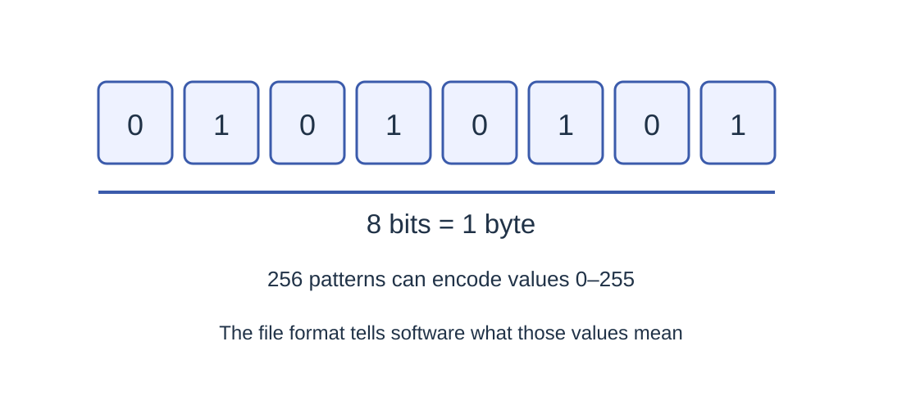
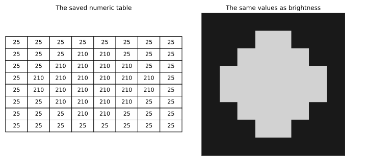
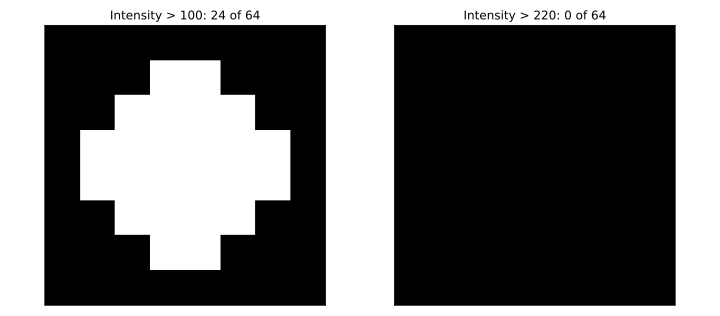
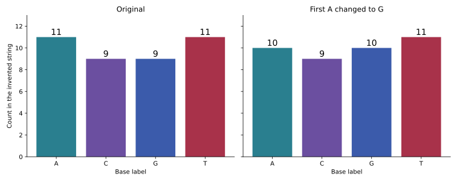
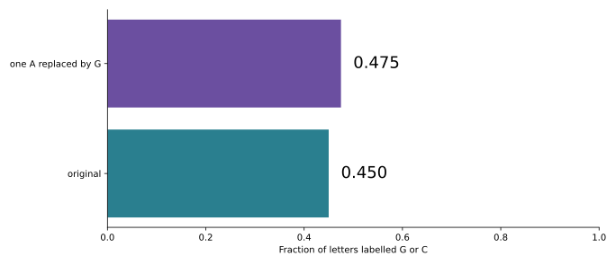
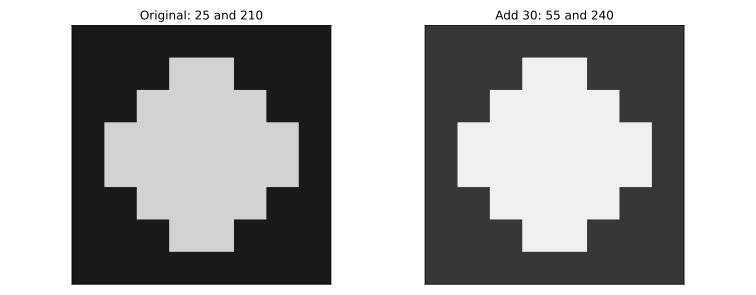
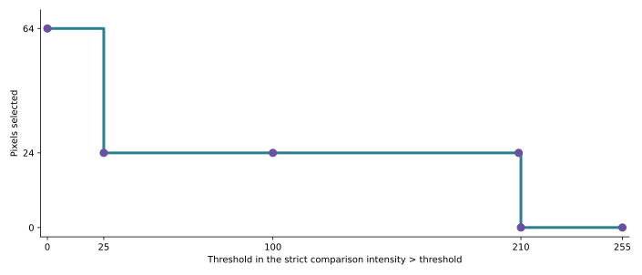
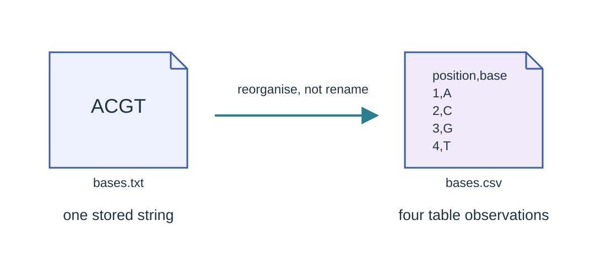

## Different meanings, familiar representations

{height=380px}

Our task: identify what each stored value represents.

::: notes
This is a short breadth session using invented DNA and an artificial image. We
are not introducing a sequence-analysis or image-processing pipeline. Students
can transfer vectors, tables, logical comparisons, and interpretation.
:::

## A file format gives bytes meaning

{height=370px}

Renaming `photo.jpg` to `photo.csv` does not convert the contents.

::: notes
A bit has two possible values; eight bits yield 256 patterns. We do not need
binary arithmetic. One format may use a byte for brightness; another uses
encoded characters. The extension helps an application choose how to read it.
:::

## One string is not forty vector elements

```r
dna <- readLines("data/dna.txt")
length(dna)  # 1 stored string
nchar(dna)   # 40 characters in that string
```

`length()` and `nchar()` answer different questions.

```r
bases <- strsplit(dna, split = "")[[1]]
length(bases)  # 40 separate letters
```

::: notes
Run from the course project. The final newline is not another DNA base.
strsplit returns a collection of results, and [[1]] selects the first. Supply
this code rather than requiring list syntax as a new programming outcome.
:::

## Counts describe this invented sequence

{height=360px}

`table(bases)` counts letters; it does not reveal a gene's biological function.

::: notes
Ask students to predict the result of replacing one A by a G. A falls by one,
G increases by one, and the total remains forty. Preserve the source file and
change an R object for this experiment. Meaning requires biological context.
:::

## An image can be a rectangular numeric table

{height=390px}

0 means black; 255 means white on this teaching scale.

::: notes
The source image has only values 25 and 210. One byte could store each intensity,
but the CSV uses text digits plus delimiters and a header. The 64 values need not
occupy only 64 bytes in that representation. No physical scale is provided.
:::

## A threshold is a stated comparison

{height=380px}

Changing a threshold changes the question we ask of the same values.

::: notes
Both images come from the actual supplied matrix. Because this constructed
image has only two levels, separating its centre is unusually easy. Noise,
lighting, and overlapping real objects would complicate interpretation.
:::

## Reuse logical values to count

```r
pixels <- as.matrix(read.csv("data/pixels.csv"))
bright <- pixels > 100
sum(bright)   # 24
mean(bright)  # 0.375
```

`TRUE` contributes 1 and `FALSE` contributes 0.

The fraction is **24 / 64**, not 24 independent organisms.

::: notes
Here read.csv plus as.matrix supplies a simple numeric matrix. Normal biological
tables still use read_csv. The calculation counts qualifying pixels; it has not
identified cells or calibrated area in square millimetres.
:::

## A pixel is not an experimental replicate

- An image position holds one brightness value.
- Many positions can belong to one plant or one field of view.
- A treatment assigned to one plant still has one treated plant.

**What extra information would you need to interpret the bright object biologically?**

::: notes
Possible answers: acquisition context, physical scale, what was imaged, biological
validation, and how treatment was assigned. Relate this to technical measurements
and independent units from day 14, rather than introducing another test.
:::

## Prediction before code

Our only pixel values are 25 and 210.

What do these comparisons count?

```r
sum(pixels > 50)
sum(pixels > 100)
sum(pixels > 220)
```

::: notes
Ask before running: 24, 24, 0. A change in a threshold need not always change the
count; it depends on which values occur. The threshold alone does not define a
cell or specify physical area.
:::


## The question determines what to count

One string can contain 40 characters.

An 8-by-8 matrix contains 64 positions.

Neither size is automatically the number of independent organisms.

::: notes
Ask students to name the represented thing before choosing length, nchar, dim,
or a count of TRUE values. This is a transfer of familiar concepts rather than
a survey of sequence or image software. Distinguish a file's physical size in
bytes from the number of meaningful values interpreted from that file.
:::

## Change one label; predict two counts

{height=350px}

The original object and file can remain unchanged.

::: notes
The sequence begins with A. Predict the total and two counts before running
the replacement. Do not edit the raw DNA file: make a changed R object. Counts
are numerical descriptions of this invented string, not evidence about the
function of a real DNA sequence.
:::

## Create a changed object explicitly

```r
bases_changed <- bases
bases_changed[1] <- "G"
table(bases_changed)
table(bases)
```

`[1]` selects the first element. Inspect **both** objects after the change.

::: notes
The important observation is that bases retains its original values while
bases_changed holds the modified values. No R memory-internals explanation is
needed. Saving neither object to the raw path also leaves the supplied file
unchanged. Ask which actions would be needed to persist the changed string.
:::

## A fraction needs a stated numerator and denominator

{height=350px}

GC fraction here = letters labelled G or C / all letters.

::: notes
The original numerator is 18 and denominator 40; afterwards 19 and 40. This
is a supplied definition with no molecular-biology prerequisite. In R,
comparison with G or C uses a logical OR. It does not identify a gene, organism,
or biological property beyond the count that has been defined.
:::

## Save a string, then verify the saved representation

```r
writeLines(paste(bases_changed, collapse = ""),
           "output/changed-dna.txt")
changed_from_disk <- readLines("output/changed-dna.txt")
nchar(changed_from_disk)
```

The new saved string still has **40 characters**.

::: notes
paste with collapse joins elements into one string without a separator.
writeLines saves that text. Reading it back checks the saved file, not only the
current object. The new filename protects the supplied raw sequence. These
lines are given operations to understand and adapt, not a new programming API survey.
:::

## Same positions, different brightness

{height=350px}

A changed threshold answer need not mean a larger biological object.

::: notes
The plot scale is fixed at zero to 255 in both panels. This makes the brightness
change interpretable. Every matrix position stayed the same; adding thirty
changed the numerical values. For this controlled example no value exceeds 255.
Real acquisition and biological interpretation require more context.
:::

## Show the response to the stated threshold

{height=350px}

A threshold is a comparison rule, not a discovered biological boundary.

::: notes
For thresholds 0, 25, 100, 209, 210, 255 the counts are 64, 24, 24, 24, 0, 0.
Only the values 25 and 210 occur, so the response is unusually simple. The plot
shows a rule applied to known values; it is not a fitted model and does not
validate a segmentation method for real microscopy.
:::

## Equality changes the selection

```r
sum(pixels > 210)   # 0
sum(pixels >= 210)  # 24
sum(pixels > 220)   # 0
sum((pixels + 30) > 220)  # 24
```

Read the operator and the object before interpreting the number.

::: notes
These are not inconsistent results. Strictly greater excludes equality;
greater-or-equal includes it. Adding thirty changes the input while the
threshold 220 stays fixed. These are the same logical distinctions used in row
filtering, now applied to a rectangular collection of intensities.
:::

## Reorganising information differs from renaming a file

{height=350px}

A new arrangement needs new delimiters and a header, not just a new suffix.

::: notes
The practical asks students to create the tiny four-row CSV themselves and
read it back. It is a format exercise, not sequence analysis. Merely renaming
bases.txt to bases.csv cannot insert a table structure that was never present.
Ask what one row represents in each version.
:::

## Explain the operation in a short report

Use two figures, the threshold table, and a few explanatory sentences.

Name the original object, controlled change, observed result, and limit.

::: notes
The independent task is representation-report.Rmd, rendered from its own saved
code. A reader should be able to distinguish pixel brightness from physical
area and label counts from sequence function. The required short conclusions
matter more than another elaborate plotting layer.
:::

## Exercises: explain the representation

[Open day 22 exercises](../../week5/22-data-representations.qmd).

- Save `representations.R`, controlled copies, and the threshold table.
- Render `representation-report.Rmd` with two figures and interpretation.
- Explain the difference between one text string and a four-row CSV.
- Keep original files intact and rerun from a fresh session.

::: notes
Keep operations at the level already taught. The added depth is predicting
controlled changes, interpreting the result, and testing the saved report;
it should not become a third specialist software unit.
:::
