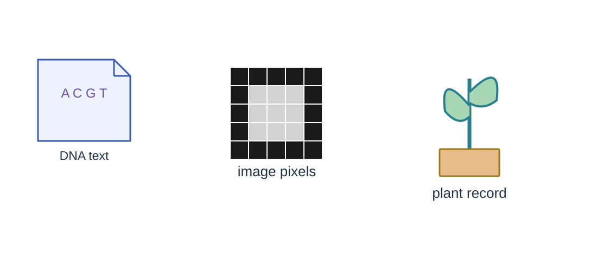
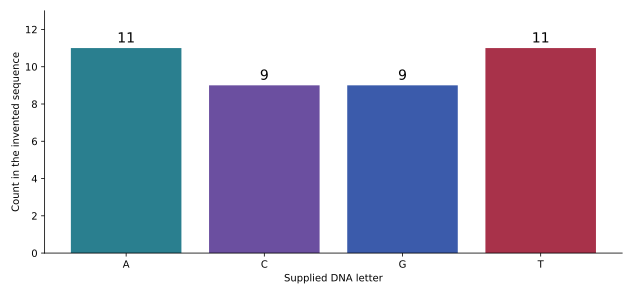

## Different meanings, familiar representations

{height=380px}

Our task: identify what each stored value represents.

::: notes
This is a short breadth session using invented DNA and an artificial image. We
are not introducing a sequence-analysis or image-processing pipeline. Students
can transfer vectors, tables, logical comparisons, and interpretation.
:::

## A file format gives bytes meaning

{height=370px}

Renaming `photo.jpg` to `photo.csv` does not convert the contents.

::: notes
A bit has two possible values; eight bits yield 256 patterns. We do not need
binary arithmetic. One format may use a byte for brightness; another uses
encoded characters. The extension helps an application choose how to read it.
:::

## One string is not forty vector elements

```r
dna <- readLines("data/dna.txt")
length(dna)  # 1 stored string
nchar(dna)   # 40 characters in that string
```

`length()` and `nchar()` answer different questions.

```r
bases <- strsplit(dna, split = "")[[1]]
length(bases)  # 40 separate letters
```

::: notes
Run from the course project. The final newline is not another DNA base.
strsplit returns a collection of results, and [[1]] selects the first. Supply
this code rather than requiring list syntax as a new programming outcome.
:::

## Counts describe this invented sequence

{height=360px}

`table(bases)` counts letters; it does not reveal a gene's biological function.

::: notes
Ask students to predict the result of replacing one A by a G. A falls by one,
G increases by one, and the total remains forty. Preserve the source file and
change an R object for this experiment. Meaning requires biological context.
:::

## An image can be a rectangular numeric table

{height=390px}

0 means black; 255 means white on this teaching scale.

::: notes
The source image has only values 25 and 210. One byte could store each intensity,
but the CSV uses text digits plus delimiters and a header. The 64 values need not
occupy only 64 bytes in that representation. No physical scale is provided.
:::

## A threshold is a stated comparison

{height=380px}

Changing a threshold changes the question we ask of the same values.

::: notes
Both images come from the actual supplied matrix. Because this constructed
image has only two levels, separating its centre is unusually easy. Noise,
lighting, and overlapping real objects would complicate interpretation.
:::

## Reuse logical values to count

```r
pixels <- as.matrix(read.csv("data/pixels.csv"))
bright <- pixels > 100
sum(bright)   # 24
mean(bright)  # 0.375
```

`TRUE` contributes 1 and `FALSE` contributes 0.

The fraction is **24 / 64**, not 24 independent organisms.

::: notes
Here read.csv plus as.matrix supplies a simple numeric matrix. Normal biological
tables still use read_csv. The calculation counts qualifying pixels; it has not
identified cells or calibrated area in square millimetres.
:::

## A pixel is not an experimental replicate

- An image position holds one brightness value.
- Many positions can belong to one plant or one field of view.
- A treatment assigned to one plant still has one treated plant.

**What extra information would you need to interpret the bright object biologically?**

::: notes
Possible answers: acquisition context, physical scale, what was imaged, biological
validation, and how treatment was assigned. Relate this to technical measurements
and independent units from day 14, rather than introducing another test.
:::

## Prediction before code

Our only pixel values are 25 and 210.

What do these comparisons count?

```r
sum(pixels > 50)
sum(pixels > 100)
sum(pixels > 220)
```

::: notes
Ask before running: 24, 24, 0. A change in a threshold need not always change the
count; it depends on which values occur. The threshold alone does not define a
cell or specify physical area.
:::

## Practical: explain the representation

[Open day 22 practical and notes](../../week5/22-data-representations.qmd).

- Save `representations.R` and short interpretation notes.
- Reuse supplied code; focus on what its values and counts mean.
- Keep original files intact and rerun from a fresh session.

Use remaining time to consolidate earlier reports.

::: notes
Keep this breadth activity short. It should build confidence in transferable
ideas, not become a third specialist software unit.
:::
