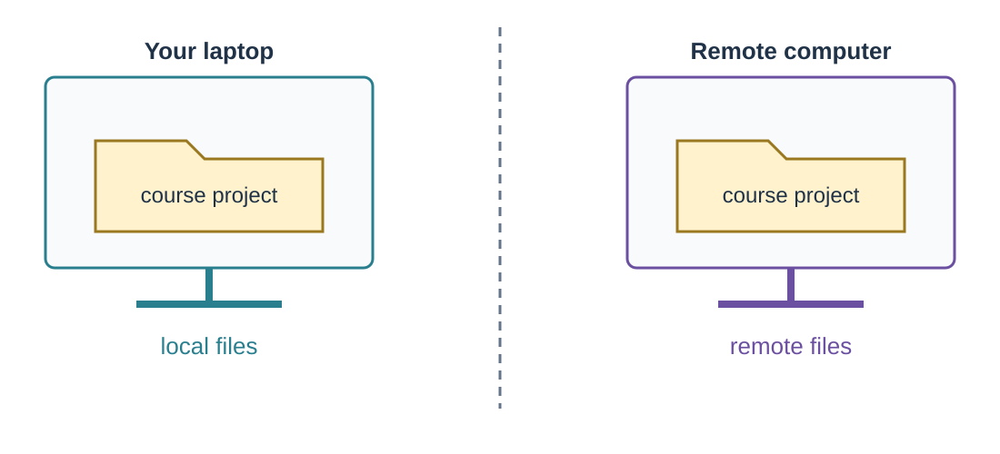
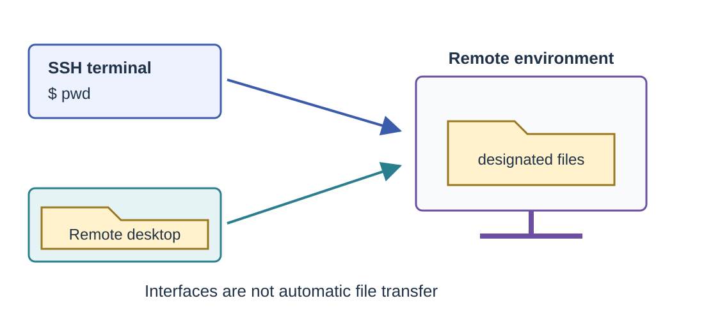
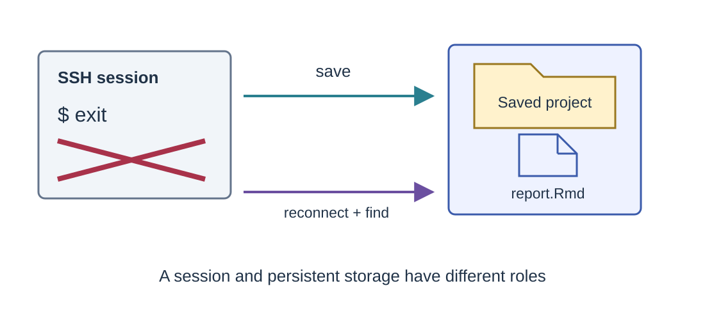
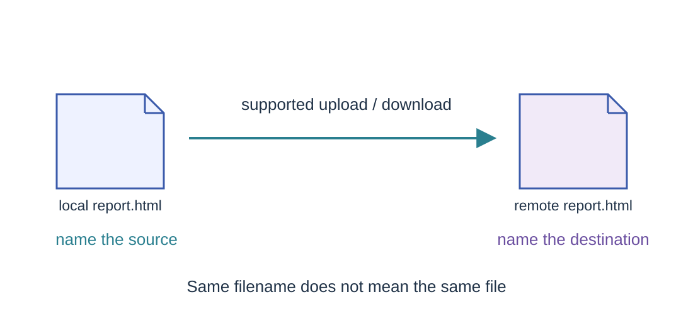
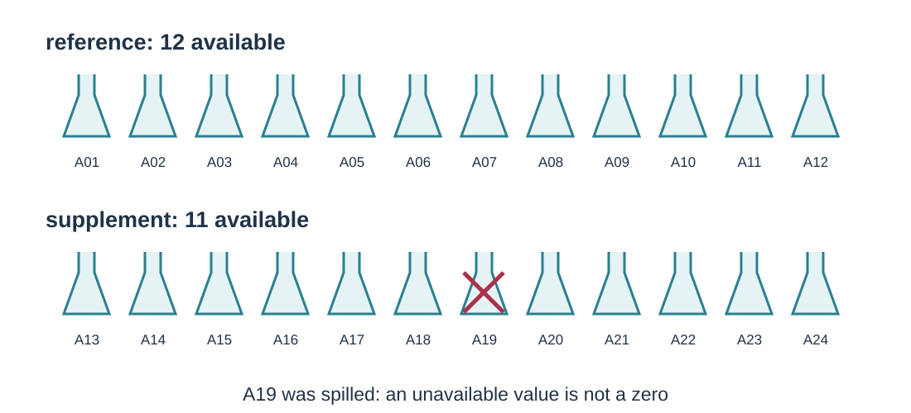
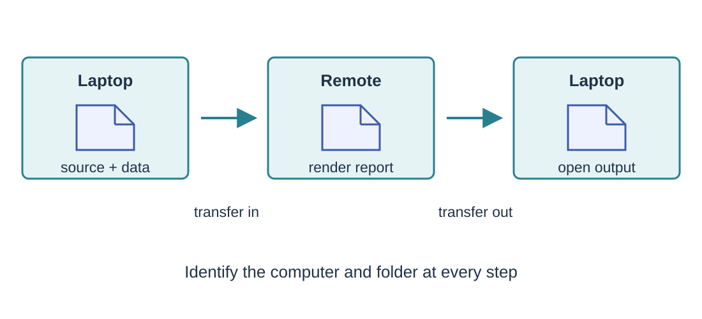
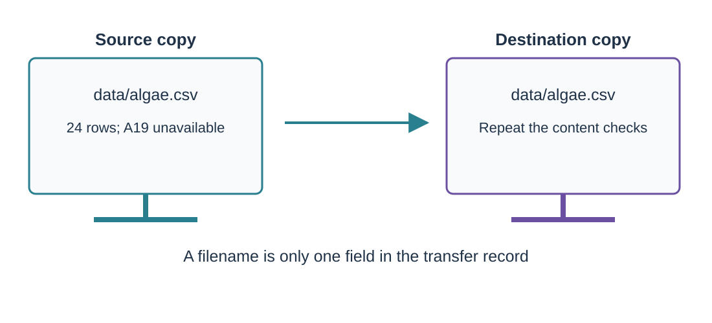
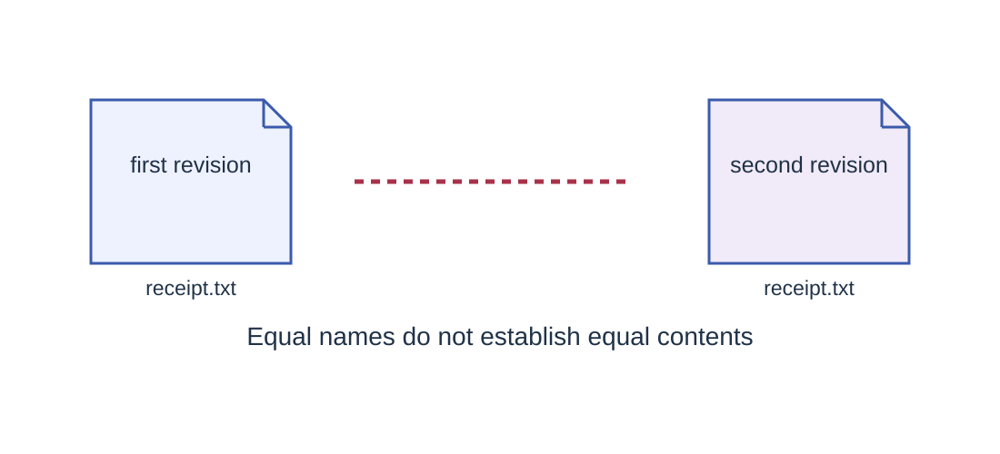
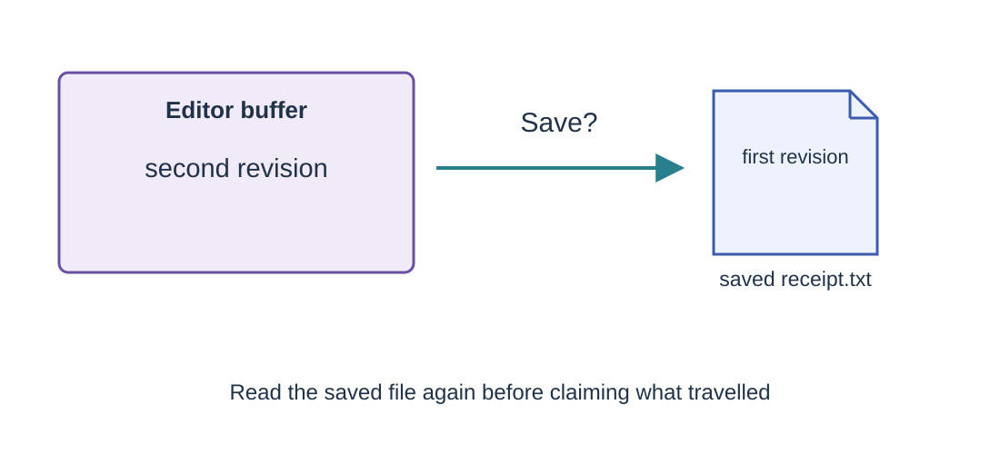
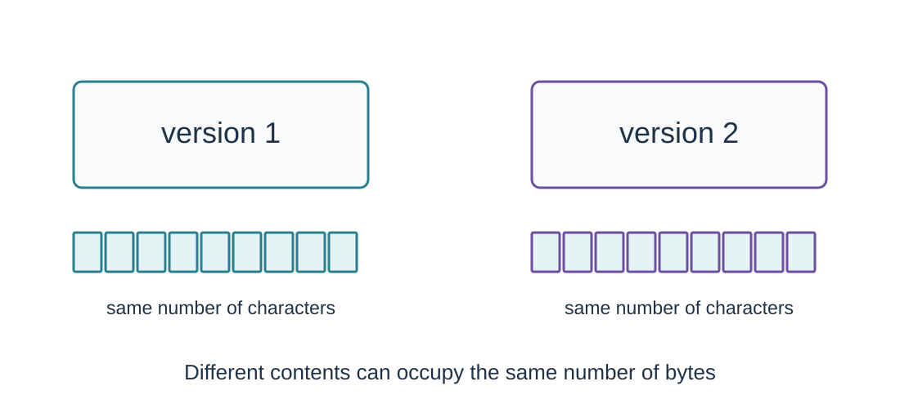

## About this lecture

Yesterday's single-cell table needs about 24 GB of RAM; your laptop has 16 GB or less. Research groups solve this by logging in to a **bigger, shared Linux computer** and running the same R analysis there. But then there are two computers, each with its own files. **You rendered a report remotely: where is it, and how do you get it back?**

Today you will:

- connect to a remote computer and find out which computer and folder you are in;
- copy a project there, check that the copy is complete, and render a report;
- bring the result back and keep a short record of what is where.

This is a hands-on day. The remote service details (host, login, transfer method) will be supplied separately; until then you rehearse locally. On Day 23 you run a small study from question to report.

::: notes
Link back to Day 21: estimate first, and if the data do not fit, use a bigger computer. HPC2N or another Linux environment will be used; do not invent hostnames or login steps. Students only need to understand the ideas today and practise on the real service when the guide is issued.
:::

## Two computers, two sets of files

:::: {.columns}
::: {.column width="40%"}
- The laptop and the remote computer each have their **own disk**.
- Both may contain a folder called `course project` with a `report.Rmd`. They are **separate copies**.
- A filename means little without saying **which computer** and **which folder**.
:::
::: {.column width="60%"}
{width="100%"}
:::
::::

::: notes
Ask where a browser download normally lands. Then ask whether logging in to a remote desktop changes that. It does not. Two identically named folders on different computers do not synchronise.
:::

## Two ways in: a terminal or a desktop

:::: {.columns}
::: {.column width="40%"}
- **SSH** (secure shell) gives a terminal on the remote computer: the same shell commands as Day 3.
- A **remote desktop** shows the remote computer's screen in a window.
- Neither one copies files for you.
- The service guide will say whether both see the same home folder.
:::
::: {.column width="60%"}
{width="100%"}
:::
::::

::: notes
The general SSH form is ssh your-course-username@the-provided-host; replace the placeholders from the service guide when it is issued. Host-key checks and authentication follow that guide. Never write passwords or login codes in notes or logs.
:::

## Which computer? Which folder?

:::: {.columns}
::: {.column width="55%"}
```text
$ ssh student@remote
student@remote:~$ hostname
remote
student@remote:~$ pwd
/home/student
student@remote:~$ mkdir introcomputing-practice
student@remote:~$ ls
introcomputing-practice
student@remote:~$ exit
logout
Connection to remote closed.
$ pwd
/home/anna
```
:::
::: {.column width="45%"}
- `student@remote` stands for your login and the computer's name from the service guide; yours will differ.
- The **prompt** changes: `student@remote:~$` means the remote computer is listening.
- `hostname` names the computer that answered; `pwd` the folder you are in **on that computer**.
- `exit` ends the connection. Back on the laptop, `pwd` shows a laptop folder again.
- Write the answers in `reports/remote-log.txt`.
:::
::::

::: notes
The session is illustrative: host name, login and paths are placeholders until the service guide is issued. Demonstrate only on the approved environment. A large service may have several login computers with different names, which is why hostname is worth recording.
:::

## Leaving does not delete your files

:::: {.columns}
::: {.column width="45%"}
```text
$ ssh student@remote
student@remote:~$ ls
introcomputing-practice
```

- `exit` closed the **session** (the connection), not the remote disk.
- After reconnecting, the folder made before is still there.
- Same idea as Day 21: closing a process empties its RAM; saved files stay on disk.
- Whether a running program keeps running after you leave depends on the service.
:::
::: {.column width="55%"}
{width="100%"}
:::
::::

::: notes
Placeholder host as on the previous slide. Ask: if R was running a long analysis in that session, does it continue after exit? Not necessarily: the service guide will explain how to run work that keeps going. Today we only work interactively.
:::

## Moving files: a transfer makes a copy

:::: {.columns}
::: {.column width="40%"}
- Uploading or downloading creates a **second copy** in a named place.
- Before transferring, write down the **source**, the **destination**, and the direction.
- Editing one copy afterwards does **not** change the other.
- Transfer the whole project (ZIP), not single files, so relative paths still work.
:::
::: {.column width="60%"}
{width="100%"}
:::
::::

::: notes
Use the service's supported upload/download method; if scp turns out to be the route, its exact syntax belongs in the service guide. Extract the ZIP on the remote side and open its .Rproj, exactly as on Day 1.
:::

## Check the copy before you analyse

:::: {.columns}
::: {.column width="55%"}
In the **remote R console**:

```text
> getwd()
[1] "/home/student/introcomputing-course"
> file.exists("data/algae.csv")
[1] TRUE
> algae <- readr::read_csv("data/algae.csv",
+                          show_col_types = FALSE)
> nrow(algae)
[1] 24
> sum(!is.na(algae$biomass_mg))
[1] 23
> algae$biomass_mg[algae$culture_id == "A19"]
[1] NA
```
:::
::: {.column width="45%"}
{width="100%"}

- `getwd()`: R works in the copied project (placeholder path).
- 24 cultures, 23 measured, A19 missing: the **same answers as on the laptop**, so the copy is complete.
:::
::::

::: notes
data/algae.csv: 24 separately grown cultures, 12 reference and 12 supplement, harvested once; A19 spilled before weighing, so its biomass is unavailable (NA, not zero). The getwd() path is a placeholder; the other lines are real output. FALSE from file.exists means R did not find that path from its working directory: check computer, project and folder before typing an absolute laptop path.
:::

## Render remotely, then bring the result back

```text
student@remote:~$ cd introcomputing-course
student@remote:~/introcomputing-course$ Rscript -e 'rmarkdown::render("report.Rmd")'
processing file: report.Rmd
...
Output created: report.html
student@remote:~/introcomputing-course$ ls
data  introcomputing.Rproj  output  report.html  report.Rmd  reports
```

:::: {.columns}
::: {.column width="50%"}
- `Rscript` starts a fresh R and renders the saved report, like Knit after a restart.
- `ls` shows the new `report.html`, **on the remote disk**. Download it to a named laptop folder and open **that** copy.
- To recalculate later you need the source and data, not only the HTML.
:::
::: {.column width="50%"}
{width="100%"}
:::
::::

::: notes
Prompt and host are placeholders; the render output was captured from the course project. If the remote service provides RStudio in a browser, Knit works as on the laptop. Run Rscript only on the permitted execution host named in the service guide.
:::

## The report is missing on my laptop

The report rendered remotely, but local Downloads is empty. Before rendering again, check:

1. Where did rendering write the HTML **on the remote computer**?
2. Was that file actually **transferred**?
3. Which **destination folder** received it?
4. Which copy did the browser open?

An empty Downloads folder does not mean the render failed. Rendering again only makes another copy in the same unexpected place.

::: notes
Ask students to answer before showing the list. Distinguish three different failures: the calculation failed, the transfer did not happen, or the result is somewhere other than where you looked. Avoid making final2.html, final3.html while the real problem is location.
:::

## Plan the copy before you make it

:::: {.columns}
::: {.column width="40%"}
Write `reports/transfer-plan.txt` first:

- source computer and project path;
- destination computer and project path;
- the input file (`data/algae.csv`) and the checks to repeat;
- the output you expect back.
:::
::: {.column width="60%"}
{width="100%"}
:::
::::

::: notes
For the local rehearsal, use two different parent folders, both labelled local. Paths are not secrets, but passwords and login codes never belong in these files. A plan written afterwards can hide a wrong assumption.
:::

## Same filename, different contents

:::: {.columns}
::: {.column width="40%"}
- Two copies of `receipt.txt` can hold different versions.
- Change one copy, save it, and reopen both: the other copy does **not** change.
- Open the saved files and compare the text before deciding which copy to send.
:::
::: {.column width="60%"}
{width="100%"}
:::
::::

::: notes
Demonstrate with a disposable receipt, not raw data. Keep both versions until you know which is which, rather than deleting an unfamiliar folder.
:::

## An unsaved edit has not travelled

:::: {.columns}
::: {.column width="40%"}
- What you see in an editor can differ from the saved file.
- A transfer copies the **saved** file.
- Save, close, reopen, then transfer.
- Likewise, editing `report.Rmd` does not change an old HTML until you render again.
:::
::: {.column width="60%"}
{width="100%"}
:::
::::

::: notes
This is the RAM/disk split from Day 21 again: the editor buffer is in RAM, the file on disk. Some editors autosave or restore unsaved text, so the test is the saved file.
:::

## Equal size is not equal contents

:::: {.columns}
::: {.column width="50%"}
```text
> writeLines("version 1", "output/receipt-a.txt")
> writeLines("version 2", "output/receipt-b.txt")
> file.size(c("output/receipt-a.txt",
+             "output/receipt-b.txt"))
[1] 10 10
> identical(readLines("output/receipt-a.txt"),
+           readLines("output/receipt-b.txt"))
[1] FALSE
```

- Both files are **10 bytes**, yet their text differs.
- Equal sizes or row counts are a useful first check, not proof.
- `identical(readLines(a), readLines(b))` compares the actual text.
:::
::: {.column width="50%"}
{width="100%"}
:::
::::

::: notes
Yesterday file.size counted bytes; here that is exactly why it is not enough: one character per byte, and the same number of characters (9 letters plus a line ending). Replace the paths with the real paths of the two copies. No hashing theory needed.
:::

## Summary {.smaller}

| Idea | Key fact |
|---|---|
| Why remote | data larger than laptop RAM need a bigger computer (Day 21) |
| Two computers | each has its own disk; same folder names are separate copies |
| SSH / remote desktop | a terminal or a screen on the remote computer; neither copies files |
| `hostname`, `pwd`, `exit` | which computer, which folder; leave without deleting saved files |
| Transfer | makes a copy; name source, destination and direction |
| Checks | repeat `nrow`, available counts and named records after copying; equal size ≠ equal contents |
| Missing result | find it on the remote side, then check the transfer and destination |

**Next (Day 23, mini-study):** plan and analyse a small biological study from question to report.

**Now:** [Open exercises](../../week5/22-remote-workflow.qmd) · [Quiz](../../week5/22-remote-workflow-quiz.qmd). Leave with `reports/remote-log.txt`, `reports/transfer-plan.txt`, the receipt and the audit. Until access details arrive, do the local rehearsal and mark the remote steps pending.

::: notes
A local rehearsal checks portable paths and project structure; connecting, authenticating and transferring still need practice on the real service once the guide is issued.
:::
