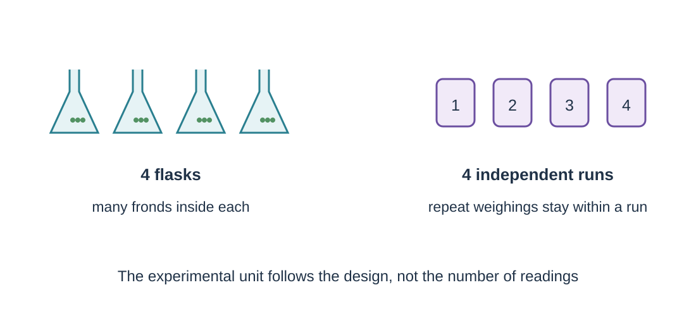
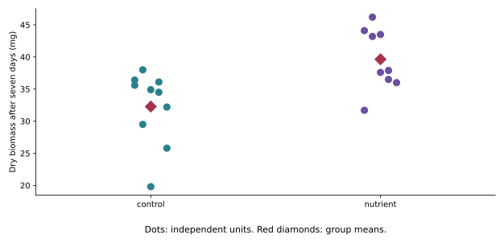
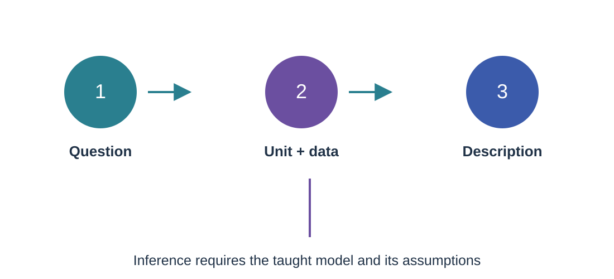
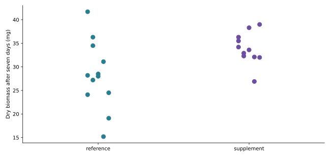
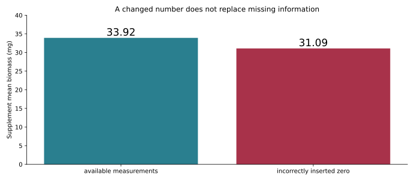
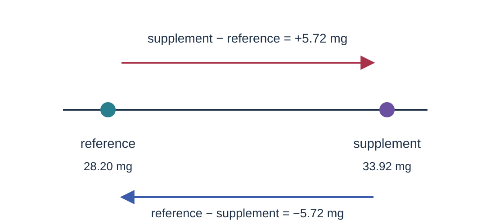

## One question, one report

{height=370px}

Complete one selected study; both use the workflow already practised.

::: notes
The default duckweed exercise includes a guided Welch comparison. The organic
alternative is descriptive and does not require a new test or chemistry knowledge.
Week 4's statistical work remains part of the course in either pathway.
:::

## Decide what is independent

{height=380px}

The number of rows must be interpreted through the experimental design.

::: notes
Twenty duckweed flasks were independently allocated nutrients or control. The
organic table has twelve independent runs allocated a collection protocol.
Many fronds in a flask or repeated weighings of one run do not add independently
treated units. Students should state this before calculation.
:::

## A missing measurement is not zero

{height=365px}

Retain the raw record. State **10 control + 9 nutrient** available measurements.

::: notes
The supplied source record explains F17. We do not know its biomass. A zero
would invent a very small biomass and change the comparison. Keep counts of
started units and available outcomes distinct.
:::

## Import and check before analysing

```r
library(readr)
library(dplyr)
library(ggplot2)
duckweed <- read_csv("data/duckweed.csv", show_col_types = FALSE)
glimpse(duckweed)
available <- duckweed |> filter(!is.na(biomass_mg))
```

Check IDs, labels, types, units, missing values, and plausible ranges.

::: notes
Run from the extracted course project root. All report prerequisites must be in
its code. The available object makes the exclusion explicit without overwriting
the raw table. No other value is confirmed as an error.
:::

## Show observations before a test

{height=360px}

Each dot is one flask; diamonds are means. Explain overlap and variation.

::: notes
This plot uses the actual teaching CSV. It excludes only the unavailable F17
y-value and the caption in the report should say so. A lower control value
does not automatically justify exclusion. Group means are not new observations.
:::

## State the comparison direction

```r
nutrient <- available |> filter(treatment == "nutrient")
control <- available |> filter(treatment == "control")
comparison <- t.test(nutrient$biomass_mg, control$biomass_mg)
```

Nutrient minus control: about **7.35 mg**, 95% CI **2.27 to 12.44 mg**.

Report sample sizes and assumptions, not only the p-value.

::: notes
The supplied data give Welch p about 0.00723. The interval concerns the mean
difference, not 95% of flasks. The inference remains conditional on independence,
the distributional assumptions, and the missing-outcome limitation. Students
need not derive the test or choose an alternative method catalogue.
:::

## Organic alternative: the maximum is given

{height=365px}

Both masses use grams. No reaction equation or molar-mass lookup is needed.

::: notes
Define theoretical mass as the supplied maximum and isolated mass as collected
dry product. Purity is assumed solely for this simplified calculation, not
measured. Other runs start at different scales, making raw masses incomparable
as yield without normalisation.
:::

## Compare percentages across independent runs

{height=365px}

Describe means, SD, and overlap. No new test is required for this alternative.

::: notes
Six runs per group, no missing outcomes. Means 68.67% and 77%; SDs 4.32 and 3.74
percentage points. The observed mean difference is 8.33 percentage points, not
an 8.33% relative increase. Higher yield alone does not establish purity or general
superiority, safety, or sustainability.
:::

## Match the output to the selected question

| Duckweed | Organic alternative |
| --- | --- |
| Outcome: dry biomass in mg | Outcome: isolated yield in % |
| Independent unit: flask | Independent unit: synthesis run |
| Guided Welch comparison and interval | Descriptive mean/SD comparison |
| One missing biomass | All outcomes available |

Do not transfer an old conclusion merely by changing a plot title.

::: notes
Students may reuse code patterns, but must change the roles, units, and study
interpretation. They should not invent a confidence interval to fill a heading
in the descriptive alternative. Neither study needs a new statistical method.
:::

## Write a result someone can assess

Include:

- Direction and size, in the outcome's units.
- Numbers of available independent units.
- Individual variation and the required uncertainty, if estimated.
- One limitation tied to the design, missing data, or simplified assumptions.

::: notes
Prompt students to distinguish an observed numerical difference from a universal
claim. Simulated teaching data do not establish real biological or chemical
effects. Ask which code or table supplies each number in their paragraph.
:::

## Keep the whole recipe in the report

1. Import data and load packages.
2. Perform checks and calculations.
3. Produce figures and summaries.
4. Explain the results and limits.
5. Save, restart, and render.

::: notes
The report must not depend on console-only objects. Source files stay in the
project root so data/relative paths keep the same meaning. Preserve the input
CSV and keep derived output separate.
:::


## Start with the claim you intend to support

{height=350px}

Write the plan before changing the code.

::: notes
The additional exercise asks for a 150–250 word plan covering question, unit,
outcome, units, missingness, plot and direction. The descriptive organic route
stops at a directed observed comparison; the duckweed route adds the taught
independent inference. One chosen main study is enough.
:::

## Make checks inspectable

For each check, retain **operation and finding**:

- Identifiers and allocation labels.
- Measurement types, units, and unavailable values.
- Derived outcome and available counts.
- Comparison direction and interpretation.

::: notes
“All checks passed” is not enough for another reader. Ask students to show a
count or a named record. They can use existing commands rather than a new
validation package. One hand calculation helps test the operation's meaning,
but does not by itself validate experimental independence.
:::

## Transfer the workflow to a fresh culture study

{height=350px}

New file: `data/algae.csv`; outcome: dry biomass in **mg**.

::: notes
Algae are photosynthetic organisms, but the task requires no microbiology:
independent cultures were randomly assigned, and one seven-day harvest produced
a biomass reading. A19 spilled before weighing. This is a short transfer memo,
not a requirement to do both duckweed and organic main reports.
:::

## Check before summarising

```r
library(readr)
algae <- read_csv("data/algae.csv", show_col_types = FALSE)
nrow(algae)
anyDuplicated(algae$culture_id)
sum(is.na(algae$biomass_mg))
```

Expect **24 rows**, **0 duplicated IDs**, **1 missing measurement**.

::: notes
The available counts are twelve reference and eleven supplement. Keep A19's
raw row and missing value. State that the culture, not its number of cells,
is the independent unit. The transfer table has different column and allocation
names from the plant table: adapt the roles, not only the title.
:::

## Look at the observations before the summary

{height=350px}

Which group contains the largest individual observation?

::: notes
Reference culture A11 has 41.7 mg, larger than every supplement observation.
This does not contradict a greater supplement mean. Let students answer the
individual-observation question before showing means, so the plot is read as
data rather than treated as decoration behind a chosen conclusion.
:::

## A group mean is not a rule for every culture

{height=350px}

Reference mean ≈ **28.20 mg**; supplement mean ≈ **33.92 mg**.

::: notes
The supplement group has the higher mean but its values do not all exceed the
reference values. Both individual observations and the summary are informative.
The plot alone does not isolate every possible source of biological variation;
the supplied design and assumptions still matter.
:::

## Zero would invent a different result

{height=350px}

The unavailable value has not become observed information.

::: notes
The correct available supplement mean is 33.91818 mg. Adding a false zero as a
twelfth measurement changes it to 31.09167 mg. This is a demonstration of why the
rule matters, not an alternative recommended analysis. Keep the raw missing
value and explain the loss rather than choosing a convenient invented number.
:::

## Repair claims as carefully as code

Faulty statements to challenge:

- “All enrolled flasks have measured biomass.”
- “The group SD is the error in the treatment effect.”
- “A higher product yield proves greater purity.”

Use the **specific data and assumptions** in the correction.

::: notes
Duckweed has nineteen available outcomes out of twenty enrolled flasks. SD is
individual spread. Organic purity was assumed for a simplified calculation,
not measured by yield. A useful rewrite changes the claim's meaning, not only
its strength from proves to suggests. Students record their corrections.
:::

## Give the difference a direction

{height=350px}

The observed supplement-minus-reference difference is about **5.72 mg**.

::: notes
Reversing the order changes the sign without altering the underlying
observations. In the duckweed test, the order also determines the interval's
direction. For the algae transfer memo no new hypothesis test is required.
If a taught test is run, it does not replace the requested descriptive reasoning.
:::

## Write a bounded result paragraph

Include unit, available n, direction, spread or overlap, and a limitation.

A larger mean does not imply every treated observation is larger.

::: notes
The algae transfer memo is 100–150 words with a saved summary and figure. Keep
number precision sensible, but calculate with the unrounded means. A19's
loss needs reporting, even when na.rm=TRUE supplies a numeric summary.
Do not generalise the simulated conditions to all organisms or supplements.
:::

## Retain a decision trail with the result

Save the analysis plan, checks, chosen direction, and interpretation revision.

Then restart and recreate the outputs from the saved source.

::: notes
The extended practical turns a short command sequence into a reviewable
analysis. Students do not need to produce a second full main study. The
fresh culture memo supplies transfer evidence and becomes a small
reproducibility task on the following day.
:::

## Exercises: a first complete version today

[Open day 23 exercises](../../week5/23-mini-study.qmd).

- Default: `duckweed-report.Rmd` plus HTML.
- Alternative: `organic-study.Rmd` plus HTML.
- Keep the chosen source and HTML in the project, with raw data intact.
- Retain the analysis plan and short algae transfer memo/script.

If extending day 15's `organic-report.Rmd`, use **Save As** to preserve it.

::: notes
The immediate goal is a complete first version, not decorative perfection.
Tomorrow's peer or fresh-folder reproduction will reveal hidden dependencies.
Students should save a note of any failed step rather than conceal it.
:::
