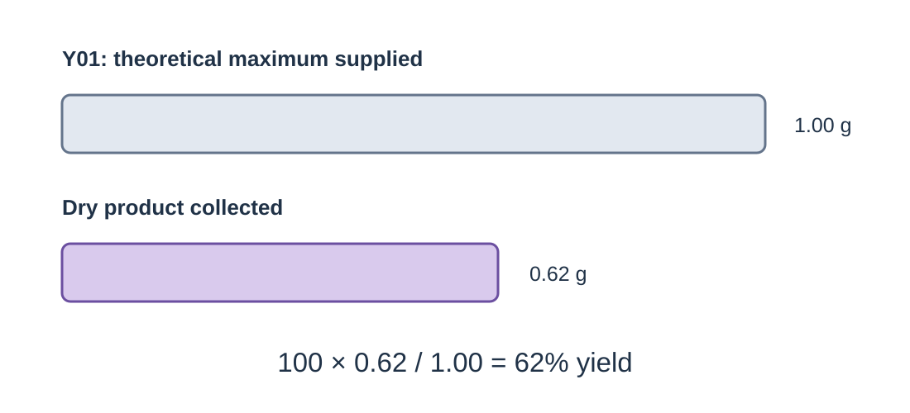

## One question, one report

{height=370px}

Complete one selected study; both use the workflow already practised.

::: notes
The default duckweed exercise includes a guided Welch comparison. The organic
alternative is descriptive and does not require a new test or chemistry knowledge.
Week 4's statistical work remains part of the course in either pathway.
:::

## Decide what is independent

{height=380px}

The number of rows must be interpreted through the experimental design.

::: notes
Twenty duckweed flasks were independently allocated nutrients or control. The
organic table has twelve independent runs allocated a collection protocol.
Many fronds in a flask or repeated weighings of one run do not add independently
treated units. Students should state this before calculation.
:::

## A missing measurement is not zero

{height=365px}

Retain the raw record. State **10 control + 9 nutrient** available measurements.

::: notes
The supplied source record explains F17. We do not know its biomass. A zero
would invent a very small biomass and change the comparison. Keep counts of
started units and available outcomes distinct.
:::

## Import and check before analysing

```r
library(readr)
library(dplyr)
library(ggplot2)
duckweed <- read_csv("data/duckweed.csv", show_col_types = FALSE)
glimpse(duckweed)
available <- duckweed |> filter(!is.na(biomass_mg))
```

Check IDs, labels, types, units, missing values, and plausible ranges.

::: notes
Run from the extracted course project root. All report prerequisites must be in
its code. The available object makes the exclusion explicit without overwriting
the raw table. No other value is confirmed as an error.
:::

## Show observations before a test

{height=360px}

Each dot is one flask; diamonds are means. Explain overlap and variation.

::: notes
This plot uses the actual teaching CSV. It excludes only the unavailable F17
y-value and the caption in the report should say so. A lower control value
does not automatically justify exclusion. Group means are not new observations.
:::

## State the comparison direction

```r
nutrient <- available |> filter(treatment == "nutrient")
control <- available |> filter(treatment == "control")
comparison <- t.test(nutrient$biomass_mg, control$biomass_mg)
```

Nutrient minus control: about **7.35 mg**, 95% CI **2.27 to 12.44 mg**.

Report sample sizes and assumptions, not only the p-value.

::: notes
The supplied data give Welch p about 0.00723. The interval concerns the mean
difference, not 95% of flasks. The inference remains conditional on independence,
the distributional assumptions, and the missing-outcome limitation. Students
need not derive the test or choose an alternative method catalogue.
:::

## Organic alternative: the maximum is given

{height=365px}

Both masses use grams. No reaction equation or molar-mass lookup is needed.

::: notes
Define theoretical mass as the supplied maximum and isolated mass as collected
dry product. Purity is assumed solely for this simplified calculation, not
measured. Other runs start at different scales, making raw masses incomparable
as yield without normalisation.
:::

## Compare percentages across independent runs

{height=365px}

Describe means, SD, and overlap. No new test is required for this alternative.

::: notes
Six runs per group, no missing outcomes. Means 68.67% and 77%; SDs 4.32 and 3.74
percentage points. The observed mean difference is 8.33 percentage points, not
an 8.33% relative increase. Higher yield alone does not establish purity or general
superiority, safety, or sustainability.
:::

## Match the output to the selected question

| Duckweed | Organic alternative |
| --- | --- |
| Outcome: dry biomass in mg | Outcome: isolated yield in % |
| Independent unit: flask | Independent unit: synthesis run |
| Guided Welch comparison and interval | Descriptive mean/SD comparison |
| One missing biomass | All outcomes available |

Do not transfer an old conclusion merely by changing a plot title.

::: notes
Students may reuse code patterns, but must change the roles, units, and study
interpretation. They should not invent a confidence interval to fill a heading
in the descriptive alternative. Neither study needs a new statistical method.
:::

## Write a result someone can assess

Include:

- Direction and size, in the outcome's units.
- Numbers of available independent units.
- Individual variation and the required uncertainty, if estimated.
- One limitation tied to the design, missing data, or simplified assumptions.

::: notes
Prompt students to distinguish an observed numerical difference from a universal
claim. Simulated teaching data do not establish real biological or chemical
effects. Ask which code or table supplies each number in their paragraph.
:::

## Keep the whole recipe in the report

1. Import data and load packages.
2. Perform checks and calculations.
3. Produce figures and summaries.
4. Explain the results and limits.
5. Save, restart, and render.

::: notes
The report must not depend on console-only objects. Source files stay in the
project root so data/relative paths keep the same meaning. Preserve the input
CSV and keep derived output separate.
:::

## Practical: a first complete version today

[Open day 23 practical and notes](../../week5/23-mini-study.qmd).

- Default: `duckweed-report.Rmd` plus HTML.
- Alternative: `organic-study.Rmd` plus HTML.
- Save both in the project root, with the chosen source data intact.

If extending day 15's `organic-report.Rmd`, use **Save As** to preserve it.

::: notes
The immediate goal is a complete first version, not decorative perfection.
Tomorrow's peer or fresh-folder reproduction will reveal hidden dependencies.
Students should save a note of any failed step rather than conceal it.
:::
