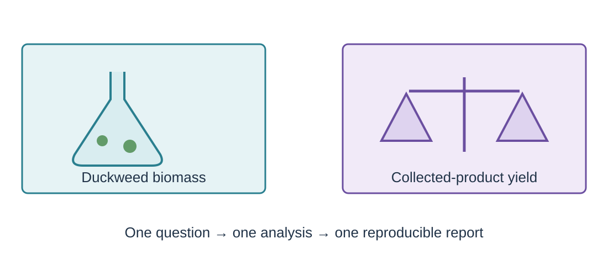
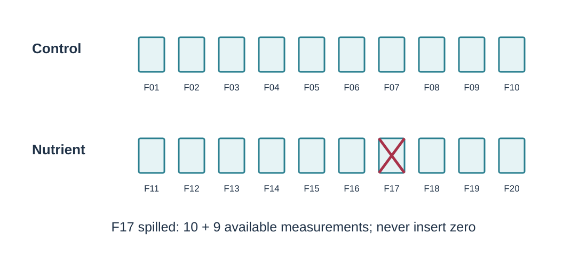
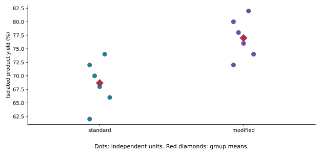
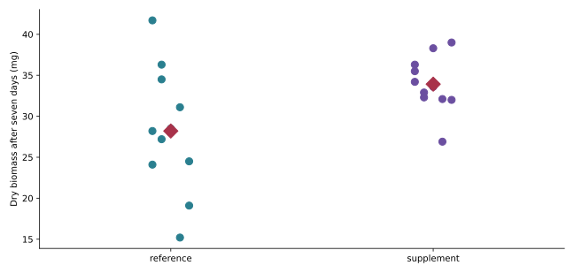

## About this lecture

In a later lab course, or in your thesis project, you will be handed a table from an experiment and asked: "what did the treatment do?" You will be expected to answer with a short report: the question, a plot, the numbers, one limitation, and code that someone else can run again. Today you do that whole job once, on one small study.

Today you will:

- choose one study: **duckweed biomass** or **organic product yield**;
- check the data and decide what one independent unit is;
- plot, summarise and compare in a stated direction;
- write a result paragraph and keep it all in one report that renders from scratch.

No new methods today: everything comes from weeks 2–4. Day 24 tests whether someone else can reproduce your report.

::: notes
Keep the briefing short and leave the time for the work. Students may choose the organic route if their teacher selects it; both routes use only familiar steps. Ask them to keep a note of any step that fails rather than hiding it.
:::

## Choose one study

:::: {.columns}
::: {.column width="45%"}
**Duckweed (default)**

- 20 flasks, randomly given extra **nutrient** or **control**.
- Outcome: dry biomass after seven days, **mg**.
- Compare with the Welch test from Day 17.
- Report: `duckweed-report.Rmd`

**Organic alternative**

- 12 synthesis runs, **standard** or **modified** protocol.
- Outcome: product yield, **%**.
- Descriptive comparison, no test.
- Report: `organic-study.Rmd`
:::
::: {.column width="55%"}
{width="100%"}
:::
::::

::: notes
Duckweed is a small floating aquatic plant. The organic study needs no chemistry: the maximum possible product mass is supplied. If students made organic-report.Rmd on Day 15, they keep it and use Save As for organic-study.Rmd.
:::

## Write the plan before the code

:::: {.columns}
::: {.column width="50%"}
Save in `reports/study-decisions.txt`:

1. **Question**, in one sentence.
2. **Independent unit**: what was randomly assigned?
3. **Outcome and units**, and how it is calculated.
4. **Missing values**: which, and what you will do.
5. **Plot**, and the **direction** of the comparison (e.g. nutrient − control).
:::
::: {.column width="50%"}
{width="100%"}
:::
::::

::: notes
The plan takes a few lines and prevents most errors later. For the organic route, say explicitly that no confidence interval or test is added.
:::

## Count the independent units

:::: {.columns}
::: {.column width="42%"}
- Duckweed: the **flask** is the unit. The many fronds in one flask share its water and nutrients.
- Organic: the **synthesis run** is the unit. Weighing one product three times is still one run.
- More readings of the same unit do not add replicates (Day 14).
:::
::: {.column width="58%"}
{width="100%"}
:::
::::

::: notes
Ask students to say the unit out loud before they calculate anything. This is also the first question to ask a lab teacher about any new dataset.
:::

## Import, check, and keep the missing flask

:::: {.columns}
::: {.column width="50%"}
```r
library(readr)
library(dplyr)
library(ggplot2)
duckweed <- read_csv("data/duckweed.csv",
                     show_col_types = FALSE)
glimpse(duckweed)
available <- duckweed |>
  filter(!is.na(biomass_mg))
```

- Expect **20 rows**, 20 unique `flask_id`s, labels `control` and `nutrient`.
- F17 was spilled: **10 control + 9 nutrient** measurements available.
:::
::: {.column width="50%"}
{width="100%"}
:::
::::

::: notes
A zero for F17 would invent a very low biomass and drag the nutrient mean down. Keep the raw table unchanged; the `available` object makes the exclusion visible. Record checks as findings ("20 rows, 1 missing: F17, spilled"), not as "data were checked".
:::

## Plot the flasks, then compare

:::: {.columns}
::: {.column width="45%"}
```r
nutrient <- available |>
  filter(treatment == "nutrient")
control <- available |>
  filter(treatment == "control")
comparison <- t.test(nutrient$biomass_mg,
                     control$biomass_mg)
```

- Means: nutrient **39.63 mg**, control **32.28 mg**.
- Nutrient − control: **7.35 mg**, 95% CI **2.27 to 12.44 mg**, Welch p ≈ **0.007**.
- The groups **overlap**: F11 (nutrient) is below several controls.
:::
::: {.column width="55%"}
{width="100%"}
:::
::::

::: notes
The order of the two vectors sets the direction: nutrient minus control. The interval concerns the mean difference, not 95% of flasks. The low control F08 (19.8 mg) has no recorded error, so it stays.
:::

## Organic route: compare yields, not grams

:::: {.columns}
::: {.column width="45%"}
- Runs started at different scales, so compare **percentages**:

  `yield_percent = 100 * isolated_mass_g / theoretical_mass_g`

- Check Y01 by hand: 100 × 0.62 / 1.00 = **62 %**.
- Means: standard **68.67 %**, modified **77.00 %** (SD 4.32 and 3.74 percentage points).
- Difference: **8.33 percentage points**, modified − standard. No test needed.
:::
::: {.column width="55%"}
{width="100%"}
:::
::::

::: notes
8.33 percentage points is not an 8.33% relative increase. Higher yield does not show higher purity: purity was assumed, not measured.
:::

## Write a result paragraph someone can check

Include: **direction and size** with units, **available n**, the spread or overlap, the **uncertainty** if you estimated it, and **one limitation**.

"Nutrient flasks had on average **7.35 mg more** dry biomass than controls (95% CI 2.27 to 12.44 mg; Welch, p ≈ 0.007; 9 nutrient and 10 control flasks). F17 was spilled and has no measurement."

| Faulty draft | Repair |
|---|---|
| "There were 20 biomass results." | 20 flasks, **19** measurements; F17 missing. |
| "The nutrient plants all grew more." | The groups overlap; the **mean** is higher. |
| "The SD is the error in the treatment effect." | SD is spread of flasks; the CI is uncertainty in the difference. |
| "p is the probability that nutrients work." | p assumes no difference and asks how surprising the data are. |

::: notes
Ask students to point at the code line or table that produced every number in their paragraph. Rewrite the meaning, not only the strength of the wording ("proves" to "suggests" is not enough).
:::

## Practise on fresh data: algae cultures

:::: {.columns}
::: {.column width="42%"}
- `data/algae.csv`: 24 cultures, **reference** or **supplement**; A19 was spilled.
- Available: **12 reference + 11 supplement**.
- Means: **28.20 mg** and **33.92 mg**: supplement − reference ≈ **+5.72 mg**.
- The largest single culture, A11 (41.7 mg), is in the **reference** group: a higher mean does not mean every culture is higher.
- Putting 0 for A19 would drop the supplement mean to 31.09 mg: wrong.
:::
::: {.column width="58%"}
{width="100%"}
:::
::::

::: notes
This is a short script, algae-transfer.R, and a memo in reports/algae-transfer.txt, not a second full report. The culture is the unit; its many cells are not replicates. Day 24 reproduces this script in a fresh folder; Day 25 looks more closely at A11.
:::

## Before you finish: the report must run on its own

1. Packages and import at the **top** of the report.
2. Checks and calculations, with findings written down.
3. Plot of individual units and a small summary table.
4. Comparison in the stated direction, and the result paragraph.
5. **Restart R, render**, and read the HTML as a stranger would.

Keep `data/` unchanged and outputs in `output/`. If something fails, write down where.

::: notes
The report must not depend on objects created in the console. Paths are relative to the project root. A complete first version today is the goal; Day 24 will expose hidden dependencies.
:::

## Summary

- One question, one independent unit, one outcome with units: write them down first.
- Missing is not zero: report started and available counts (20 flasks, 19 measured).
- Plot the individual units before any summary or test.
- State the direction (nutrient − control) and report size, uncertainty, n and a limitation.
- The report must render from a fresh R session using only its own code.

**Next (Day 24, reproduce and share):** can someone else run your report in a fresh copy of the project and get the same result?

**Now:** [open the Day 23 exercises](../../week5/23-mini-study.qmd). Leave with `duckweed-report.Rmd` (or `organic-study.Rmd`) and its HTML, `reports/study-decisions.txt`, and the algae script and memo.

::: notes
Remind students to save a note of anything that failed. These files are the input for Day 24.
:::
