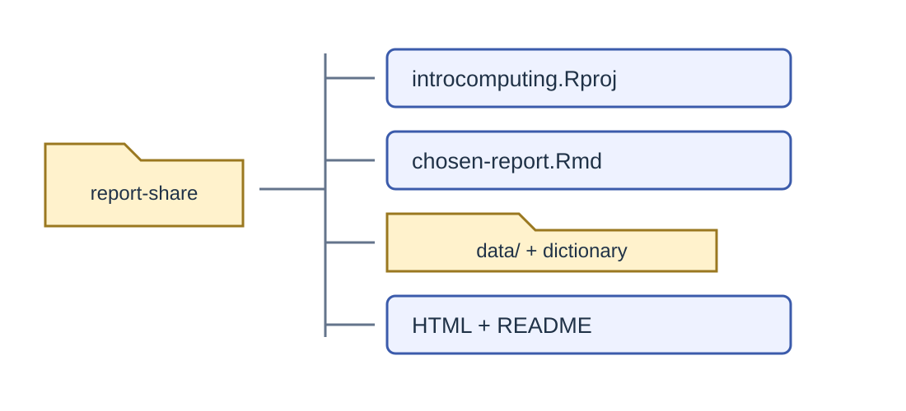
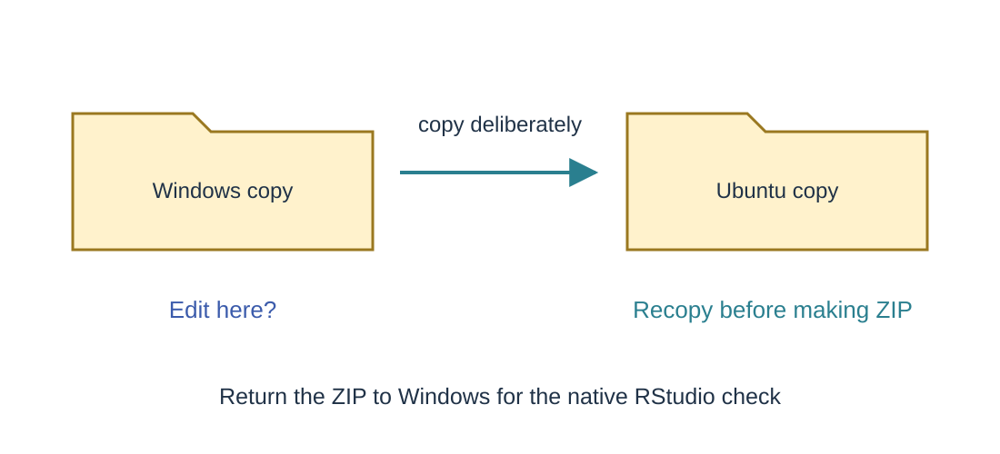
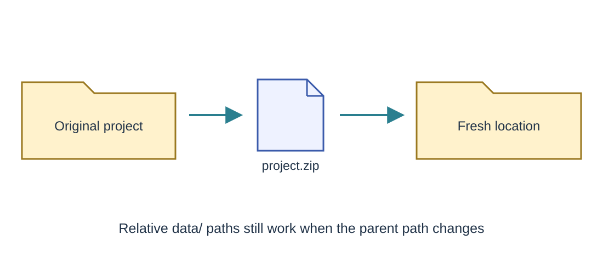

## Your screen may contain hidden prerequisites

{height=375px}

“It works on my screen” is a starting observation, not a reproduction check.

::: notes
An imported object can remain in interactive memory while its import is missing
from the report. The recipient lacks that session. Do not add machinery such as
saving an entire workspace; put the needed imports and calculations in the source.
:::

## Source and result have different jobs

{height=380px}

HTML is readable. `.Rmd` plus inputs makes the analysis repeatable.

::: notes
An HTML output does not by itself supply the original analysis recipe. Ask
students which file they would edit when new measurements arrive and which
they would send for someone simply to read.
:::

## Restart, then render from saved files

1. Save the source `.Rmd`.
2. Restart R.
3. Knit without manually recreating console objects first.
4. Read the first meaningful error and named chunk, if rendering stops.

Keep software installation separate from every report render.

::: notes
The source should load its packages, import input files, and create all its
objects. Restarting does not delete saved data files. If students use a Console
render command, it belongs outside the report: a report must not render itself.
:::

## A recipient needs the whole small project

{height=390px}

Use the selected study's source and CSV; the `.Rproj` does not contain them.

::: notes
For duckweed use duckweed-report.Rmd and data/duckweed.csv. For the organic
alternative use organic-study.Rmd and data/organic-recovery.csv. Include the
dictionary and required output directory. A shortcut to the author's files
is not a transferred dataset.
:::

## Copies do not update themselves

{height=375px}

Revised source → recopy → repackage → test the returned ZIP.

::: notes
This is especially important for Windows students using Ubuntu shell tools but
native RStudio. After making a ZIP in Ubuntu, copy it back to a normal Windows
folder for extraction and the native application test. Do not accidentally
test stale files or rely on WSL paths in the shared report.
:::

## Test in a different location

{height=370px}

Open its `.Rproj`, restart, and render the source without repairing it first.

::: notes
Peer exchange tests a recipient's environment. A fresh folder on the same laptop
checks portability but not all software differences. Keeping the relative data/
path tests that the analysis does not rely on an author's personal path.
:::

## Diagnose one dependency at a time

| Symptom | First check |
| --- | --- |
| Object not found | Was it created inside the report, before use? |
| Function unavailable | Is its package loaded in setup? |
| Cannot open data | Which computer, project, and relative path? |
| Export directory missing | Include or explicitly create the destination. |

::: notes
Ask students to reproduce the exact failure before changing multiple things.
The error identifies a question to investigate; it does not always identify
the full cause. Credentials never belong in an error log or screenshot.
:::

## Review meaning as well as execution

- What is the question and independent unit?
- Are axes, counts, units, and comparison direction clear?
- Does the prose agree with the actual results?
- Are missing data and limitations explained?

For a descriptive organic report, do not invent a test or confidence interval.

::: notes
A successful render can reproduce a mistaken analysis. Ask the reader to locate
evidence for the conclusions, not just confirm that an HTML file exists.
:::

## A successful rerun is a bounded claim

It establishes that the supplied source and inputs regenerate the result in
the **tested environment**.

It does not establish:

- Correct biological design or interpretation.
- Compatibility with every future software version.
- Protection against losing the only storage device.

::: notes
Distinguish reproduction, scientific validity, and backup. Use sessionInfo when
investigating software-version differences, without expecting beginners to
interpret every field. A ZIP beside the original is not a separate backup.
:::

## Practical: keep a reproduction log

[Open day 24 practical and notes](../../week5/24-reproduce.qmd).

- Produce one tested share ZIP and corrected report.
- Record destination, first error, fix, and rerun outcome.
- Retain source, input, HTML, and a supported backup copy.

Use the study you chose yesterday.

::: notes
Feedback should identify actions another person can reproduce. Keep this as
formative practice, not a report-grading exercise. A fresh render is the endpoint.
:::
