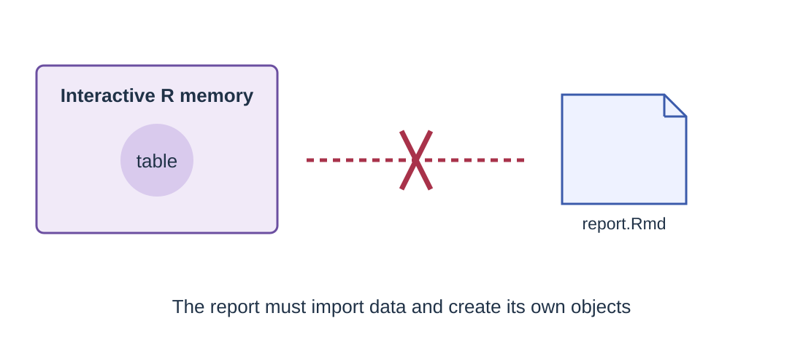
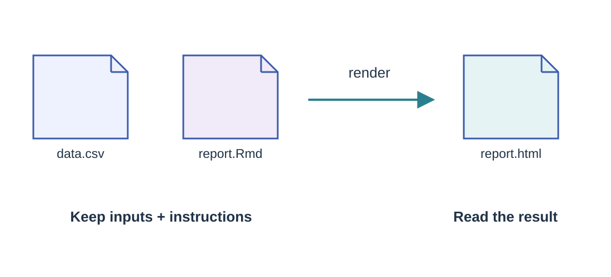
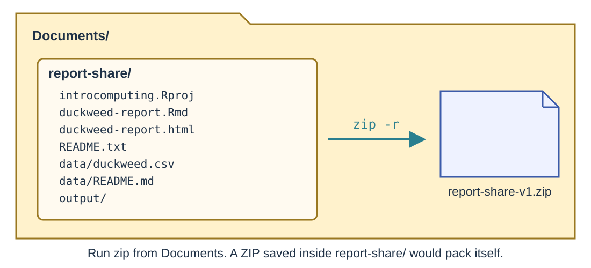
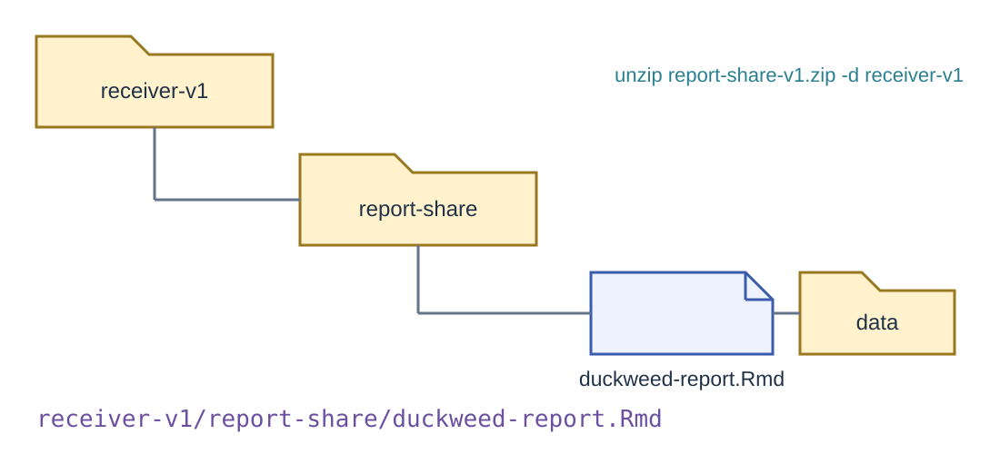
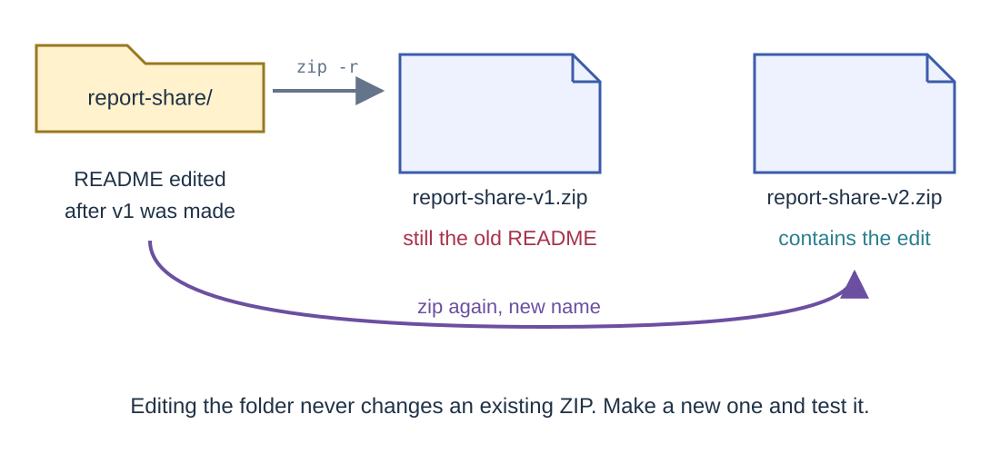
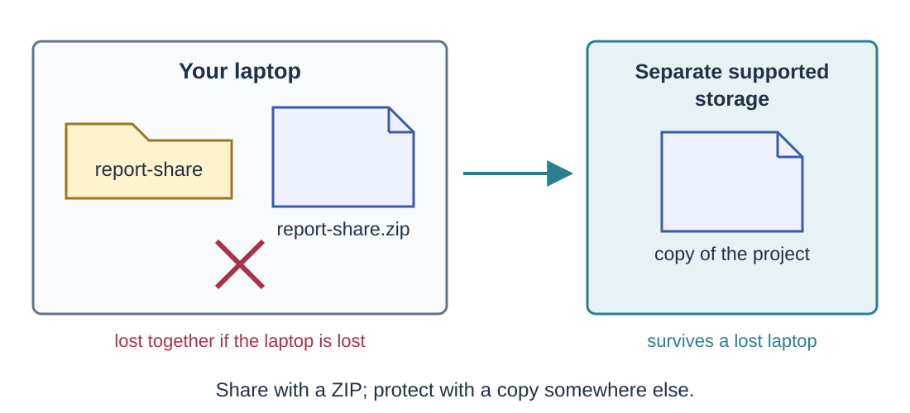

## About this lecture

Your duckweed report is finished. Your supervisor wants to check it, a lab partner wants to add next month's flasks, and you will need it again for your thesis. **If someone else opens your project, do they get the same report?** Often they do not: the report quietly relied on something that only existed on your screen.

Today you will:

- render the report from a fresh R session, so it cannot lean on hidden objects;
- pack the project as a ZIP and test it as the receiver, in a new folder;
- handle corrections: a ZIP is a snapshot, and it is not a backup;
- separate "it renders" from "it is right".

Day 23 produced the report; today makes it shareable. Day 25 consolidates the whole workflow.

::: notes
Ask who has ever received a file that "doesn't work" or a spreadsheet whose numbers nobody could re-derive. That is today's problem. The methods are not new: restart, Knit, zip, unzip. The new thing is doing them as a deliberate test from the receiver's side.
:::

## The problem: it works on my screen

:::: {.columns}
::: {.column width="45%"}
A report can run for you and fail for anyone else because it depends on:

- an object you created in the **Console**, not in the report;
- a package loaded only in the Console;
- a personal path such as `C:/Users/anna/Desktop/duckweed.csv`;
- a data file that is not in the project.

You will not notice any of these on your own computer.
:::
::: {.column width="55%"}
{width="100%"}
:::
::::

::: notes
All four are invisible as long as you stay in the same session on the same laptop. That is why the tests today change the session (restart) and the location (new folder).
:::

## Source and result have different jobs

{height=330}

- The **HTML** is for reading. It cannot be re-run on new data.
- The **`.Rmd` plus the CSV** is the recipe. That is what makes the result repeatable.
- Share both; keep the source as the master copy.

::: notes
Ask: when next month's flasks arrive, which file do you edit? The .Rmd, then Knit. Someone who only receives the HTML can read the result but not check or extend it.
:::

## Test 1: restart R, then Knit

**Session → Restart R**, then **Knit** without running anything in the Console. The report must now import, calculate and plot by itself.

| Error | Usual cause | Repair |
|---|---|---|
| `object 'duckweed' not found` | Import only run in the Console | Put the import in a chunk before it is used |
| `could not find function` | Package loaded only in the Console | Add `library()` to the setup chunk |
| `cannot open file` | Personal path, or file not in project | Use `data/duckweed.csv` and keep the file |
| Old text, new numbers | Result typed by hand | Check the sentence, or use inline R |

Read the **first** error and the chunk it names. Fix one thing, then Knit again.

::: notes
Demonstrate with a report whose import line has been run only in the Console: works before restart, fails after. Restarting does not delete saved files; it only empties memory. Expected duckweed values after a correct render: 10 control flasks, mean 32.28 mg; 9 nutrient flasks, mean 39.63 mg (F17 spilled).
:::

## What the receiver needs

:::: {.columns}
::: {.column width="42%"}
Copy into a new `report-share` folder **outside** your project:

- `introcomputing.Rproj`
- your report, here `duckweed-report.Rmd`, and its HTML
- `data/duckweed.csv` and `data/README.md`
- `output/` if the report saves there
- a `README.txt`: data simulated, file to render, packages needed

The `.Rproj` contains no data; a shortcut is not a copy.
:::
::: {.column width="58%"}
{width="100%"}
:::
::::

::: notes
For the organic alternative: organic-study.Rmd and data/organic-recovery.csv. Leave out credentials, session files and unrelated work. The README is what a supervisor reads first: what the data are and how to get the report.
:::

## Pack the folder as a ZIP

:::: {.columns}
::: {.column width="58%"}
```text
$ ls
report-share
$ zip -r report-share-v1.zip report-share/
  adding: report-share/ (stored 0%)
  adding: report-share/output/ (stored 0%)
  adding: report-share/output/README.txt (stored 0%)
  adding: report-share/README.txt (deflated 19%)
  adding: report-share/duckweed-report.html (deflated 66%)
  adding: report-share/duckweed-report.Rmd (deflated 14%)
  adding: report-share/introcomputing.Rproj (deflated 26%)
  adding: report-share/data/ (stored 0%)
  adding: report-share/data/README.md (deflated 61%)
  adding: report-share/data/duckweed.csv (deflated 59%)
$ ls
report-share
report-share-v1.zip
```
:::
::: {.column width="42%"}
{width="100%"}

- Run it from the folder that **contains** `report-share` (here Documents), so the ZIP lands beside it, not inside it.
- `-r` packs the folder with everything inside it; `zip` names each file it adds.
- `ls` shows the new ZIP. Use a new name for every version.
:::
::::

::: notes
"deflated 66%" means that file was compressed to about a third of its size. A ZIP inside the folder it packs would be packed into the next ZIP. Re-running zip with an existing name updates that archive and can keep files you have since deleted, so new names (v1, v2) are simpler. Windows students: copy report-share into Ubuntu first, and copy the finished ZIP back to Windows for the RStudio test. The output was captured from a real run on a demonstration copy.
:::

## Test 2: open it as the receiver would

:::: {.columns}
::: {.column width="55%"}
```text
$ unzip -l report-share-v1.zip
Archive:  report-share-v1.zip
  Length      Date    Time    Name
...
      397  2026-11-19 16:45   report-share/data/duckweed.csv
   638418                     10 files
$ unzip report-share-v1.zip -d receiver-v1
Archive:  report-share-v1.zip
   creating: receiver-v1/report-share/
...
  inflating: receiver-v1/report-share/data/duckweed.csv
$ ls receiver-v1
report-share
$ ls receiver-v1/report-share
data  duckweed-report.html  duckweed-report.Rmd
introcomputing.Rproj  output  README.txt
```
:::
::: {.column width="45%"}
{width="100%"}

- `unzip -l` lists the 10 entries without unpacking: is everything there?
- Extraction keeps the packed folder: **one extra level**.
- Open `receiver-v1/report-share/introcomputing.Rproj`, restart R, Knit. Expect 10 and 9 flasks, means 32.28 and 39.63 mg.
:::
::::

::: notes
The listing comes from a demonstration copy with a short report; your file sizes will differ. Check the project name in RStudio's corner: it is easy to Knit the original by mistake. Jittered point positions may move slightly between computers; numbers should not.
:::

## Two fresh starts test different things

{height=330}

- **Restart R** finds objects that only lived in memory.
- **New folder** finds missing files and paths that point back to your original.
- Together they are the closest you can get to the receiver's computer on your own laptop.

::: notes
Restarting in the original folder can still find a file via a personal absolute path. Moving the project but keeping the session can hide a missing import. Both together catch both. A different computer can still differ in software versions.
:::

## A ZIP is a snapshot

:::: {.columns}
::: {.column width="45%"}
- You fix the README after making v1. Neither `v1.zip` nor `receiver-v1` changes.
- Make `report-share-v2.zip`, extract to `receiver-v2`, and check the fix is there.
- A new name is not proof. Open the file.
- Add a line to the README saying what changed in v2.
:::
::: {.column width="55%"}
{width="100%"}
:::
::::

::: notes
The same applies to separate copies on Windows and Ubuntu: they do not update each other. Revise, recopy, repack, retest.
:::

## Sharing is not backup

{height=330}

A ZIP next to the original protects against nothing if the laptop is lost, stolen or broken. Keep a copy of the project on the supported separate storage, and note where.

::: notes
Ask students to say where their backup is. If the university storage is not set up for them yet, they should say so in the log rather than count a second folder on the same disk as a backup.
:::

## It renders ≠ it is right

Two tests, each in a disposable copy of the project:

| What you change | Does Knit work? | Is the report right? |
|---|---|---|
| Rename `data/duckweed.csv` | **No**: it stops with an error naming the file | — |
| Add the sentence "All 20 flasks had a measured biomass." | **Yes**: the HTML looks fine | **No**: only 19 were weighed (F17 spilled) |

- R notices a missing file. It cannot notice a wrong sentence.
- After every render, read the claims against the numbers in the tables and figures.

::: notes
After restoring the file name, check that the means are back to 32.28 and 39.63 mg; an absent error message is not the same as the right result. Delete the disposable copies so a deliberately false sentence never ends up in the shared ZIP.
:::

## A source edit does not update the HTML

{height=330}

After any change, Knit again and open the **new** HTML. Compare numbers at sensible precision: 33.91818 and 33.92 mg are the same mean; 34.32 mg is a different analysis.

::: notes
A browser tab with a familiar title may be the old file. The numbers come from the algae data (supplement mean 33.91818 mg), which students package as algae-brief in the exercises. A difference beyond rounding means checking input, exclusions and code, not the number of digits.
:::

## Summary

| Check | What it finds |
|---|---|
| Restart R, then Knit | Objects and packages that existed only in the Console |
| Extract the ZIP into a new folder, then Knit | Missing files and personal paths |
| Make v2 and check the fix in a new extraction | Old snapshots sent by mistake |
| Copy on separate storage | Protection against losing the laptop |
| Read the claims against the numbers | Wrong sentences that render without error |

**Next (Day 25, consolidate):** the whole workflow once more, from files to a shared report.

**Now:** [open the Day 24 exercises](../../week5/24-reproduce.qmd). Leave with a tested `report-share-v2.zip`, `algae-brief.Rmd` with its HTML, a backup copy, and `reports/reproduction-log.txt`.

::: notes
The exercises use the day-23 report (duckweed or organic), then repeat the procedure for the algae memo: 12 reference cultures, mean 28.20 mg; 11 supplement cultures, mean 33.92 mg (A19 missing). Formative practice, not graded.
:::
