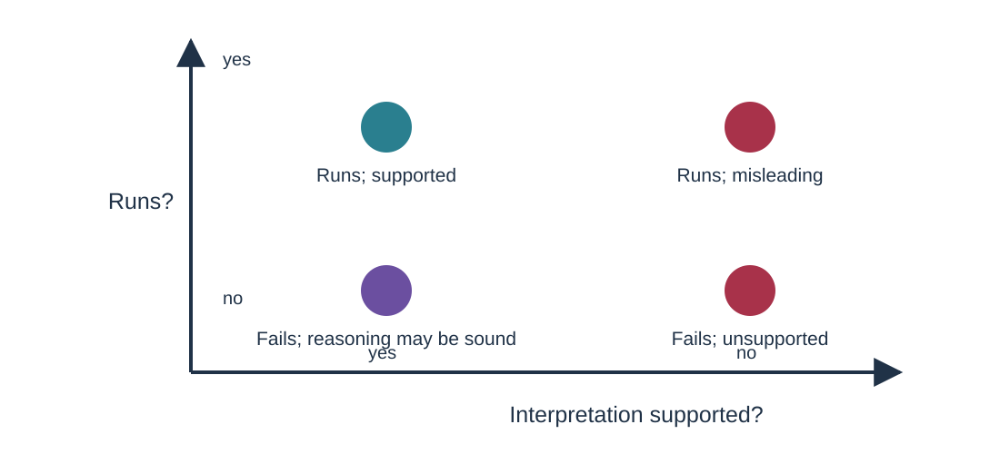
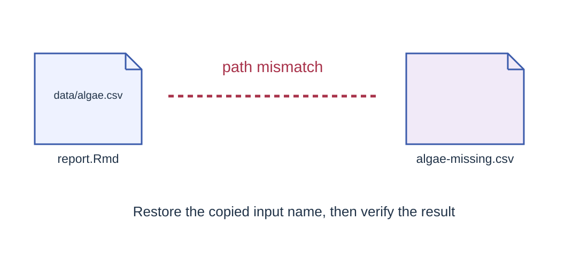
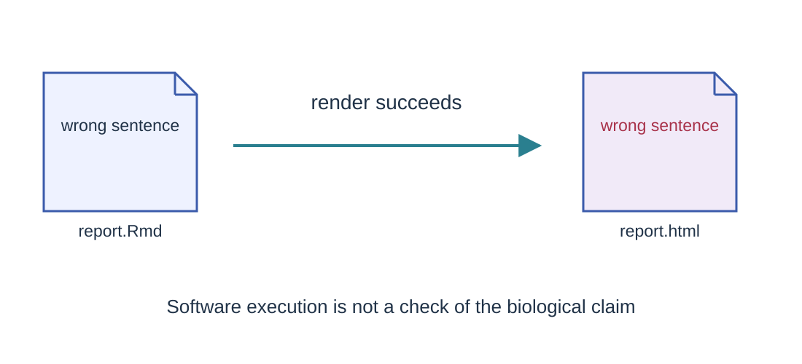
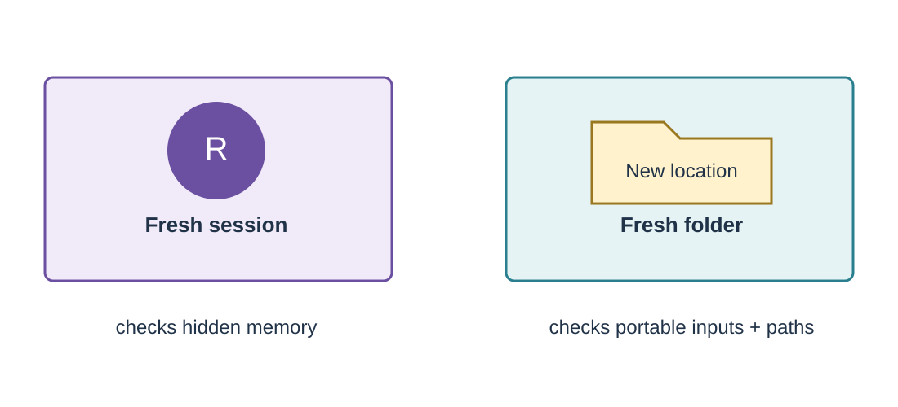
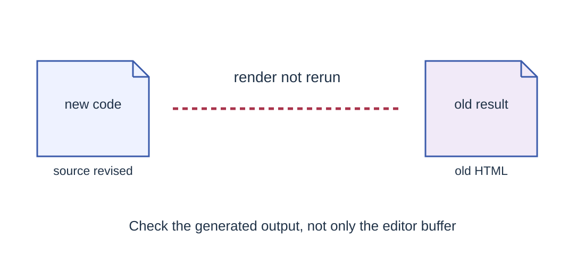

## Your screen may contain hidden prerequisites

{height=375px}

“It works on my screen” is a starting observation, not a reproduction check.

::: notes
An imported object can remain in interactive memory while its import is missing
from the report. The recipient lacks that session. Do not add machinery such as
saving an entire workspace; put the needed imports and calculations in the source.
:::

## Source and result have different jobs

{height=380px}

HTML is readable. `.Rmd` plus inputs makes the analysis repeatable.

::: notes
An HTML output does not by itself supply the original analysis recipe. Ask
students which file they would edit when new measurements arrive and which
they would send for someone simply to read.
:::

## Restart, then render from saved files

1. Save the source `.Rmd`.
2. Restart R.
3. Knit without manually recreating console objects first.
4. Read the first meaningful error and named chunk, if rendering stops.

Keep software installation separate from every report render.

::: notes
The source should load its packages, import input files, and create all its
objects. Restarting does not delete saved data files. If students use a Console
render command, it belongs outside the report: a report must not render itself.
:::

## A recipient needs the whole small project

{height=390px}

Use the selected study's source and CSV; the `.Rproj` does not contain them.

::: notes
For duckweed use duckweed-report.Rmd and data/duckweed.csv. For the organic
alternative use organic-study.Rmd and data/organic-recovery.csv. Include the
dictionary and required output directory. A shortcut to the author's files
is not a transferred dataset.
:::

## Copies do not update themselves

{height=375px}

Revised source → recopy → repackage → test the returned ZIP.

::: notes
This is especially important for Windows students using Ubuntu shell tools but
native RStudio. After making a ZIP in Ubuntu, copy it back to a normal Windows
folder for extraction and the native application test. Do not accidentally
test stale files or rely on WSL paths in the shared report.
:::

## Test in a different location

{height=370px}

Open its `.Rproj`, restart, and render the source without repairing it first.

::: notes
Peer exchange tests a recipient's environment. A fresh folder on the same laptop
checks portability but not all software differences. Keeping the relative data/
path tests that the analysis does not rely on an author's personal path.
:::

## Diagnose one dependency at a time

| Symptom | First check |
| --- | --- |
| Object not found | Was it created inside the report, before use? |
| Function unavailable | Is its package loaded in setup? |
| Cannot open data | Which computer, project, and relative path? |
| Export directory missing | Include or explicitly create the destination. |

::: notes
Ask students to reproduce the exact failure before changing multiple things.
The error identifies a question to investigate; it does not always identify
the full cause. Credentials never belong in an error log or screenshot.
:::

## Review meaning as well as execution

- What is the question and independent unit?
- Are axes, counts, units, and comparison direction clear?
- Does the prose agree with the actual results?
- Are missing data and limitations explained?

For a descriptive organic report, do not invent a test or confidence interval.

::: notes
A successful render can reproduce a mistaken analysis. Ask the reader to locate
evidence for the conclusions, not just confirm that an HTML file exists.
:::

## A successful rerun is a bounded claim

It establishes that the supplied source and inputs regenerate the result in
the **tested environment**.

It does not establish:

- Correct biological design or interpretation.
- Compatibility with every future software version.
- Protection against losing the only storage device.

::: notes
Distinguish reproduction, scientific validity, and backup. Use sessionInfo when
investigating software-version differences, without expecting beginners to
interpret every field. A ZIP beside the original is not a separate backup.
:::

## Two checks, not one badge of correctness

{height=350px}

A reproducible mistake is still a mistake.

::: notes
Ask which check software can perform directly. It can report missing inputs or
unavailable functions; it cannot automatically know that a scientific conclusion
is warranted. The controlled exercise separates execution failures from false
or unsupported prose in a document that renders successfully.
:::

## Investigate one controlled change at a time

Use a disposable copy:

1. Run the working reference version.
2. Change one known item and predict its effect.
3. Observe the error or inconsistency.
4. Restore, rerun, and compare the key result.

::: notes
Preserve the original project. Students record the changed item, expected and
actual consequence, repair, and confirming rerun. Changing several things at
once makes diagnosis harder and can conceal which correction mattered.
This is practical error recovery, not deliberate damage to raw measurements.
:::

## A copied input with another name is unavailable to this path

{height=350px}

Repair the copied filename or documented path; verify the rerun.

::: notes
Use the current main report's actual input in the exercise, not necessarily
algae. Temporarily renaming it in a disposable project should cause a file
error. Restore the exact name and confirm the original counts and main result.
The absence of an error alone is not enough evidence of a correct repair.
:::

## Do not invent a value to silence an error

A missing file, a missing measurement, and an unknown R object are different.

- Restore the required input file/path.
- Preserve an unavailable measurement as `NA`.
- Create an object through the saved import/calculation.

::: notes
These problems need different actions. A copied input renamed for an experiment
has not become a dataset of zeros. A missing observation does not justify
removing all objects or installing packages. Ask the learner to classify the
problem before choosing a repair.
:::

## Wrong prose can render successfully

{height=350px}

Read the claims against the counts, plot, and assumptions.

::: notes
In the controlled exercise, the false duckweed sentence says all enrolled
samples had outcomes; the organic sentence says yield independently establishes
purity. Both can render. Students must rewrite the claim and check they did not
accidentally share an intentionally misleading diagnostic version.
:::

## Fresh memory and fresh location test different dependencies

{height=350px}

Use both tests when handing work to another person.

::: notes
Restarting in the original folder may leave a personal file path accessible.
Moving a project while retaining interactive objects may conceal a missing
import. A fresh session in a new extracted folder tests both problems together,
within the particular software environment being used.
:::

## A source edit does not update an old HTML

{height=350px}

Locate and open the **newly generated** output after rerunning.

::: notes
The file manager, editor, and browser may each display a different stage of
work. Ask the learner to state which artifact they inspected. A browser tab
with a familiar title is not a version check. Reopen the known output file
rather than accumulating copies named final2 without tracing them.
:::

## Use the fresh culture memo for a small portable report

`algae-brief.Rmd` needs:

- Its own imports and calculations.
- Input and design, available counts, and one observation plot.
- A short interpretation and missingness account.
- A README for the recipient.

::: notes
This transfers the already completed algae script and memo; it is not a new
full project or statistical method. Save source in the project root so data/
paths remain consistent. Include actual inputs rather than shortcuts to the
original project. The required available counts remain 12 and 11.
:::

## Compare numerical results with sensible precision

`33.91818 mg` and `33.92 mg` can be the same result at different precision.

`33.91818 mg` and `34.32 mg` require investigation.

Check input, exclusions, outcome, and calculation before blaming rounding.

::: notes
A comparison should include counts and definitions as well as printed digits.
Rounding affects display, not the intended underlying calculation. Environment
records such as sessionInfo can help diagnosis, but do not replace the source,
input data, or an explanation of a changed exclusion rule.
:::

## Keep the failure investigation useful

Record what changed, what you predicted, what happened, and what confirmed repair.

Share the corrected source, not an unresolved test case.

::: notes
Use a short case log and a new clear package name after revision. A successful
rerun is a bounded result in a tested environment. If working alone, leave the
case for another task and then follow only the written directions; this helps
expose instructions that rely on remembered undocumented actions.
:::

## Practical: keep a reproduction log

[Open day 24 practical and notes](../../week5/24-reproduce.qmd).

- Test the chosen main-study package and the brief algae-share package.
- Record destination, first error, fix, and rerun outcome.
- Retain source, input, HTML, and a supported backup copy.
- Keep a controlled-failure log distinguishing execution from interpretation.

Use the study you chose yesterday.

::: notes
Feedback should identify actions another person can reproduce. Keep this as
formative practice, not a report-grading exercise. A fresh render is the endpoint.
:::
