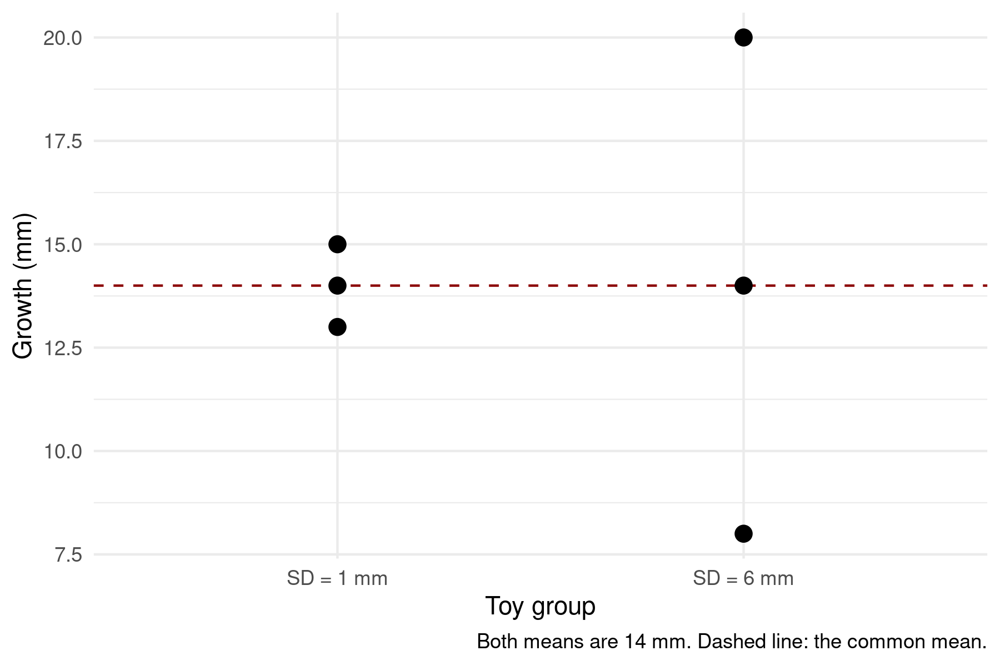

## About this lecture

Next year a lab teacher or thesis supervisor will hand you a spreadsheet and ask: "Can you make a figure and tell me whether the treatment did anything?" Nobody will list the steps for you. Today you practise doing the whole job on familiar data, using your notes and the reference pages.

Today you will:

- run the complete workflow again: find, check, analyse, explain, reproduce;
- repair a broken analysis and explain results in plain words;
- investigate an unusually high value without deleting it;
- leave with a project, a report and a checklist you can reuse.

This is the last day of the course. No new method: only practice with what you already know.

::: notes
Frame the day as rehearsal. Using the reference pages is part of competent practice, not cheating. Students can start at the station where they feel weakest.
:::

## The workflow you can reuse

{height=300 fig-align="center"}

- **Find** the data and the project folder without "recent files". **Check** rows, units, missing values and the independent unit.
- **Analyse** with a plot of individual units first. **Explain** size, spread or uncertainty, and a limitation.
- **Reproduce**: restart, render, and back up.

::: notes
Every station today exercises part of this chain. Ask students which step they found hardest during the mini-study and start there.
:::

## Practice stations: start where you are weakest

:::: {.columns}
::: {.column width="42%"}
- **Files:** download, unzip, find and inspect files in the terminal.
- **R:** repair a broken analysis and rerun it.
- **Meaning:** explain units, spread, uncertainty and limits.
- **Report:** render your Day 23 report from a fresh session.
- **Remote:** log in and transfer a file, if the service is available. Otherwise note it as still to do.
:::
::: {.column width="58%"}
{width="100%"}
:::
::::

::: notes
Everyone should eventually do files, R and meaning. Remote access is practised when the real service works; finishing the local stations does not complete the remote task.
:::

## Repair a broken analysis

```text
seedling <- read_csv("seedlings.csv")
seedlings <- mutate(seedlings, growth_mm = final_mm + initial_mm)
mean(seedlings$Growth_mm)
```

What is wrong?

- **Path:** the file is in `data/`: `"data/seedlings.csv"`.
- **Names:** `seedling` versus `seedlings`; `growth_mm` versus `Growth_mm` (R is case sensitive).
- **Meaning:** growth is final **minus** initial. P01: 44.3 − 25.7 = **18.6 mm**.
- **Packages:** `library(readr)` and `library(dplyr)` must come first.

::: notes
Let students find the problems before revealing them. The last one is the most important: code can run without error and still compute the wrong biology. Checking one row by hand catches it.
:::

## Explain before calculating: spread and units

:::: {.columns}
::: {.column width="45%"}
- Two groups can share a mean and still differ in **spread**: both have mean 14 mm, SD 1 and 6 mm.
- A larger SD is not automatically bad technique; organisms vary.
- One plant with 100 cells measured is still **one** independent plant.
- A missing value is **not zero**: zero invents a measurement.
:::
::: {.column width="55%"}
{width="100%"}
:::
::::

::: notes
These are questions from Station 3 of the practical. Ask students to explain each in one sentence to a neighbour before checking the answers.
:::

## Explain before calculating: uncertainty and range

:::: {.columns}
::: {.column width="45%"}
- Estimate **3 mm**, 95% interval **−2 to 8 mm**. Does that show no effect?
- **No.** The interval includes zero **and** effects in both directions: the study cannot tell. Report the uncertainty.
- A reading above the highest calibration standard: flag it, dilute, measure again.
- A positive leaf-area slope: an **association**, not proof that changing area changes mass.
:::
::: {.column width="55%"}
{width="100%"}
:::
::::

::: notes
Supplied numbers, not computed from the course data. Avoid "not significant, so no difference". The calibration and association items revisit Days 19 and 20.
:::

## Investigate a high value

:::: {.columns}
::: {.column width="42%"}
- Algae data: reference culture **A11 = 41.7 mg**, the largest value in the file.
- The data dictionary records a spill for A19, but **nothing wrong with A11**.
- So A11 stays in the **primary** result.
- To see how much it matters, make a **separate** object:

```r
algae_without_a11 <- filter(algae,
  culture_id != "A11")
```
:::
::: {.column width="58%"}
{width="100%"}
:::
::::

::: notes
Start from the imported algae object (library(readr), library(dplyr), read_csv("data/algae.csv")). Do not edit the CSV. A high value is a question to investigate, not permission to remove it.
:::

## How much does A11 change the result?

:::: {.columns}
::: {.column width="42%"}
- **Primary** (all available): reference **28.20**, supplement **33.92 mg**; difference **5.72 mg**.
- **Sensitivity check** (A11 omitted): reference **26.97 mg**; difference **6.95 mg**.
- The supplement mean does not change; the reference n drops from 12 to 11.
- Report the primary result. Label the check "A11 omitted **without evidence of error**".
- Three different issues: A19 **missing**, A11 **high but recorded**, and the study's simplifying **assumptions**.
:::
::: {.column width="58%"}
{width="100%"}
:::
::::

::: notes
Record the steps in reports/final-investigation.txt. After rendering, check that the main figure and inline numbers come from the primary data, not from a diagnostic object left in memory.
:::

## Hand the work over and test it

:::: {.columns}
::: {.column width="42%"}
Write instructions a stranger could follow:

- the question, and what one row means;
- where the raw data are, what blank cells mean;
- which report to render, and what it should show.

Then **test them**: extract the project into a new folder, follow your own instructions, and fix anything unclear.
:::
::: {.column width="58%"}
{width="100%"}
:::
::::

::: notes
A successful render does not supply the meaning: the reader still needs units, counts and a limitation in the HTML. If the instructions change, make a new clearly named package and test that one too.
:::

## Questions for your next lab

Ask these before analysing any new dataset:

- What does **one row** represent, and what was **independently assigned**?
- What are the **units**, and what do **blank cells** mean?
- Which **figure** shows the individual observations and answers the question?
- Where are the **raw data**, the **source**, the **output** and the **backup**?

Write them, with your workflow, in `reports/next-lab.txt`.

::: notes
Asking these questions is a sign of competence, not of not knowing. Encourage students to add one question of their own that they would ask a lab teacher.
:::

## Summary

- The workflow is the same for every dataset: find, check, analyse, explain, reproduce.
- Check one row by hand: code can run and still compute the wrong biology.
- Missing is not zero; high is not automatically wrong; keep the primary result and label any sensitivity check.
- An interval that includes zero means "uncertain", not "no effect".
- A report is finished when someone else can render it from a fresh copy and understand it.

**After this course:** use this project and `reports/next-lab.txt` in your later lab courses and thesis work. Start every new dataset with the questions on the previous slide.

**Now:** [open the Day 25 exercises](../../week5/25-consolidate.qmd). Leave with your primary report, the labelled A11 check, `reports/final-investigation.txt`, a tested handover, `reports/next-lab.txt` and `reports/readiness-review.txt`.

::: notes
In the readiness review, students list three things they can now do reliably and two that need more practice, with a concrete next practice task. Remote login and transfer stay listed as pending if the real service was not used.
:::
