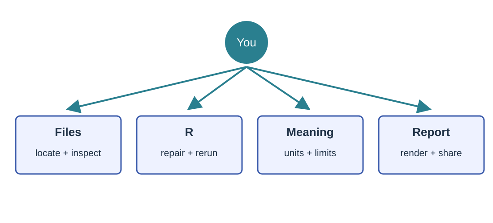
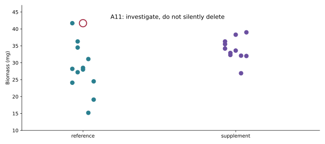
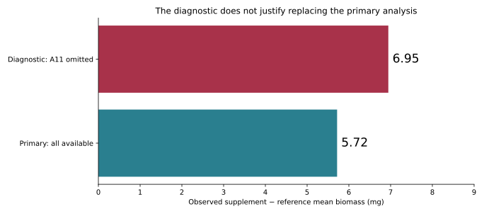
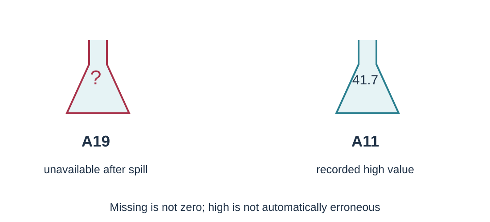

## Reuse the workflow, not a memorised answer

{height=390px}

Today adds no new statistical method.

::: notes
Keep the final day as protected practice and catch-up. Students need reliable
file handling and report rendering more than another model. Use their saved
projects and reference sheets, not an assumption of memorised commands.
:::

## Begin where you need practice

{height=380px}

Use references and explain the action you chose.

::: notes
Students may start at different stations. Everyone should practise file recovery,
R recovery, and interpretation. Remote access is another skill when the actual
service is available, not a reason to delay local practice indefinitely.
:::

## Repair meaning as well as spelling

This is intentionally broken code:

```text
seedling <- read_csv("seedlings.csv")
seedlings <- mutate(seedlings, growth_mm = final_mm + initial_mm)
mean(seedlings$Growth_mm)
```

Find the path, name, case, and calculation problems.

::: notes
Correct path is data/seedlings.csv from the project root. Use a consistent
seedlings object and growth_mm column, load readr/dplyr, and subtract initial
from final length. P01 grew 44.3 − 25.7 = 18.6 mm. Do not run broken code as if it were
the course's suggested solution.
:::

## A mean does not describe every observation

{height=380px}

Keep centre, individual spread, and uncertainty in an estimate distinct.

::: notes
The groups have means 14 mm, SDs 1 and 6 mm. A larger SD need not mean worse technique;
biological differences also cause spread. Neither SD is automatically a
confidence interval or a range containing every observation.
:::

## Count the independent units

{height=380px}

A large number of readings cannot repair a lack of independent replication.

::: notes
Transfer to future practicals: ask what was independently sampled or assigned
to treatment. Cells, time points, or repeat balance readings may be related.
Do not decide the test sample size merely from the row count.
:::

## Interpret an uncertain result carefully

A treatment-minus-control estimate is **3 mm**, with a 95% interval from
**−2 to 8 mm**.

Does this establish no effect?

**No:** it includes zero and effects in both directions. State the uncertainty.

::: notes
Pause before showing the answer. This is a supplied interpretation exercise,
not a calculation from the course dataset. Avoid equating absence of a small
p-value with proof of equality. No additional test is needed.
:::

## Your next-lab questions

- What does one row represent, and what was independently assigned?
- What are the units and the meaning of blank cells?
- Which figure answers the question without hiding observations?
- Where are the source, raw data, output, and backup?

::: notes
Invite students to write a question they would ask a later practical teacher.
The workflow replaces manual spreadsheet calculations, but still needs subject
context and a valid experimental design. Asking these questions is competence.
:::


## Evidence of a skill is an action you can repeat

Locate the raw input, source, derived table, figure, HTML, and backup.

Explain the role of each without relying on recent files or session memory.

::: notes
The portfolio is not judged by its number of files. Ask students to demonstrate
one reproducible path from question to result. Keep the day as consolidation:
no new package, model, or examination format is introduced. The references are
part of competent practice rather than forbidden assistance.
:::

## A high recorded value is a question to investigate

{height=350px}

No source evidence confirms that A11 is erroneous.

::: notes
The value is 41.7 mg. A high point can affect a small-sample summary, but that
observation alone does not justify exclusion. The source notes identify A19 as
spilled; they do not identify A11 as a transcription error. Distinguish evidence
for a repair from a preference for a simpler-looking plot.
:::

## Name the primary and diagnostic datasets separately

```r
library(readr)
library(dplyr)
algae <- read_csv("data/algae.csv", show_col_types = FALSE)
algae_without_a11 <- filter(algae, culture_id != "A11")
```

The primary result uses **all available measurements**.

::: notes
The new object is a sensitivity demonstration, not a replacement raw file.
Counts must be recomputed for each version. Preserve A19 as missing. Do not
choose a dataset by which p-value is smaller; the task only examines how one
record changes a descriptive summary.
:::

## The diagnostic changes the answer, not the evidence for exclusion

{height=350px}

Primary difference ≈ **5.72 mg**; diagnostic difference ≈ **6.95 mg**.

::: notes
The supplement mean stays 33.91818 mg. The reference mean falls from 28.20 mg
to 26.97273 mg, so the observed difference increases to 6.94545 mg. There is no
confirmation that the omitted value is wrong. The primary analysis remains the
main report; a sensitivity result must carry its changed count and rationale.
:::

## Different problems require different explanations

{height=350px}

Missing is not zero. Unusual is not automatically erroneous.

::: notes
Ask students to explain each issue without giving both the same label of
bad data. A19 reduces available n. A11 remains a recorded observation unless
independent source evidence supports a correction. Model assumptions are a
third issue: they do not disappear merely because the file is tidy.
:::

## An uncertain estimate does not establish equality

{height=350px}

State the uncertainty rather than turn it into “no effect”.

::: notes
This is the same interpretation case already in the practical. The picture
supports a discussion of compatible differences in both directions. It is not
a new computation from algae. It does not mean that 95 percent of plants lie
inside the interval or that the null hypothesis has 95 percent probability.
:::

## Match the output to the question

- What values were recorded? Inspect and describe.
- How variable are observations? Show points and SD.
- How uncertain is a guided mean comparison? Use the taught interval/test.
- What concentration matches a signal? Use the supported calibration.

::: notes
Students are not learning a menu of tests. These are familiar workflow
questions that should lead to an interpretable output. A calculated dilution
formula is not empirical evidence needing regression; an observational line
is not proof of an intervention's effect.
:::

## A handover should survive a change of reader

{height=350px}

Give directions another person can follow, then test them.

::: notes
The final independent task is a handover request and readiness review. A peer
should locate input, render source, and state a limitation. Working alone, use
a differently named extracted folder. Keep only tested packages and clearly
identify revisions, including separate Windows and Ubuntu copies.
:::

## Choose the next rehearsal from evidence

Write three reliable actions, two weak steps, and a concrete next practice task.

Keep unfinished remote skills explicitly pending.

::: notes
Self-review should identify an action, not only confidence. “I can render after
restarting” has a checkable meaning; “I understand R” is too broad. Remaining
time belongs to the weak step. Do not fill it with an advanced topic merely
because some students finish earlier.
:::

## Practical: leave with work you can find again

[Open day 25 practical and notes](../../week5/25-consolidate.qmd).

- Locate your project without a recent-files menu.
- Render your chosen report from a fresh session.
- Save `reports/next-lab.txt` as your reusable workflow.
- Identify the supported backup and any pending remote-access skill.
- Keep a labelled sensitivity check, handover, and readiness review.

::: notes
Stop adding topics. Use the time to make these tasks dependable. The descriptive
organic alternative stays descriptive; higher yield alone does not prove higher
purity. The course's written examination design remains outside these materials.
:::
