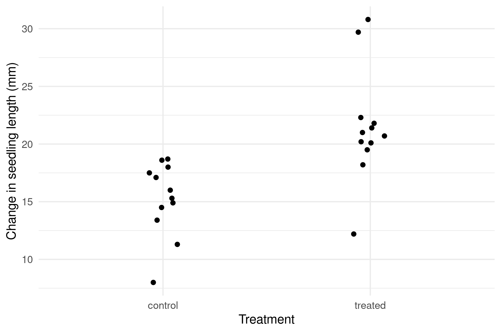

[Lecture](../lectures/08-transform-plot/lec.qmd) · [Exercises](08-transform-plot.qmd)

Try each question before opening its hint or answer.

---

**Q1.** A plant begins at 25.7 mm and ends at 44.3 mm. What should `growth_mm = final_mm - initial_mm` produce? Does adding this column change the source CSV?

::: {.callout-tip collapse="true" title="Hint"}
Distinguish the derived R table from the file it was imported from.
:::

::: {.callout-note collapse="true" title="Answer"}
**18.6 mm**. `mutate()` creates or changes a column in its returned table. The source CSV stays unchanged unless a separate write operation replaces it.
:::

---

**Q2.** Which chooses rows and which chooses columns?

```r
filter(seedlings, treatment == "treated")
select(seedlings, plant_id, growth_mm)
```

::: {.callout-tip collapse="true" title="Hint"}
Ask whether the operation selects observations or variables.
:::

::: {.callout-note collapse="true" title="Answer"}
`filter()` chooses rows meeting the treatment condition. `select()` chooses the two named columns.
:::

---

**Q3.** 

What does one point represent, and why does horizontal jitter not create additional observations?

::: {.callout-tip collapse="true" title="Hint"}
Read the vertical axis and distinguish display position from a measurement.
:::

::: {.callout-note collapse="true" title="Answer"}
One point is one plant's change in length, in mm. Horizontal jitter separates overlapping points; `height = 0` keeps every growth value unchanged. The number of plants is unchanged.
:::

---

**Q4.** Collected product is 0.62 g from a supplied maximum of 1.00 g. Another run collects 0.90 g from a maximum of 2.00 g. Using `100 × collected / maximum`, which has the higher percentage yield?

::: {.callout-tip collapse="true" title="Hint"}
Compare ratios rather than collected masses alone.
:::

::: {.callout-note collapse="true" title="Answer"}
The first yields **62%** and the second **45%**. The larger collected mass has the smaller percentage because the starting scales differ.
:::

---

**Q5.** Required stock volume is `target concentration × final volume / stock concentration`. For stock 500 mmol/L, target 50 mmol/L, and final volume 50 mL, how much stock is required? What if stock is instead 100 mmol/L and target is 200 mmol/L?

::: {.callout-tip collapse="true" title="Hint"}
The concentrations use the same units. Compare the calculated volume with the requested total.
:::

::: {.callout-note collapse="true" title="Answer"}
The first case needs **5 mL**. The second formula gives **100 mL** for a requested 50 mL total, so that request cannot be met by adding solvent alone. Keep and flag the impossible request.
:::
