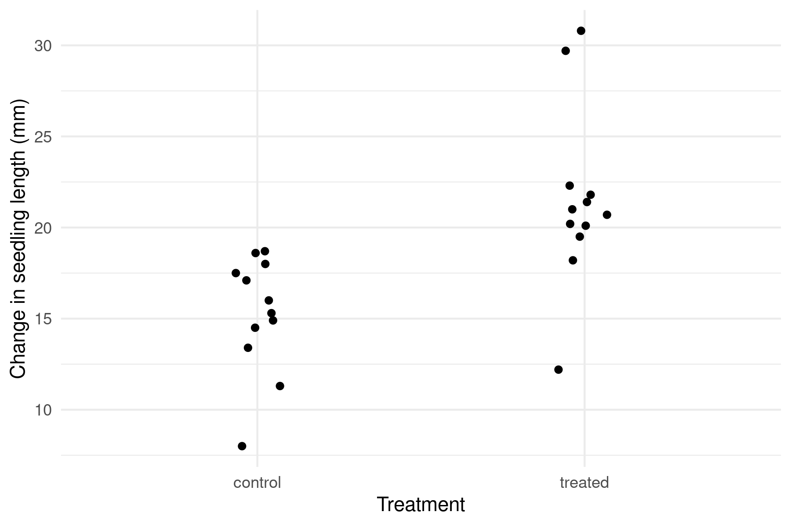

## Today's question

Do plants that started longer also end longer? And how much did each plant grow?
A new column and a labelled figure can answer these questions without editing
cells by hand. Start a script called `day08.R` in your project root.

## Create a derived measurement

```{r}
library(readr)
library(dplyr)
library(ggplot2)
seedlings <- read_csv("data/seedlings.csv", show_col_types = FALSE)
seedlings <- mutate(seedlings, growth_mm = final_mm - initial_mm)
head(seedlings)
```

`mutate()` returns a table with a new or changed column. We assign that returned
table to `seedlings`. Within this function, R looks for `final_mm` and `initial_mm`
in the supplied table. The original file on disk is unchanged. For P01, check
44.3 minus 25.7: the growth is 18.6 mm. A negative change would mean the recorded
final length was smaller; it would deserve checking, not automatic deletion.

The new variable describes **change**, while `final_mm` describes **size**.
These answer different questions. Always say which you are comparing.

## Select observations and variables

```{r}
control_plants <- filter(seedlings, treatment == "control")
growth_table <- select(seedlings, plant_id, treatment, growth_mm)
```

`filter()` selects rows satisfying a condition. `==` asks whether values are
equal; it does not assign values. Quotation marks mark the text label `"control"`.
`select()` chooses columns. Neither operation changes the original raw CSV.
Inspect `control_plants`: it should have twelve rows. `growth_table` should have
24 rows and three columns.

Sometimes it is easier to read a sequence from left to right:

```{r}
longer_control <- seedlings |>
  filter(treatment == "control") |>
  filter(growth_mm > 15)
```

The base R pipe `|>` passes the result on its left as the first argument to the
next function. Read this as “take seedlings, keep controls, then keep growth over
15 mm”. This is a convenience for joining steps, not a new biological operation.
Run intermediate steps when diagnosing a problem.

## Map columns to a figure

```{r}
size_plot <- ggplot(seedlings, aes(x = initial_mm, y = final_mm,
                                  colour = treatment)) +
  geom_point(size = 2) +
  labs(x = "Initial seedling length (mm)",
       y = "Final seedling length (mm)",
       colour = "Treatment") +
  theme_minimal()
size_plot
```

`ggplot()` identifies the table. `aes()` maps columns to positions and colour.
Each point is one plant. The `+` adds a layer or a display instruction to the
figure. The plus at the end of a line tells R that the expression continues.
Colour maps a group label; it does not mean the treatment is a numeric measurement.

Read the labels before interpreting the pattern. The horizontal axis is initial
length, so this figure does not directly show growth. It also cannot by itself
prove that starting longer causes a larger final length.

```{r}
growth_plot <- ggplot(seedlings, aes(x = treatment, y = growth_mm)) +
  geom_point(position = position_jitter(width = 0.08, height = 0, seed = 8),
             alpha = 0.8) +
  labs(x = "Treatment", y = "Change in seedling length (mm)") +
  theme_minimal()
growth_plot
```

This shows growth for each group. A small horizontal **jitter** separates points
that would overlap; `height = 0` leaves every measured vertical value unchanged.
`seed = 8` makes this display repeatable. No test is needed today: describe what
you can see, including overlap and variation among plants.

## Save something another application can read



```{r}
ggsave("output/seedling-growth.png", plot = growth_plot,
       width = 6, height = 4, dpi = 150)
write_csv(growth_table, "output/seedling-growth.csv")
```

The supplied project includes `output/`. These commands create files there; they
may replace files with the same names. The plot object in memory and the PNG on
disk are different things. Locate and open both saved outputs in the file manager.

## Your practical

1. Recreate both plots from the start of the script and calculate P02's growth
   by hand to check the subtraction.
2. Save a table containing only treated plants' IDs and growth measurements.
3. Make a plot of initial length against growth. Label both axes with mm.
4. Write two sentences: one describing a visible pattern, one identifying a
   question the plot alone cannot settle.
5. Restart R and run the script. Confirm the saved files still open afterwards.

::: {.callout-tip collapse="true"}
## Hint: a plot or file is missing

Printing `growth_plot` shows the plot; assigning it alone may not. Check
`getwd()` and `dir.exists("output")` if saving fails. If a column is not found,
check `names(seedlings)` and run the earlier `mutate()` line.
:::

## Check your understanding

::: {.callout-note collapse="true"}
## Why keep the raw table?

A derived table lets someone trace the calculation back to the recorded lengths.
P02 grew 8.0 mm. Selecting columns is not selecting plants; `select()` and
`filter()` act on different parts of the table.
:::

**Keep:** `day08.R`, your derived tables, and figures in `output/`.
Next: [put explanation and code in one report](09-rmarkdown.qmd).
