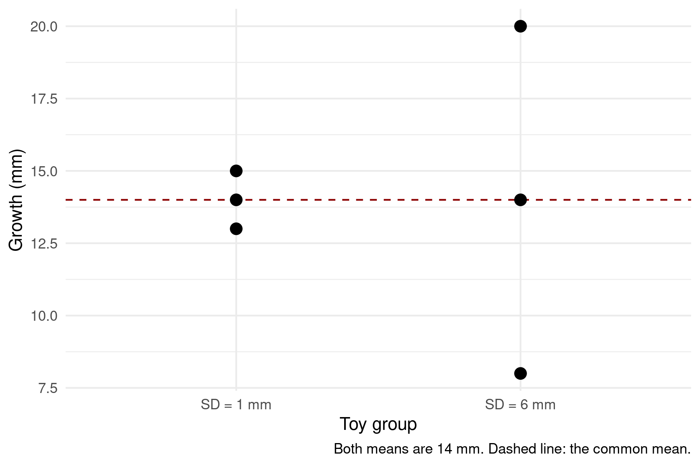

[Lecture slides](../lectures/12-variation/lec.qmd) · [Quiz](12-variation-quiz.qmd) · [Weekly revision](quiz.qmd)

## Today's question

"Control seedlings grew 15.3 mm on average" does not tell a reader whether
every plant grew about 15 mm or whether some grew 8 mm and others 19 mm. Today
you describe both the **centre** of a set of measurements and their **spread**,
first with three small numbers you can check by hand and then with the seedlings.

Use the complete file `data/seedlings.csv` today, not yesterday's repair
exercise; the study is described in the [data dictionary](../data/README.md).

**Save today:** `day12-variation.R` in the project root.

## Mean and median

The **mean** adds all values and divides by how many there are. The **median**
is the middle value after sorting, or the average of the two middle values when
there is an even number. Use both to find out where three growth values are
centred:

```{r}
growth_mm <- c(12, 14, 16)
mean(growth_mm)
median(growth_mm)
```

Both give 14 mm. Now one value is much larger than the others:

```{r}
uneven_mm <- c(10, 10, 10, 100)
mean(uneven_mm)
median(uneven_mm)
```

The mean is 32.5 mm and the median 10 mm. The large value pulls the mean
strongly but hardly moves the median. Neither number is wrong; if the large value
is a real measurement, it stays in the data.

## How far is each value from the mean?

The **deviation** of a value is its distance from the mean: value minus mean.
For 12, 14 and 16 mm the deviations are −2, 0 and +2 mm. They always add up to
zero, because the mean sits in the middle, so their plain average cannot measure
spread. Squaring each deviation removes the sign: 4, 0 and 4.

## Variance and standard deviation

The **sample variance** adds the squared deviations and divides by one less than
the number of values. The **standard deviation** (SD) is the square root of the
variance. Use R to find out both for the three growth values, once by the formula
and once with the built-in functions:

```{r}
deviations_mm <- growth_mm - mean(growth_mm)
sum(deviations_mm^2) / (length(growth_mm) - 1)
var(growth_mm)
sd(growth_mm)
```

The squared deviations add up to 8, and 8 / 2 gives a variance of **4 mm²**. The
SD is **2 mm**. Because the variance squares millimetres, its unit is mm², which
is hard to picture; the SD is back in millimetres and can be read next to the
mean. Dividing by n − 1 instead of n is the usual choice when the values are a
sample, and `var()` and `sd()` do the same.

Now compare two toy groups with the same mean:

```{r}
close_mm <- c(13, 14, 15)
spread_mm <- c(8, 14, 20)
mean(close_mm)
mean(spread_mm)
sd(close_mm)
sd(spread_mm)
```

Both means are 14 mm, but the SDs are 1 mm and 6 mm: the plants in the second
group differ much more from each other.



## How much do the control plants vary?

Use the same functions on the control plants to find out their centre and spread:

```{r}
library(readr)
library(dplyr)
seedlings <- read_csv("data/seedlings.csv", show_col_types = FALSE) |>
  mutate(growth_mm = final_mm - initial_mm)
control <- filter(seedlings, treatment == "control")
mean(control$growth_mm)
median(control$growth_mm)
var(control$growth_mm)
sd(control$growth_mm)
```

The 12 control plants grew a mean of 15.28 mm (median 15.65 mm) with an SD of
3.19 mm and a variance of 10.18 mm². None of them grew exactly 15.28 mm: their
growth ranges from 8.0 to 18.7 mm. In a report, round to what the ruler can
support, for example "mean 15.3 mm, SD 3.2 mm, n = 12".

## Centre and spread in the seedlings

1. Write the three-row hand calculation for 12, 14 and 16 mm in a comment in
   `day12-variation.R`: each value, its deviation, its squared deviation, their
   sum, and the divisor n − 1. Check that it gives the same 4 mm² as `var()`.
2. Use `mean()`, `median()`, `var()` and `sd()` on the treated plants to find out
   whether they differ from the controls in centre, in spread, or in both. You
   should get 21.49 mm, 20.85 mm, 23.67 mm² and 4.87 mm: the treated plants grew
   more **and** varied more.
3. Use the same four functions on `c(12, 14, 26)` to find out what one unusually
   tall plant does to each summary. Predict first. The mean rises from 14 to
   17.33 mm, the median stays 14 mm, and the SD jumps from 2 to 7.57 mm.
4. Use `mean(close_mm + 10)` and `sd(close_mm + 10)` to find out what changes if
   every plant had grown 10 mm more. The mean becomes 24 mm and the SD stays
   1 mm, because the plants still differ from each other by the same amounts.
5. Divide `close_mm` by 10 to convert to centimetres and find out the new mean,
   variance and SD. You get 1.4 cm, 0.01 cm² and 0.1 cm: the mean and SD are
   divided by 10, the variance by 100. The plants are not less variable; only the
   unit changed. A check like this is useful when your code converts units.

::: {.callout-tip collapse="true"}
## Hint: use the units to check yourself

Adding a constant moves the centre but leaves every deviation unchanged.
Dividing lengths by ten divides the mean and SD by ten, and the variance by one
hundred because its unit is squared. `?var` and `?sd` describe the functions and
their `na.rm` argument for missing values.
:::

## Another lab: percentage yield

Your teacher may choose this context instead of task 2 above. In an organic
synthesis, each **run** is one attempt to make a product. In
`data/organic-recovery.csv`, `theoretical_mass_g` is the most product a run could
give from its starting materials, and `isolated_mass_g` is the dry product
actually collected, both in grams. Runs started from different amounts, so you
compare the **percentage yield**, 100 × isolated / theoretical, rather than grams.

Use `mean()`, `var()` and `sd()` to find out how much the yield of the standard
protocol varies between runs:

```{r}
organic <- read_csv("data/organic-recovery.csv", show_col_types = FALSE) |>
  mutate(yield_percent = 100 * isolated_mass_g / theoretical_mass_g)
standard_runs <- filter(organic, protocol == "standard")
mean(standard_runs$yield_percent)
var(standard_runs$yield_percent)
sd(standard_runs$yield_percent)
```

Run Y01 gives 100 × 0.62 / 1.00 = 62%. The six standard runs have a mean yield of
**68.67%**, a variance of 18.67 squared percentage points and an SD of **4.32
percentage points**. A change from 62% to 70% is 8 percentage points, not an
8% increase. Repeat the summaries for `protocol == "modified"`: mean 77.00%, SD
3.74 percentage points.

## A second class's data

The second class's file, `data/seedlings-transfer.csv`, has 18 plants, nine per
group. Do their treated plants also vary more than their controls? Start
`day12-transfer.R` with its own `library()` lines, import and growth calculation.

1. Find T01 and check its growth by hand (15.0 mm), so you know the subtraction
   is the right way round.
2. Use `group_by(treatment)` and `summarise()` with `n()`, `mean()`, `median()`,
   `var()` and `sd()` to find out the centre and spread of each group, and save
   the table as `output/day12-transfer-summaries.csv`. Control: n 9, mean
   13.66 mm, median 12.9 mm, SD 2.53 mm. Treated: n 9, mean 17.87 mm, median
   17.1 mm, SD 1.94 mm. Here the treated plants grew more but varied **less**, the
   opposite of the first study, so a larger mean does not come with a larger SD.
3. Add a column `growth_cm = growth_mm / 10` and summarise it again to find out
   which numbers change with the unit. Means and SDs are divided by 10 and
   variances by 100, and the treated group still has the larger mean and the
   smaller SD.

## Check your understanding

::: {.callout-note collapse="true"}
## Which spread is larger in the main study, and what does it describe?

The treated SD (4.87 mm) is larger than the control SD (3.19 mm). It describes
how much individual treated plants differ from each other. How precisely we know
a group's mean is a different question, which comes on day 14.
:::

::: {.callout-note collapse="true"}
## Does a larger SD mean the measurements were careless?

Not necessarily. Plants really differ, and measurement noise adds to that. The
SD shows how much the values vary, not why they vary.
:::

**Keep:** `day12-variation.R` and `day12-transfer.R` with your notes in comments.
Next: [summarise groups while still showing individuals](13-group-summaries.qmd).
