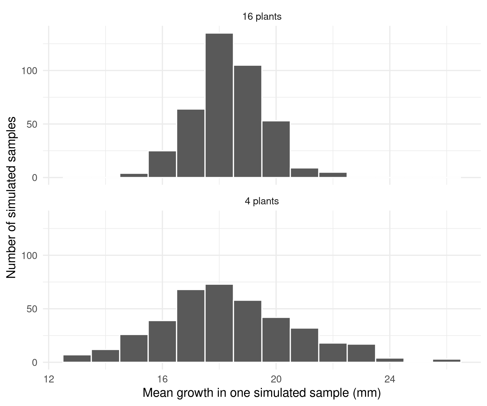

[Lecture slides](../lectures/14-replicates-uncertainty/lec.qmd) · [Quiz](14-replicates-uncertainty-quiz.qmd) · [Weekly revision](quiz.qmd)

## Today's question

Would measuring one plant ten times tell you as much about other plants as
measuring ten different plants? A thesis that counts the ten readings as ten
plants looks far more certain than the experiment can support. Today you learn
to count the independent units in a design, and you use a short simulation to see
how much a mean changes from one sample of plants to the next.

**Save today:** `day14-sampling.R` in the project root and
`output/day14-design-notes.txt`.

## The experimental unit

The **experimental unit** is the thing that independently received a treatment.
In the seedling study each plant grows in its own pot and was randomly allocated
to control or treated (see the [data dictionary](../data/README.md)), so the unit
is one plant, and there are 24 of them, 12 per group. Each plant was measured
twice, but the two lengths become a single growth value.

Another plant is a **biological replicate**: it tells you how plants respond.
Measuring the same plant again is a **technical replicate**: it tells you how
repeatable your measurement is. Three ruler readings of P01 can show how well you
measure, but they are still one plant. In the same way, 100 cells from one mouse
are one mouse, and ten time points from one culture are one culture.

## When plants share a tray

Suppose the nutrient had been given to whole trays instead: one tray of twelve
control plants and one tray of twelve treated plants. Then each group received a
single treatment decision, and anything special about a tray, such as a warmer
spot on the bench, is mixed up with the treatment. The independent unit is the
tray, so there is one per group, however many plants are measured. Only more
trays, not more plants per tray, would fix this.

## Spread among plants and spread among means

The SD from day 12 describes how much individual plants differ. A different
question is how much the **mean** would change if you repeated the experiment
with new plants. That spread is called **sampling uncertainty**, and it becomes
smaller when the mean is based on more independent plants, while the plants
themselves stay just as variable.

## Simulating many experiments

We cannot repeat the experiment hundreds of times, but R can imitate it. The
supplied code treats the 24 measured growth values as a small "population" and
draws many samples from it. Save it in `day14-sampling.R` and run it unchanged:

```{r}
library(readr)
library(dplyr)
library(ggplot2)
seedlings <- read_csv("data/seedlings.csv", show_col_types = FALSE) |>
  mutate(growth_mm = final_mm - initial_mm)
population_mm <- seedlings$growth_mm
set.seed(14)
means_4 <- replicate(400, mean(sample(population_mm, size = 4, replace = TRUE)))
means_16 <- replicate(400, mean(sample(population_mm, size = 16, replace = TRUE)))
sampling <- data.frame(mean_mm = c(means_4, means_16),
                       sample_size = rep(c("4 plants", "16 plants"), each = 400))
ggplot(sampling, aes(x = mean_mm)) +
  geom_histogram(binwidth = 1, colour = "white") +
  facet_wrap(~ sample_size, ncol = 1) +
  labs(x = "Mean growth in one simulated sample (mm)",
       y = "Number of simulated samples") +
  theme_minimal()
sd(population_mm)
sd(means_4)
sd(means_16)
```

`sample(population_mm, size = 4, replace = TRUE)` draws 4 values, and
`replace = TRUE` allows the same value to be drawn twice. `mean()` turns that
sample into one mean, and `replicate(400, ...)` repeats the whole thing 400 times.
`set.seed(14)` fixes the random draws so that everyone gets the same result.

Each value in the histogram is the **mean of one simulated sample**, not a plant.
The 24 plants vary with an SD of 5.13 mm. The means of 4 plants vary with an SD of
2.44 mm, and the means of 16 plants with an SD of only 1.24 mm: four times as many
plants roughly halves the spread of the means. The SD of the means is what is
later called the **standard error**.



## Counting units and reading the simulation

1. For each design below, write in `output/day14-design-notes.txt` how many
   measurements there are and how many independently treated units, completing
   "We have … measurements, but … independently treated units":
   (a) the seedling study; (b) one plant per treatment, each measured with a ruler
   twelve times; (c) two trays of twelve plants with the treatment given per tray;
   (d) one synthesis run whose product is weighed twelve times. For each, say what
   the repeated measurements can tell you.
2. Use `sd(means_4)` and `sd(means_16)` to find out how much more stable a mean of
   16 plants is than a mean of 4. You should get 2.44 and 1.24 mm, while
   `sd(population_mm)` stays 5.13 mm, because the plants did not become more alike.
3. Change the seed to 25 and rerun to find out whether the result depends on the
   particular random draws. The exact values change (2.54 and 1.30 mm), but
   means of 16 plants still vary about half as much as means of 4. Then set the
   seed back to 14.
4. Change `replicate(400, ...)` to `replicate(1000, ...)` for `means_16` to find out
   whether more repetitions make the means more stable. The SD stays about the same
   (1.24 mm): more repetitions give a smoother histogram, but only a larger sample
   size narrows it. Neither adds a measured plant.

::: {.callout-tip collapse="true"}
## Answer check for task 1

(a) 24 growth values from 24 plants: 24 units, 12 per group. (b) 24 readings from
2 plants: 1 unit per group; the readings show how repeatable the ruler is.
(c) 24 growth values from 2 trays: 1 unit per group; the plants show how plants
within a tray vary. (d) 12 masses from 1 run: 1 unit; the weighings show how
repeatable the balance is.
:::

## A second class's data

Use the 18 growth values in `data/seedlings-transfer.csv` as a new small
population, in a new part of `day14-sampling.R`. Both groups are combined because
the question is about sample size, not treatment.

1. Import the file, calculate `growth_mm`, then set the seed to 14 and make
   `means_3` and `means_12` with `size = 3` and `size = 12`. Use `sd()` to find out
   how much means of 3 and of 12 plants vary. You should get 1.69 and 0.83 mm, while
   the 18 plants themselves vary with an SD of 3.08 mm.
2. Put both sets of means in one table with the `data.frame()` pattern above, save
   it as `output/day14-transfer-sampling.csv`, and draw the two histograms on the
   same axis to see the difference.
3. A supervisor offers you a choice: measure each of two plants twenty more times,
   or grow ten more plants. Which tells you more about the mean growth of plants
   under these conditions? Write two sentences in your design notes. The ten plants,
   because the mean of more independent plants is more stable; extra readings of
   two plants only show how well you measure those two.

## Check your understanding

::: {.callout-note collapse="true"}
## Is a precise mean enough?

No. If every plant was measured 5 mm too long, or all plants grew in one unusually
sunny tray, a large sample gives a very stable mean in the wrong place. A narrow
histogram of means shows that the sampling is repeatable, not that it measures the
right thing.
:::

::: {.callout-note collapse="true"}
## What do the 400 values in `means_16` represent?

400 simulated sample means, each from 16 values drawn from the same 24 plants.
They are not 400 new plants.
:::

**Keep:** `day14-sampling.R` and `output/day14-design-notes.txt`.
Next: [write a descriptive report](15-descriptive-report.qmd).
