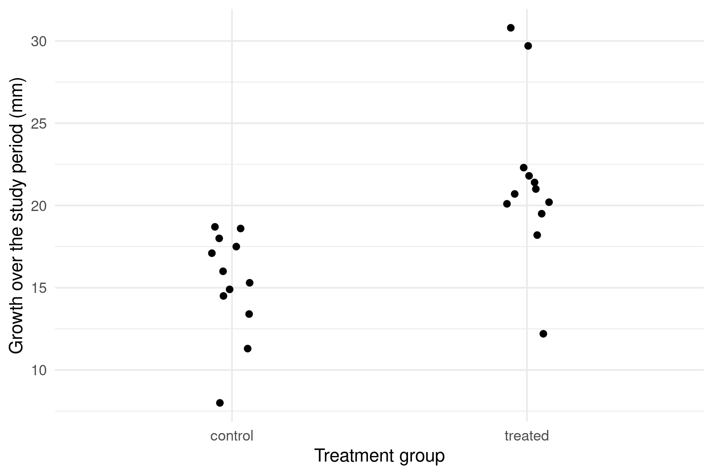

[Lecture slides](../lectures/16-comparisons/lec.qmd) · [Quiz](16-comparisons-quiz.qmd) · [Weekly revision](quiz.qmd)

## Today's question

Does the nutrient treatment change how much a seedling grows? Last week you
described the plants. Today you turn that description into a comparison: you
decide what to compare and in which direction, look at the plants, calculate the
difference between the group means, and prepare the report that day 17 extends
with a statistical test.

Open `introcomputing.Rproj` and use the complete `data/seedlings.csv`; the study is
described in the [data dictionary](../data/README.md).

**Save today:** `comparison.Rmd` and its HTML, `output/day16-growth.png` and
`output/day16-plan.txt`.

## The question, the unit and the direction

The outcome is growth, final minus initial length in millimetres. The unit is one
plant in its own pot, randomly allocated to a group, so there are 12 independent
plants per group. Each plant was measured twice, but its two lengths give one
growth value, so it counts once.

We compare **mean growth of treated plants minus mean growth of control plants**.
A positive difference then means the treated plants grew more. Deciding the
direction before calculating keeps the code, the numbers and the sentences in
the report consistent.

## Growth in the two groups

Use `group_by()` and `summarise()` to find out how many plants are in each group
and how much they grew:

```{r}
library(readr)
library(dplyr)
library(ggplot2)

seedlings <- read_csv("data/seedlings.csv", show_col_types = FALSE) |>
  mutate(growth_mm = final_mm - initial_mm)

group_summary <- seedlings |>
  group_by(treatment) |>
  summarise(n = n(), mean_mm = mean(growth_mm),
            sd_mm = sd(growth_mm), .groups = "drop")
group_summary
```

Each group has 12 plants. The control mean is 15.28 mm (SD 3.19 mm) and the
treated mean 21.49 mm (SD 4.87 mm).

## Looking at the plants

```{r}
growth_plot <- ggplot(seedlings, aes(x = treatment, y = growth_mm)) +
  geom_point(position = position_jitter(width = 0.08, height = 0, seed = 16)) +
  labs(x = "Treatment group", y = "Growth over the study period (mm)") +
  theme_minimal()
growth_plot
```



The treated plants sit higher on average, but the groups overlap: the largest
control plant (18.7 mm) grew more than the smallest treated plant (12.2 mm). So
the treated group grew more **on average**, not every treated plant.

## The difference in means

`pull()` takes one column out of a table as a plain vector of numbers. Use it to
make one vector per group, then find out how much more the treated plants grew:

```{r}
treated <- seedlings |>
  filter(treatment == "treated") |>
  pull(growth_mm)
control <- seedlings |>
  filter(treatment == "control") |>
  pull(growth_mm)

observed_difference <- mean(treated) - mean(control)
observed_difference
```

The result is **6.22 mm**: treated plants grew on average 6.22 mm more than
controls. A difference is a number with a unit and a direction, so always write
it as "6.22 mm (treated − control)". The sign comes from the order of the
subtraction: `mean(control) - mean(treated)` gives −6.22 mm for the same plants.

## Would another experiment give the same difference?

No. Twelve other plants per group would give another difference, because plants
vary. Even if the treatment did nothing, two groups of plants would rarely have
exactly equal means. Day 17 asks how large a difference chance alone could
produce, and for that we need three terms.

The **null hypothesis** is that mean growth would be the same under both
conditions if we could grow very many plants. The alternative is **two-sided**: a
difference in either direction counts, and we decide this now, before seeing any
test. A **p-value** says how often a difference at least as extreme as ours would
arise if the null hypothesis were true. It is not the probability that the
treatment works, and it does not tell you how large the effect is.

## Preparing `comparison.Rmd`

Save a copy of the root-level `report.Rmd` as `comparison.Rmd`, also in the
project root so its `data/` paths work, and keep your earlier reports.

1. Write the analysis plan at the top of the report and in
   `output/day16-plan.txt`: the question, the outcome and its unit, the unit (one
   plant), how plants were allocated, and the direction (treated − control).
2. Add the import, `group_summary` and the plot. Use `group_by(treatment)` and
   `summarise(mean(initial_mm))` to find out whether the groups started at the same
   size. Controls started slightly longer (23.0 mm against 21.9 mm), which is why
   growth, not final length, answers the question.
3. Add the `treated`, `control` and `observed_difference` code. Reverse the
   subtraction in a separate line to find out what changes: only the sign
   (−6.22 mm). Keep treated − control as the result you report.
4. Use `min(treated)` and `max(control)` to find out whether every treated plant
   grew more than every control plant. It did not: 12.2 mm is less than 18.7 mm.
   Write the results as a statement about means.
5. Write a results paragraph with n, both means with SDs, the difference with its
   direction and unit, and the overlap. End with what is still open: how uncertain
   the difference is. Save the figure with
   `ggsave("output/day16-growth.png", growth_plot, width = 6, height = 4)` and
   render the report.

::: {.callout-tip collapse="true"}
## Hint: a surprising sign

Print `mean(treated)` and `mean(control)` separately. A negative difference from
`mean(control) - mean(treated)` describes the reverse comparison, not a different
biological result. Calling an object `treatment_effect` does not change its sign;
the order of the subtraction does.
:::

## A second class's data

The second class's experiment, `data/seedlings-transfer.csv`, has 18 plants, nine
per randomly allocated group, measured seven days apart. Did their treated plants
also grow more? Create `transfer-comparison.Rmd` in the project root with the same
question and direction.

1. Import the file, check it (18 rows, no repeated ID, no missing values) and
   calculate growth. T01 grew 15.0 mm; check it by hand.
2. Use `group_by()` and `summarise()` with `n()`, `mean()` and `sd()` to find out
   how much each group grew, and save the table as
   `output/day16-transfer-summary.csv`. Control: 9 plants, mean 13.66 mm (SD
   2.53 mm). Treated: 9 plants, mean 17.87 mm (SD 1.94 mm).
3. Calculate the difference, treated − control. You should get 4.21 mm, smaller
   than the 6.22 mm of the first study. Different plants, grown by a different
   class, give a different estimate; whether the two differences are really
   different is not something we can judge yet.
4. Suppose this class had grown all treated plants in one tray and all controls in
   another. In two sentences in the report, say how many independently treated
   units each group would then have (one tray) and why measuring more plants in
   those trays would not help. Render from a fresh session; day 17 adds the test to
   this report.

## Check your understanding

::: {.callout-note collapse="true"}
## Can we conclude that every treated plant grew more?

No. Look at the dots: the largest control plant grew more than the smallest
treated plant. The treated plants grew more on average.
:::

::: {.callout-note collapse="true"}
## Are 12 plants measured twice 24 independent replicates per group?

No. The two measurements belong to the same plant and are combined into one growth
value. Each group has 12 independent plants.
:::

::: {.callout-note collapse="true"}
## Does the difference of 6.22 mm tell us how uncertain it is?

No. That depends on how much plants vary and how many there are, which is what the
Welch test on day 17 uses.
:::

**Leave with:** `comparison.Rmd`, its rendered HTML, and
`output/day16-growth.png`.

Next: [Day 17 — A guided Welch t-test](17-welch-test.qmd).
