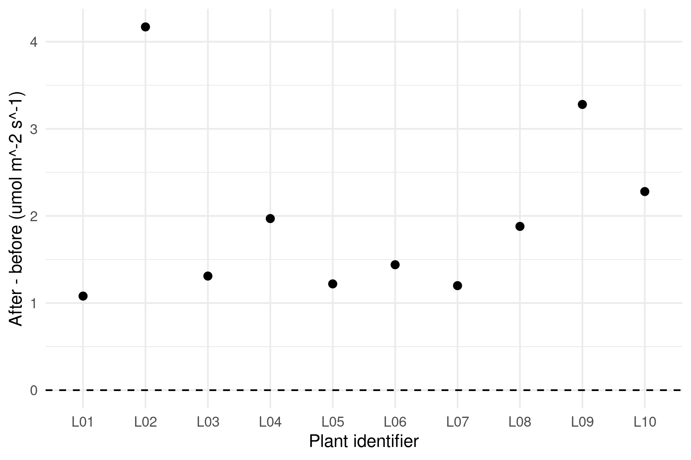

[Lecture slides](../lectures/18-paired/lec.qmd) · [Quiz](18-paired-quiz.qmd) · [Weekly revision](quiz.qmd)

## Today's question

Ten plants had their leaf photosynthesis measured, then the light was increased
and the **same ten plants** were measured again. Did their photosynthesis rate
go up, and by how much? Because every plant appears twice, we compare each plant
with itself: a **paired** design.

The file `data/paired.csv` holds simulated rates in micromoles of CO₂ per square
metre per second, written µmol m⁻² s⁻¹; see [data/README.md](../data/README.md).
Before was always measured first, and after second.

**Save today:** `paired-report.Rmd` and its HTML, `output/day18-changes.png`, and
`paired-transfer.Rmd` with its HTML. Copy the root `report.Rmd` to
`paired-report.Rmd` and put the code below into it.

## Is every plant in the table once?

```{r}
library(readr)
library(dplyr)
library(ggplot2)

paired <- read_csv("data/paired.csv", show_col_types = FALSE)
paired
anyDuplicated(paired$plant_id)
```

You should see ten rows, one per plant, each with a before and an after value.
`anyDuplicated()` returns `0`, meaning that no plant identifier appears twice.
The identifier is what tells us which two readings belong together. Here they
already share a row; if the readings came in two separate files, you would match
them by `plant_id` before subtracting, never by row position.

## How much did each plant change?

Use `mutate()` to find out how much the rate of each plant changed:

```{r}
paired <- paired |>
  mutate(change_umol_m2_s = after_umol_m2_s - before_umol_m2_s)

paired |>
  select(plant_id, before_umol_m2_s, after_umol_m2_s, change_umol_m2_s)
mean(paired$change_umol_m2_s)
```

Check the first plant by hand: L01 went from 5.87 to 6.95, an increase of
**1.08**. All ten changes are positive, from 1.08 to 4.17, and the mean change
is **1.983 µmol m⁻² s⁻¹**. The plants started at quite different levels (5.20 to
8.81), but taking each plant's own change removes those differences.

Plot the changes, so a reader can see every plant:

```{r}
change_plot <- ggplot(paired, aes(x = plant_id, y = change_umol_m2_s)) +
  geom_hline(yintercept = 0, linetype = "dashed") +
  geom_point(size = 2) +
  labs(x = "Plant identifier", y = "After − before (µmol m⁻² s⁻¹)") +
  theme_minimal()
change_plot
ggsave("output/day18-changes.png", change_plot, width = 6, height = 4)
```



L02 rose by 4.17, much more than the others. Nothing in the records says it was
measured wrongly, so it stays in the analysis.

## How uncertain is the mean change?

A paired t-test estimates the mean change and its 95% confidence interval:

```{r}
paired_comparison <- t.test(paired$after_umol_m2_s,
                            paired$before_umol_m2_s,
                            paired = TRUE,
                            alternative = "two.sided")
paired_comparison
```

`paired = TRUE` tells R that the first value in each vector belongs to the same
plant, and so on. With after first and before second, the estimate is after
minus before: a mean change of **1.98**, 95% CI **1.25 to 2.71** µmol m⁻² s⁻¹,
p = **0.00017**. The interval describes the *mean* change; individual plants
changed by anything from 1.08 to 4.17. There are ten independent units here,
the plants, not twenty readings.

A paired t-test is the same as testing the ten changes against zero.
Use `t.test(paired$change_umol_m2_s, mu = 0)` to find out whether it gives the
same estimate, interval and p-value. It does: it is the same analysis written
differently, not a second piece of evidence.

## What can this experiment show?

The rate went up in every plant. But the light changed **and** time passed
between the two readings, because every plant was measured before, then after.
Acclimation during the day or drift in the instrument could also raise the
readings, and a small p-value cannot separate these from the light. A better
experiment would add plants that are measured twice without any change in light.

In `paired-report.Rmd`, write the question, the ten plants measured twice, the
ID check, the change plot, the test result in the after-minus-before direction,
and this limitation. Restart R and render.

::: {.callout-tip collapse="true"}
## Hint: check the direction with one plant

L01's change should be +1.08. The same order, after then before, belongs in the
`mutate()` line and in the two vectors given to `t.test()`; if the estimate is
−1.98, one of them is reversed.
:::

## Why not analyse before and after as two groups?

Use `t.test(paired$after_umol_m2_s, paired$before_umol_m2_s)`, without
`paired = TRUE`, to find out what happens if you ignore the pairing and treat
the readings as two separate groups of plants, as on day 17.

::: {.callout-tip collapse="true"}
## Answer

The estimate is the same, 1.98, but the interval widens to 0.74 to 3.23. The
differences between plants (some start at 5, some at 9) stay in the
calculation and blur the change. The design decides the test: these are the
same plants, so the paired analysis is the right one.
:::

## What happens if the pairs get mixed up?

A common mistake is to sort the before column and the after column
separately, for example in a spreadsheet. Find out what that does: make a
separate object, keep `paired` unchanged, and compare the two.

```{r}
wrong_sorted <- paired |>
  mutate(before_umol_m2_s = sort(before_umol_m2_s),
         after_umol_m2_s = sort(after_umol_m2_s),
         change_umol_m2_s = after_umol_m2_s - before_umol_m2_s)
mean(wrong_sorted$change_umol_m2_s)
sd(paired$change_umol_m2_s)
sd(wrong_sorted$change_umol_m2_s)
t.test(wrong_sorted$after_umol_m2_s, wrong_sorted$before_umol_m2_s, paired = TRUE)
```

::: {.callout-tip collapse="true"}
## Answer

The mean change is still 1.983, so the mean cannot reveal the mistake. But the
SD of the changes falls from 1.02 to 0.50, and the p-value becomes about
0.0000006. Sorting matched the smallest reading with the smallest, not each
plant with itself, so these "changes" belong to no real plant. A smaller p-value
from broken pairs is simply wrong. Sorting the **whole table** by `plant_id` is
safe, because rows move together.
:::

## Three plants: how much can they tell us?

A teaching example measured three plants, D1, D2 and D3, before and after a
change in light: before 5, 8 and 6, after 7, 9 and 9 µmol m⁻² s⁻¹. Create
`paired-transfer.Rmd` and enter the values as a table:

```r
demo <- data.frame(plant_id = c("D1", "D2", "D3"),
                   before_umol_m2_s = c(5, 8, 6),
                   after_umol_m2_s = c(7, 9, 9))
```

Use a change column and `t.test(..., paired = TRUE)` to find out whether three
plants are enough to tell that the rate went up. Add a change plot with a zero
line, a short interpretation, and a note that these are illustrative values,
kept separate from the ten-plant study. Render it.

::: {.callout-tip collapse="true"}
## Answer check

The changes are +2, +1 and +3: mean 2, SD 1. The 95% interval for the mean
change is **−0.48 to 4.48** (p = 0.07). All three plants went up, yet the
interval includes zero, because three pairs say very little about plants in
general. The honest conclusion is "uncertain", not "no effect". More plants
would narrow the interval; measuring the same three plants again would only
show how repeatable the instrument is.
:::

## Check your understanding

- How many independent units are in `paired.csv`? **Ten plants, not twenty readings.**
- Can two unrelated groups of plants be paired by putting them side by side?
  **No; a pair is the same plant measured twice.**
- Does the small p-value show that light caused the increase? **No; light and
  time changed together.**

**Leave with:** `paired-report.Rmd`, its HTML, `output/day18-changes.png`, and
`paired-transfer.Rmd` with its HTML.

Next: [Day 19 — A calibration line](19-calibration.qmd).
