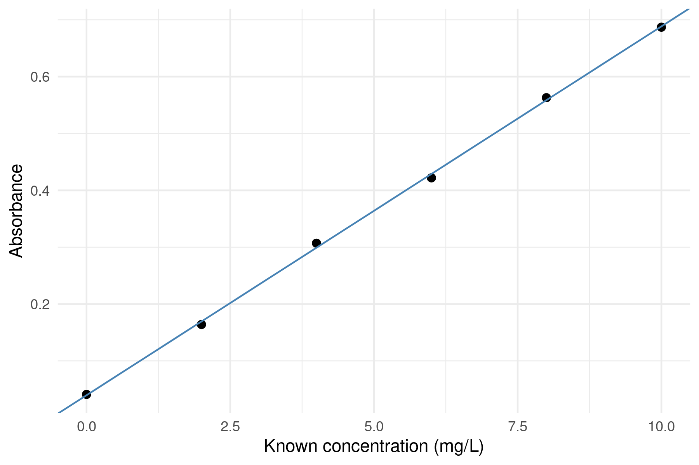
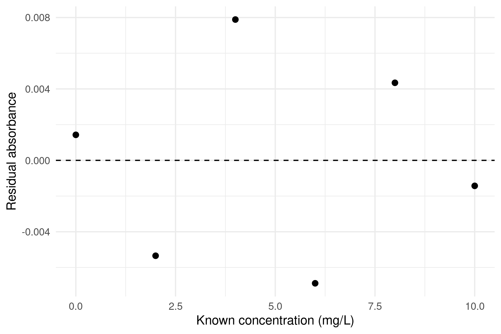

## Today's question

A laboratory instrument gives an absorbance reading, but we want a concentration.
We first measure solutions of known concentration, called **standards**. Can a
straight line describe their readings well enough to estimate the concentration
of an unknown sample?

This is a common quantitative laboratory workflow. The prepared standards in
`data/calibration.csv` cover 0–10 mg/L. Absorbance is dimensionless. These are
simulated data for a simple teaching example; no particular reagent or actual
assay is implied. Each standard is one calibration point, not a plant or a
replicate treatment group.

## Put known concentration on the horizontal axis

```{r}
library(readr)
library(dplyr)
library(ggplot2)

standards <- read_csv("data/calibration.csv", show_col_types = FALSE)
calibration_plot <- ggplot(standards,
                          aes(x = concentration_mg_l, y = absorbance)) +
  geom_point(size = 2) +
  labs(x = "Known concentration (mg/L)", y = "Absorbance") +
  theme_minimal()
calibration_plot
```

The readings increase approximately along a line. We describe that line as
`absorbance = intercept + slope × concentration`. The **intercept** is the fitted
reading at concentration zero. The **slope** is the fitted increase in absorbance
for a one mg/L increase in concentration. A fitted line summarises the relation;
it does not have to pass through every observation.

## Fit the line in R

```{r}
calibration_fit <- lm(absorbance ~ concentration_mg_l, data = standards)
coef(calibration_fit)
```

`lm()` fits a linear model. In its formula, `~` separates the response on the
left from the explanatory variable on the right. `data = standards` says where
to find the columns. `coef()` extracts the fitted intercept and slope. The
[R documentation for lm](https://stat.ethz.ch/R-manual/R-devel/library/stats/html/lm.html)
is a reference; we use only this simple straight-line case.

Your fitted coefficients should be approximately 0.03957 for the intercept and
0.06489 for the slope. Thus the line is approximately
`absorbance = 0.03957 + 0.06489 × concentration`.

```{r}
calibration_plot <- calibration_plot +
  geom_abline(intercept = coef(calibration_fit)[1],
              slope = coef(calibration_fit)[2], colour = "steelblue")
calibration_plot
```

The `[1]` and `[2]` select the first and second coefficients. We retain the
full-precision values for calculations; rounded values are useful for prose.
The nonzero intercept may represent a background reading. Do not force the line
through zero merely because concentration zero sounds like “nothing”.



## Check deviations from the line

A **residual** is an observed reading minus the line's fitted reading. Positive
means the point is above the line; negative means it is below. Residuals have
absorbance units here.

```{r}
standards <- standards |>
  mutate(fitted_absorbance = fitted(calibration_fit),
         residual = residuals(calibration_fit))
standards

residual_plot <- ggplot(standards,
                        aes(x = concentration_mg_l, y = residual)) +
  geom_hline(yintercept = 0, linetype = "dashed") +
  geom_point(size = 2) +
  labs(x = "Known concentration (mg/L)", y = "Residual absorbance") +
  theme_minimal()
residual_plot
```



Look for curvature or a point that stands apart, not for all residuals to be
positive or negative. These six small residuals show no obvious curved pattern.
Six standards are still limited evidence: the picture does not guarantee that
the relationship holds at arbitrary concentrations.

## Estimate the unknowns within the calibration range

Rearranging the line gives
`concentration = (absorbance − intercept) / slope`. This is a point estimate;
we are not calculating a full uncertainty interval for the unknown concentration.

```{r}
unknowns <- read_csv("data/unknowns.csv", show_col_types = FALSE)
intercept <- coef(calibration_fit)[1]
slope <- coef(calibration_fit)[2]

unknowns <- unknowns |>
  mutate(within_range = absorbance >= min(standards$absorbance) &
                        absorbance <= max(standards$absorbance),
         concentration_mg_l = if_else(
           within_range, (absorbance - intercept) / slope, NA_real_))
unknowns
```

The `&` requires both range conditions. `if_else()` assigns a numeric missing
value, `NA_real_`, to unsupported estimates. U1 is about 4.17 mg/L and U2 about
7.40 mg/L. U3 exceeds the largest measured standard reading. Report it as outside
the calibration range; do not present an extrapolated value as a valid result.
A real laboratory might dilute the sample and measure it again using its assay
protocol. Do not invent a dilution correction without such a measurement.

## Transfer question: a newly measured dilution

Use this short calculation as a transfer check, rather than doing another
complete calibration exercise. A **dilution** mixes some original solution with
solvent to reach a larger final total volume. Assume that no measured substance
is lost or reacts. Its concentration is reduced by the factor
`final total volume / original-sample volume`.

A separate unknown was outside the instrument range. A new measurement is now
provided: **1.00 mL** of the original was diluted to a **total of 10.00 mL**, and
the diluted reading was **0.520**. This is not an instruction to add 10 mL of
solvent, and it is not a new reading for U3. All data remain simulated.

1. Check that 0.520 is inside the measured standard-reading range.
2. Use the fitted line to calculate the diluted concentration in mg/L.
3. Multiply by `10.00 / 1.00` to estimate the original concentration.
4. State why this differs from extrapolating a line beyond its measured range.

::: {.callout-tip collapse="true"}
## Hint and numerical check

```r
diluted_absorbance <- 0.520
dilution_factor <- 10.00 / 1.00
diluted_mg_l <- (diluted_absorbance - intercept) / slope
original_mg_l <- diluted_mg_l * dilution_factor
c(diluted_mg_l = diluted_mg_l, original_mg_l = original_mg_l)
```

Using unrounded coefficients, the estimates are about **7.40 mg/L** diluted and
**74.04 mg/L** original. The diluted reading is within range; the original
estimate follows from that new reading and a stated dilution factor. This does
not make U3's old out-of-range reading valid. Full measurement, dilution, and
calibration uncertainty are still omitted from these point estimates.
:::

## Practical and saved work

Create `calibration-report.Rmd` at the project root. Explain what a standard is,
include the line and residual plots, describe the slope with units, and report
the two supported concentration estimates. Explain why U3 needs another step.
State that these simple inverse estimates omit full calibration uncertainty.
Save the table with `write_csv(unknowns, "output/day19-unknowns.csv")` and both
figures with `ggsave()`. Render after restarting R.

::: {.callout-tip collapse="true"}
## Hint: which way round is the model?

We prepared concentration and measured absorbance, so we fit absorbance as the
response. We then rearrange that fitted line. Fitting concentration as a
response is a different regression and is not the workflow used here.
:::

## Check your understanding

- What does a positive residual mean? **The observed reading is above the line.**
- Does a good fit from 0–10 mg/L justify a prediction at 100 mg/L? **No.**
- Are concentration estimates exact? **No; standards, measurement, and the fitted
  relationship all contribute uncertainty.**

**Leave with:** the calibration report, supported concentration table, and figures.

Next: [Day 20 — A biological association](20-association.qmd).
