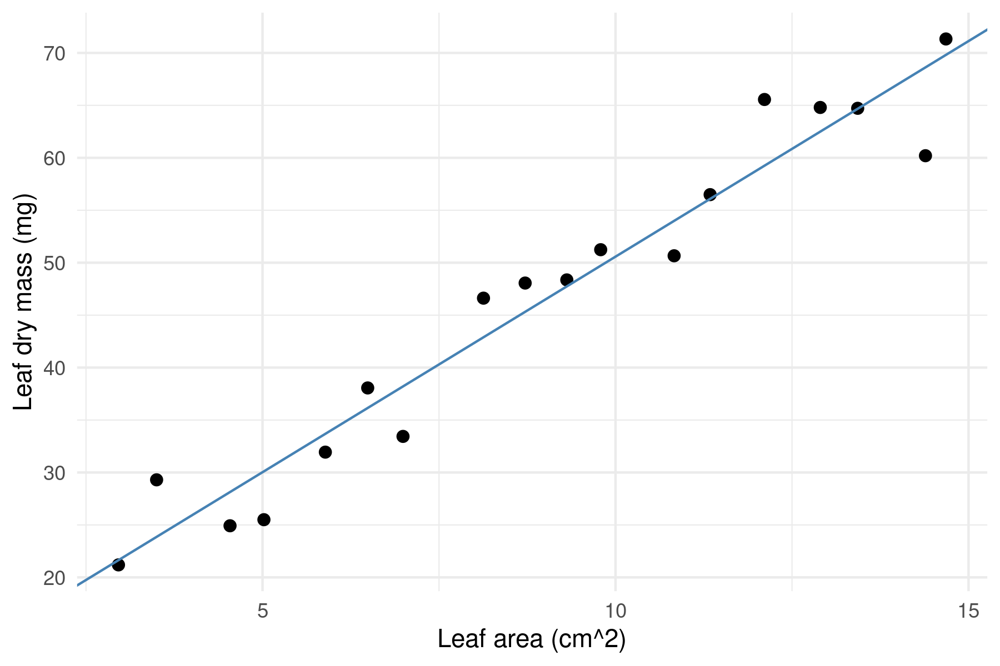
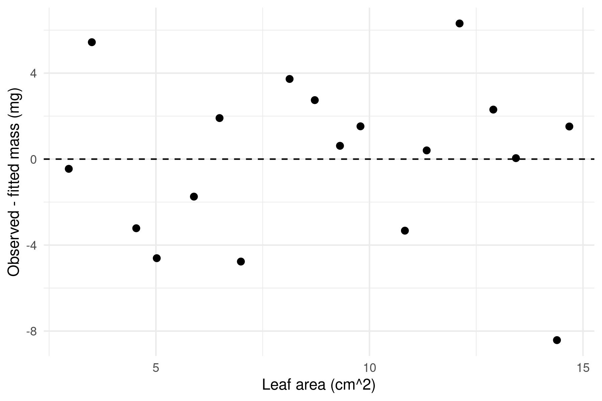

## Today's question

Do larger leaves tend to have greater dry mass? We now fit a line to observations
of different plants, rather than prepared calibration standards. The R function
is familiar, but the biological interpretation changes. A relationship between
two measurements does not by itself establish that changing one causes the other.

`data/leaf-mass.csv` contains simulated data from one sampled leaf on each of
18 independent plants. `leaf_area_cm2` measures area and `dry_mass_mg` measures
mass after drying. The study is observational: leaf area was not randomly
assigned. Species, age, environment, and other features could influence both
measurements. We begin with the simple question about association within the
observed range.

## Plot first, then fit

```{r}
library(readr)
library(dplyr)
library(ggplot2)

leaves <- read_csv("data/leaf-mass.csv", show_col_types = FALSE)
leaf_plot <- ggplot(leaves, aes(x = leaf_area_cm2, y = dry_mass_mg)) +
  geom_point(size = 2) +
  labs(x = "Leaf area (cm²)", y = "Leaf dry mass (mg)") +
  theme_minimal()
leaf_plot

leaf_fit <- lm(dry_mass_mg ~ leaf_area_cm2, data = leaves)
coef(leaf_fit)
```

Read the formula aloud: explain dry mass using leaf area. The fitted intercept
is about 9.48 mg and slope about 4.11 mg/cm². In these observations, a one cm²
difference in leaf area is associated with a fitted mean difference of about
4.11 mg in dry mass. The line summarises a tendency, not a fixed ratio that every
leaf obeys.

```{r}
leaf_plot <- leaf_plot +
  geom_abline(intercept = coef(leaf_fit)[1], slope = coef(leaf_fit)[2],
              colour = "steelblue")
leaf_plot
range(leaves$leaf_area_cm2)
```



The observed areas range from 2.96 to 14.68 cm². An intercept is mathematically
the fitted mass at zero area, but zero lies outside our data. Do not claim that
a leaf with no area biologically weighs 9.48 mg. The fitted intercept helps
position a line over the observed range.

## A line leaves individual differences

```{r}
leaves <- leaves |>
  mutate(fitted_mass_mg = fitted(leaf_fit),
         residual_mg = residuals(leaf_fit))

leaf_residual_plot <- ggplot(leaves, aes(x = leaf_area_cm2, y = residual_mg)) +
  geom_hline(yintercept = 0, linetype = "dashed") +
  geom_point(size = 2) +
  labs(x = "Leaf area (cm²)", y = "Observed − fitted mass (mg)") +
  theme_minimal()
leaf_residual_plot
```



Describe the residual pattern in ordinary language. Are points on both sides of
zero? Is there obvious curvature? Does spread appear much greater at one end?
These checks help identify limitations; they are not proof that every model
assumption is satisfied. Independence still comes from how the plants were
sampled, not from the residual plot.

Unusual points can influence the line, especially near the ends of the area
range. We can explore that influence without deleting data from the main analysis:

```{r}
without_a18 <- leaves |> filter(plant_id != "A18")
sensitivity_fit <- lm(dry_mass_mg ~ leaf_area_cm2, data = without_a18)
coef(leaf_fit)
coef(sensitivity_fit)
```

This is a demonstration, not a search for the slope we prefer. A18 has no known
recording error and belongs in the main result. Compare the slopes and note
whether omitting it changes the broad description. Never select observations
according to which omission gives the smallest p-value.

## Keep prediction within the evidence

For an area of 8 cm², calculate the fitted mean mass using the line:

```{r}
coef(leaf_fit)[1] + coef(leaf_fit)[2] * 8
```

The result is about 42.36 mg. It is a fitted mean, not a promise that the next
leaf will have that mass. There is individual variation around the line and
uncertainty in the line itself. An area of 80 cm² is far outside the measured
range; extrapolating there would rely on an untested assumption that the same
relationship continues.

## Practical: choose an analysis for a question

Create `association-report.Rmd` at the project root. Include the study design,
point plot with fitted line, residual plot, slope interpretation with units,
and observed range. Add a short sensitivity note explaining what the A18
exercise showed, while retaining all observations in the main model. Save the
main figure as `output/day20-leaf-line.png` and render the report.

Finish with three sentences that answer different questions:

1. What association did we observe?
2. What does the fitted slope mean numerically and biologically?
3. What causal claim would this design fail to establish?

Then compare your reports from days 17 and 19. A two-group treatment question
motivated a comparison of means; a concentration measurement motivated a
calibration line; today's two measured variables motivate an association. The
biological question and design come before the choice of R function.

::: {.callout-tip collapse="true"}
## Hint: a precise slope sentence

Use “Within the observed area range, an additional 1 cm² of leaf area was
associated with approximately … mg greater fitted mean dry mass.” Avoid “making
the leaf larger causes …”, because this study did not manipulate area.
:::

## Check your understanding

- Is the slope measured in mg, cm², or mg/cm²? **mg/cm².**
- Does a strong relationship establish causation? **No.**
- Would 18 leaves from one plant provide the same independent sample as 18
  plants? **No; leaves sharing a plant may be dependent.**

**Leave with:** a rendered association report and a clear explanation of how
its question differs from a treatment comparison or instrument calibration.

Next: [Day 21 — Work across local and remote computers](../week5/21-remote-workflow.qmd).
